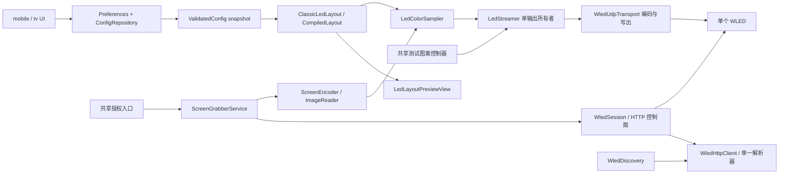

# WLED 直连流光溢彩：架构复核与实施基线

> 日期：2026-11-16；源码基线：`1f8466c0ecd6b7544bb338068601cbfbef9dd48a`。  
> 来源：[原可行性报告](wled-direct-ambilight-feasibility-2026-11-16.md)。本文是该报告的**修订决策与实施契约**；冲突时以本文为准，原报告保留为分析记录。  
> 范围：文档评审与任务设计，**没有实现 WLED 功能，也没有完成 Android/WLED 实机验收**。任务入口：[模块任务总纲](../task/00-overview.md)。

## 1. 结论与不变边界

**条件可行，但原方案不可直接照单实施。** 首套 274 RGB 的 DNRGB 单包路径成立；RGBW 默认 type 5、采样性能估算、现代 Android 生命周期与分阶段删除顺序存在实施阻断项。本轮将这些问题修订为下面的可测试契约。

保留原报告已经确认的产品选择：

- `common` 承载共享逻辑，`mobile` / `tv` 是 UI 壳；Java/Kotlin、AppCompat / Material Views / Leanback，不改 Compose、不新增后端切换框架。
- WLED 是最终版本唯一后端；不做云端、多设备、音频、DRM 绕过或旧配置自动迁移。
- 首套 ESP32-WROOM-32D + 274 颗 WS2815 RGB；T86/B90/L49/R49，Input161，Reverse=true；Sony KD55XD8005 是目标 TV，**其系统版本与 60fps 能力仍需实测**。
- RGBW、SKIP/BLACK、四角/深度/Overlap/Edge Gap、平均色、共用预览、两端完整设置均为首版范围。
- minSdk21、compileSdk35、targetSdk35；新应用身份 `com.abrenoch.wledgrabber`，名称 WLED Grabber；仅侧载，不在本次执行签名、安装或发布。
- 60fps 是原需求的验收目标，不因评审自动降为 30fps。未达到时保持阻塞，只有明确变更需求才可降级。

**关键优化**：RGB 默认 DNRGB，RGBW 改为 DDP；固定固件证据；单一配置快照与校验器；单一设备输出所有者；有界帧池；严格授权/释放状态机；用精确积分图替代无界重复逐矩形遍历；测试与采集共用发送路径。

## 2. 核验方法与来源锚点审计

### 2.1 当前证据

先用 GitNexus `query/context/impact` 定位采集、服务、设置、扫描调用关系，再核对工作树。索引时间为 `2026-11-16T02:53:39.541Z`；索引 HEAD 与当前 HEAD 一致，**106 个已索引文件 SHA-256 全部一致**，未重建索引。

- `HyperionScreenEncoder` upstream：LOW，直接调用者 `HyperionScreenService.startScreenRecord`，传递至 `onStartCommand`；返回 2 个受影响入口分组。
- `HyperionScreenService` upstream（含成员关系）：LOW，4 个直接 import 文件、6 个总命中，包含双端 MainActivity、TileService、HyperionThread。类级图未列流程不等于运行期没有回调。
- 设计 Markdown 未被图索引：impact 返回 **UNKNOWN / target not found**；补充精确引用检索，无源码依赖该文档。这里只改文档；未来每次代码修改必须重新做符号级 impact，不将本次 LOW 当永久许可。

下表路径均相对仓库根；行号对应上述 HEAD，**符号优先于行号**。新增文件列表是设计，不伪装为已存在实现。

| ID | 原报告引用 | 当前实际 file:line / 符号 | 核验及修订 |
|---|---|---|---|
| E01 | §3.3 prepare 45–55 | `common/src/main/java/com/abrenoch/hyperiongrabber/common/HyperionScreenEncoder.java:45-55` `prepare` | 一致；创建 VirtualDisplay，随后设置 ImageReader |
| E02 | §3.3 reader / callback 120–152 | `common/src/main/java/com/abrenoch/hyperiongrabber/common/HyperionScreenEncoder.java:120-152` `setImageReader` / `imageAvailableListener` | 一致；异常路径没有 finally close，不能原样复用 |
| E03 | §3.3 pixels / average / send 154–242 | `common/src/main/java/com/abrenoch/hyperiongrabber/common/HyperionScreenEncoder.java:154-242` `getPixels/getAverageColor/sendImage` | 一致；每帧分配 BAOS；平均模式也会调用 BorderProcessor |
| E04 | §3.3 scaled 60–64 | `common/src/main/java/com/abrenoch/hyperiongrabber/common/HyperionScreenEncoderBase.java:60-64` 构造器缩放 | 一致；不能沿用 X/Y 推导新采样分辨率 |
| E05 | §3.3 divisor 50–65 | `common/src/main/java/com/abrenoch/hyperiongrabber/common/util/HyperionGrabberOptions.java:50-65` `findDivisor` | 一致；替换尺寸策略，保留参数容器职责 |
| E06 | §3.4 sendFrame / run | `common/src/main/java/com/abrenoch/hyperiongrabber/common/network/HyperionThread.java:21-40` `sendFrame`；`:86-104` `run` | 原 73–104 是宽泛范围；发送在调用线程同步执行 |
| E07 | §3.4 TCP 112–151 | `common/src/main/java/com/abrenoch/hyperiongrabber/common/network/Hyperion.java:112-151` `sendRequest/receiveReply` | 一致；最终删除，不能作为 UDP 健康判断依据 |
| E08 | §3.5 Preferences | `common/src/main/java/com/abrenoch/hyperiongrabber/common/util/Preferences.kt:18-49` `getString/getInt/putInt`；`:71-82` 布尔值/默认资源 | 存在；getInt 可抛解析错误，多字段写非原子，必须补强统一入口 |
| E09 | §3.5 手机校验 36–60 / 129–147 | `mobile/src/main/java/com/abrenoch/hyperiongrabber/mobile/SettingsActivity.java:36-60` listener；`:129-147` `GeneralPreferenceFragment` | 一致；仅整数可解析性，不是完整范围/跨字段校验 |
| E10 | §3.5 TV 32–159 / 173–198 | `tv/src/main/java/com/abrenoch/hyperiongrabber/tv/fragments/settings/BasicSettingsStepFragment.kt:32-159` `onCreateActions`；`:173-225` `onGuidedActionClicked` | 后一引用截断完整处理方法；测试另在 `:254-256` 和 `:280-322` |
| E11 | §3.7 scanner 可复用 | `common/src/main/java/com/abrenoch/hyperiongrabber/common/network/NetworkScanner.java:43-65` `tryNext`；`:95-165` `getIPAddresses/getIPsToTry` | 只复用枚举/排序思路；固定 /24、50ms TCP 探测、失败 socket 释放不可照搬 |
| E12 | §3.7 Boot/Tile 完全复用 | `common/src/main/java/com/abrenoch/hyperiongrabber/common/BootActivity.java:38-49` `startScreenRecorder`；`common/src/main/java/com/abrenoch/hyperiongrabber/common/HyperionGrabberBootReceiver.java:14-24` `onReceive` | 入口可保留，授权/后台启动行为不可原样复用 |
| E13 | §4.7 / §6.6 生命周期 | `common/src/main/java/com/abrenoch/hyperiongrabber/common/HyperionScreenService.java:163-201` `onStartCommand`；`:250-301` 采集/释放/状态 | 当前 177 行采集早于 178 行前台化；必须倒置且回调闭合 |
| E14 | §7.5 黑边 | `common/src/main/java/com/abrenoch/hyperiongrabber/common/HyperionScreenEncoderBase.java:19` `mRemoveBorders`；`common/src/main/java/com/abrenoch/hyperiongrabber/common/util/BorderProcessor.java:56-145` `parseBorder` | 开关默认 false；算法需边界测试后才接入，首版默认不启用 |
| E15 | §3.1 / §10.3 构建 | `build.gradle:4-15`；`gradle/wrapper/gradle-wrapper.properties:6`；`common/build.gradle:31-62`；`mobile/build.gradle:26-31`；`tv/build.gradle:27-59` | 4.6/3.2.1/1.2.71、SDK26、Support26.1.0 与原报告一致 |
| E16 | §12 现有测试 | `mobile/src/test/java/com/abrenoch/hyperiongrabber/ExampleUnitTest.java:1-17` | 仅示例；没有新协议/布局/竞态测试，不能称有回归保障 |
| E17 | §5.8 / 附录A 上游 286–453 | 固定参考提交 `c3f24c0fcc3aaed854535214608b186a1f3de388` 的 `createClassicLedLayout` 286–423，`createClassicLeds` 425 起 | 本次下载固定版与当时 master 文件字节一致；未来只按符号/固定提交对照，见 S09 |

原报告“4 组比较、误差 5e-5”未附可复跑 fixture/命令，本次不继承为验收证据。当前只新验证了 §7 的像素访问量计算及 274 映射排列；完整差分测试归 LAY-1/LAY-2。

### 2.2 缺陷与闭环表

P0=阻断按原设计实施；P1=影响健壮性/验收；P2=明确延期，不代表已实现。

| ID | 等级 | 原报告问题与证据 | 修订决策 | 落地任务 |
|---|---|---|---|---|
| A01 | P0 | §6 type5 在固定 v0.15.1 外层 `<5` 条件下不可达（S01） | 禁用 type5；RGBW DDP 升为首版必做，不改 RGBW 范围 | NET-2、QA-2 |
| A02 | P0 | 附录B.3 给 `/json/info` 多套 `info`；rgbw/lc 不足以证明物理同构（S03） | 分 endpoint 解析；能力提示与显式通道确认分离 | CFG-2、NET-1 |
| A03 | P0 | §4.5 可变 byte[] 复用没有所有权；多线程 clear/stop 可复活旧帧（E02/E13） | 有界三帧租约、单设备 writer、session epoch、统一停止屏障 | CAP-2、CAP-3、NET-3 |
| A04 | P0 | §3.7 完全复用授权入口；旧服务启动顺序与现代 API 不符（E12/E13、S06/S07） | 每次新会话授权，前台化后 getMediaProjection，注册回调，再创建一次 display | CAP-1、MOB-2 |
| A05 | P1 | §6.3 单灯 DNRGB 长7字节被 `packetSize>7` 排除；490 的尾1包丢颜色（S01） | 单灯用 DRGB type2；DNRGB 分片不留1灯尾包 | NET-2 |
| A06 | P1 | §6.7 应用减白可被 WLED auto-white 再次覆盖，白色变黑（S04） | 首版应用合成 + WLED Manual；preserve 不宣称光度恒定 | SMP-2、NET-1、QA-2 |
| A07 | P1 | §6.6 lastSendSuccess 被包装成连接；HTTP失败仍暗示关灯保证（S01/S03） | LOCAL_SENDING / DEVICE_OBSERVED 分开；关灯结果 CONFIRMED/UNCONFIRMED | NET-3、CAP-3 |
| A08 | P1 | §7.2 288灯每帧1.5–7万像素、采样可忽略，未覆盖Overlap | 精确积分图 O(W×H+N)，固定分辨率/内存上限，设备实测 | SMP-1、QA-2 |
| A09 | P1 | §5.4 SKIP后仍写 logical 模糊；§5.7 超数量允许强行保存；任意非退化四边形不够 | 明确索引列表S、严格几何/数量验证，非法草稿不激活 | CFG-1、LAY-1、LAY-2 |
| A10 | P1 | §10.3 P1删除protobuf，§11 P7才删调用；追“最新”版本不可复现 | 构建固定矩阵；旧依赖只在内部过渡保留，最终切换单PR删除 | FND-1、FND-2、REL-1 |
| A11 | P1 | §6.5 bool HostProbe 丢失探测信息；/24扫描、HTTP宽放行缺边界 | ProbeResult一次解析；LAN端点约束、禁重定向、有界扫描 | CFG-2、NET-1 |
| A12 | P1 | §4.6新身份却称必须卸载旧版；整仓grep会误伤许可/来源 | 新旧身份可共装但应停旧发送；mobile/tv同ID替代APK；保留合法来源 | REL-1、REL-2 |
| A13 | P1 | §6.4 PUSH似原子提交、sequence0–15循环、DDP超时混用 | PUSH只作显示提示；sequence固定0；DDP超时来自设备配置 | NET-2、NET-3 |
| A14 | P1 | §7/§12 把发送60Hz、show FPS、物理刷新/延迟混为一谈 | 三层分别采证，不承诺未实测帧率；缺设备即未验收 | QA-2、QA-3 |

## 3. 目标模块边界与 DRY



- 仍只有三个 Gradle 模块；新纯 Java 模型置 `common/.../led`，协议与客户端置 `common/.../network/wled`。不引入 DI 容器、通用后端注册器、额外线程框架或新 HTTP 库。
- `Preferences` 是持久化唯一适配器；`ConfigRepository` 负责一次读取/校验/原子保存，不让纯 `LedLayoutConfig` 直接依赖 Android Resources。UI 只展示共享验证结果，不能各写一份范围判断。
- `CompiledLayout` 包含规范化矩形、像素矩形、物理到逻辑映射与 generation；预览、真实采样、测试图案使用同一计划，不再重复布局公式。
- `LedColorSampler` 只消费平面视图和计划并填充租约；`ScreenEncoder` 只取得/关闭 Image 和发布帧。当前 BAOS 算法仅作为测试参考，不保留生产双实现。
- `WledUdpTransport` 只编码/写出，`WledSession` 只管理设备探测/释放策略；`LedStreamer` 是应用内唯一 UDP writer/输出模式所有者。socket ready 不是设备 ready。
- 复用 `NetworkScanner` 的地址排序意图与 scanner listener 的进度语义，不保留 AsyncTask 或固定 /24/50ms TCP 实现。HTTP 探测返回 `ProbeResult(device, capabilities, observedAt, error)`，不是 bool 后再次请求。
- 两个 `LayoutPreviewActivity` 只提供主题、导航、生命周期；View 不持有 socket、不请求 MediaProjection。测试图案控制器归 common，旧 TV TestTask 的网络分支删除。

## 4. 配置、布局与采样契约

### 4.1 配置与能力

`ValidatedConfig` 含 schemaVersion、revision、DeviceEndpoint、明确的 RGB/RGBW 模式、布局、采集参数及停止策略。数值解析失败返回字段错误，不抛异常到 UI；范围/交叉校验集中在 `ConfigValidator`。`Preferences` 增加一次 edit 的多字段保存，后台提交成功才发布新 revision；不逐字段更新正在发送的配置。SharedPreferences 的 commit失败不保证其内部内存视图回滚，因此两端只从Repository读取“最后成功提交”的缓存快照，禁止直接旁路读取Preferences；失败保留旧活动revision并提示重试。进程重建时重新读取、校验磁盘快照，不能自动恢复采集。

首版保存配置后标记“下次启动生效”；运行中的 epoch 使用不可变快照。更换设备、数量、通道、协议、分辨率、布局均先 stop，再由用户重新启动/授权。旋转是同一会话的 display generation 更新，不等于重用已终止授权。

- `GET /json/info` 根字段为 `leds.count/ver/udpport/...`，不是 `info.leds`。聚合 `/json` 才用 `info` 子对象。
- 探测 `count` 是设备观察值；手动值是配置值，分别存储，禁止覆盖观察记录。数量不足阻断启动，不提供“强制继续”绕过；多余物理灯每帧黑色。定义发送长度M为已确认的全设备可寻址数量；有效探测count与手动物理数量必须一致，否则仅保存待修正草稿、不启动。不能把手动较小值截断报文而让设备尾灯遗留旧色；观察值缺失时先恢复探测，不借“手动覆盖”伪造确认。
- `rgbw` deprecated，`lc/seglc` 在固定源码与滚动文档间有 OR/AND 差异；只能提示。首版对同构 RGB 或同构 RGBW 验收，混合总线/CCT/复杂映射保留未验证警告并要求明确配置，不自动推导 stride。
- 手动地址入口始终可用；探测失败进入未确认状态。首版不提供“跳过所有验证仍显示已连接”，也不通过 UDP 成功猜固件/协议能力。
- 每边0..1000，N>0；输出数量 M 在1..65536且不小于有效布局数量；所有乘加用检查算术。协议索引边界是表示范围，不是“65536灯60fps支持”承诺。

### 4.2 几何与物理索引

复用原报告 §5.3 四边公式；零灯边直接跳过，避免除零。四角满足屏幕坐标中的凸、无自交、非零面积，以及上/下边 x 递增、左/右边 y 递增；Depth/Edge Gap 必须使各已启用边可采样。边界裁剪到 `[0,1]` 后若矩形面积为0则报字段错误，不能把退化几何悄悄修成一像素。有效的小矩形取整后至少一像素，坐标采用原稿 round + 半开区间规则。

Overlap 是归一化坐标的绝对扩展，10%不是单颗宽度的10%；UI 明示这一点。Edge Gap 横向比例用实际采集内容的高宽比；这是相对固定16:9上游的有意差异，不声称任意四角算法完全等价。

令逻辑槽位 `L=[0..N-1]`，gap为合法半开区间 `[g,g+k)`：

- SKIP：`S = L 删除gap`，`K=N-k>0`。
- BLACK：`S=L`，`K=N`；gap槽位保留但标为黑。
- 将 Input 用 `floorMod(input,K)` 归一化为 q。未反转 `slot(p)=S[(p+q) mod K]`；反转 `slot(p)=S[floorMod(q-1-p,K)]`。原稿公式里的 logical 在 SKIP 后实际应是 S。
- `p>=K` 的物理尾灯输出黑色。平均色模式也保留 BLACK gap 和尾黑，只填充映射有效且非gap的物理灯。
- 首套274：`slot(p)=floorMod(160-p,274)`；物理0/25/26/160/161/273分别是逻辑160/135/134/0/273/161。Input 在 reverse 时不是直观物理0对应的原始槽号，预览必须显示实际结果。

### 4.3 有界精确采样

默认 sRGB 分量算术平均，不增加 gamma/亮度增强。使用三个 `int[]` 积分图一次遍历有效帧，矩形均值 O(1)，总复杂度 O(W×H+N)。平均模式复用整域矩形查询，RGBW 在均值后转换。

- 长边640且不放大源图；所有尺寸正数，宽高均≤640。最大通道累积 `255×640×640=104448000`，int安全；若将来提升尺寸须重新证明上界。
- 640×360三通道积分图为 `3×641×361×4=2776812` 字节。方形最坏约4.93MB，不沿用“额外内存<1MB”的原估算。
- reader最多3张，应用同时持有≤1张；三帧颜色池；采集+积分图+帧池+布局工作缓冲预算≤12MiB（不含UI/系统图形栈）。通过分配记录与堆分析分别验证，不能把Java堆当全部内存。
- 平面地址使用 buffer 的有效起始位置、rowStride、pixelStride、limit及Image cropRect；验证最后访问字节，不假定最后一行含完整 padding。Image 在 capture线程的 finally 中关闭；不把其 ByteBuffer 交给 sender。
- 测试 oracle 用简单逐像素求和，测试中共享一个实现；生产仅一个积分图路径。热身后应用自有逐帧代码不新建数组/集合；系统 Image 包装分配不包含在“零数组分配”指标里。
- 自动黑边/线性平均/时间平滑是 SMP-3 的后续范围，首版不启用。以后复用 BorderProcessor 前必须用全黑、单像素、异常stride、裁剪抖动等回归锁住边界。

## 5. 线程、生命周期与输出所有权

### 5.1 三个执行域

1. 主线程：Activity、授权结果、服务前台化、UI状态；不执行 DNS、HTTP、扫描、UDP。
2. 一个 capture HandlerThread：Image acquire/采样/close、display resize与计划generation切换。
3. 一个 sender线程 + 有界控制面executor：sender是唯一UDP写者；HTTP请求串行化设备状态变更，扫描最多4并发且与发送分离。不引入每帧 Thread 或每帧 Future。

`FrameLease` 携带 sessionEpoch、layoutGeneration、timestamp、channels、count。生产者只写借到的空闲帧；`offer(lease)` **无论接受还是丢弃均接管所有权**。sender发送完成、pending被替换或epoch失效时恰好归还一次。池大小3：producer、pending、inFlight各≤1；无空闲帧则放弃当前采样，绝不等待网络。inFlight绝不被覆盖；pending总是latest-wins。

同一物理输出只有 CAPTURE 或 TEST 一个模式。测试开始需采集已停；测试由前台预览Activity持有会话租约，不索取屏幕授权，也不启动mediaProjection类型FGS；页面退后台或退出即停止。WledSession在进程内仲裁CAPTURE/TEST所有权，两种宿主只可借用同一输出所有者，不能各建独立sender。结束统一release，返回页面不会偷偷恢复旧采集授权。测试图案占用同样的epoch、帧池、编码器及writer。

### 5.2 状态机与授权

```text
IDLE -> VALIDATING -> AWAITING_CONSENT -> STARTING -> CAPTURING
                       用户拒绝 -> IDLE
CAPTURING -> PAUSED（仅仍有效会话） -> CAPTURING
任意活动状态 -> STOPPING -> IDLE / RELEASE_UNCONFIRMED
授权撤销/会话失效 -> STOPPING -> NEEDS_CONSENT
IDLE -> TESTING -> STOPPING
```

VALIDATING在用户前台操作后异步完成设备与配置验证，再显示系统授权；授权成功即启动service，先前台化，再调用一次getMediaProjection、注册MediaProjection.Callback，最后createVirtualDisplay一次。注册失败/创建失败走统一幂等释放。不在等待网络期间占用前台启动时限。

- 新会话不缓存授权Intent，不经boot/进程重建自动重用；服务采用不自动重放采集的重启策略（如START_NOT_STICKY）。
- `MediaProjection.Callback.onStop` 统一清理reader/display/projection/thread/队列；VirtualDisplay.Callback不能替代它。
- API34+ 用 captured-content resize回调处理单应用窗口和旋转；低版本用display/configuration变化。在原VirtualDisplay上resize/setSurface，先停止旧reader回调，生成新计划，再接受新generation；不能重复createVirtualDisplay。
- 息屏统一停止发送并release；如系统已撤销投屏，亮屏只显示“需重新授权”，不承诺无感续采。仍有效会话的恢复与已终止会话严格区分。
- target35开机接收器只提供用户可见提醒入口，不从BOOT_COMPLETED启动mediaProjection FGS，不后台强拉Activity；通知权限被拒则下次前台显示提示。
- service和内部Activity默认不导出；launcher/tile/boot入口按平台需求声明exported及系统权限。控制广播保持进程内或显式受限，不把capture intent暴露给外部。

### 5.3 停止屏障与恢复

所有停止原因（按钮、通知、测试结束、息屏、授权撤销、错误）调用同一停止操作：

1. 进入STOPPING并封闭该epoch新offer；停止生产、丢pending，等待/取消本地inFlight后禁止后续颜色发送。
2. 在同一writer上尽力发送一帧全黑；随后通过同一控制客户端 POST `/json/state`，载荷 `{"on":false,"live":false,"tt":0}`。
3. 读回 `/json/state.on==false` 且 `/json/info.live==false` 才记录 `RELEASE_CONFIRMED`；它表示该时点设备观察值，不能保证其他控制器或迟到UDP不会再次点亮。
4. 总停止控制面预算3秒；超时/断网/身份变化记 `RELEASE_UNCONFIRMED`，释放本地资源并明确显示“设备关灯未确认”。不把UDP黑帧或超时当关灯证据。
5. STOPPING中禁止新start；旧控制请求结果不能改变新epoch。请求结果未知时不自动重放off到后续会话；再次开始需用户确认并做新探测。epoch只隔离本地，不能撤销已到达设备的HTTP/UDP。

DNRGB设timeout=2秒；DDP依赖设备有限 realtime timeout，基线源码默认2500ms但可配置。首版要求用户核对有限超时、关闭强制实时最大亮度、其他发送者和Sync；不发送无限占用的 `live:true`/timeout255，不擅自修改固件配置。进程被杀时不保证finally/HTTP执行；设备超时可能恢复原效果，不保证关灯，属于显式风险。

网络切换/设备重启：终止旧端点epoch、释放旧socket；新网络重新NSD/HTTP校验身份、数量、协议后才恢复。设备身份/能力变化必须由用户确认；不把历史IP当长期身份，不无限重试或排队陈旧帧。

## 6. WLED 固件、协议与网络契约

### 6.1 固定版本证据

本次代码核验只保证 **v0.15.1 / `4f3992b4dc57c888b53d9576c894a278e03e4cfc`** 的可见实现行为，不宣称所有0.15+或定制固件一致。能力页面展示版本、编译信息（如有）、MAC、count、检测时间与用户确认配置。其他版本可进行显式兼容试验，不把best-effort显示为已验证支持。ESP8266保留支持入口和性能警告，但不继承ESP32性能承诺。

| 传输 | 首版选择与精确报文 | 分包/边界 |
|---|---|---|
| RGB，M=1 | DRGB type2，`[02][02][R][G][B]` | type4的7字节单灯包被固定固件忽略；只适用于物理索引0、总数1 |
| RGB，M≥2 | DNRGB type4，`[04][02][start16be][RGB...]` | 每包2..489灯、报文≤1472B；余1时重分尾部，如490=488+2、979=489+488+2 |
| RGBW | **DDP必做**，10B header + RGBW | datatype0x1B，目标端口4048；每包≤1440数据字节=360灯 |
| RGB可选传输 | 同一DDP编码器，datatype0x0B | 每包≤1440数据字节=480灯；不是额外后端 |

DDP：version1；非末包flags=0x40，末包/单包=0x41；sequence固定0（禁用序号，不做0..15普通循环）；destination=1；offset为累计**字节**偏移32bit大端，length为本包数据字节16bit大端；不带timecode。1440是客户端数据预算而非协议最大值。DDP使用4048，不能误用info.udpport；DNRGB使用info.udpport或已确认的用户覆盖端口。HTTP端口与这两者分别存储。

PUSH不是ACK/完整帧事务；固定接收实现首次PUSH前可能显示非PUSH包，丢包/乱序不能可靠重组。DNRGB按包show同样可能局部更新。发送失败后放弃剩余旧帧，下一次发送新完整帧，不重试过期分片；首套274两种格式均单包。禁止实现type5作为“自动fallback”。

必要寻址前提：realtime offset=0、main-segment-only关闭、DDP DMX start address=1、没有额外LED map/总线反向叠加；这些不能从一个rgbw字段证明。协议保持RGB/RGBW语义顺序，物理GRB等交给WLED，不二次重排。

### 6.2 RGBW 与颜色责任

首版保留两个应用合成模式：`min_subtract: W=min(R,G,B), RGB'=RGB-W`；`preserve: RGB'=RGB, W=min(R,G,B)`。**两者均要求WLED的auto-white为Manual，且全局override没有改回自动模式**。设置页必须显式说明/确认并用测试图案检查，未知时不能显示“已验证RGBW”。

S04显示auto-white会重算W；应用白色变成(0,0,0,255)后再被自动模式重算，会成为全黑。不得同时让两端合成。preserve只是保留RGB并叠加W，不保证亮度/色度恒定；需要RGBW样机标定。WLED实时gamma也受设置控制，原报告“总会生效”不成立；默认应用不增加gamma并记录设备设置。

### 6.3 HTTP、发现与安全

使用平台 `HttpURLConnection` + `org.json`，不为两个GET/一个POST引入新库。连接与读取各≤1秒、完整操作的应用截止时间≤3秒、响应体≤64KiB；拒绝非2xx、错schema、重定向和异常Content-Length/超限流。单一JSON解析器供发现、启动、健康、停止读回复用。低API上的阻塞DNS不保证可中断：解析放在专用有界worker（同时最多1个），超时使结果失效，不增开替代线程；迟到解析不得继续发HTTP/UDP。3秒是调用方结果/本地采集停止预算，不宣称操作系统DNS线程必在该时刻结束；占满时新解析快速报告暂不可用。

端点只接受显式host/IP+port，不接收任意URL路径、userinfo或scheme。解析后绑定选定网络上的同一地址；首版允许可信局域网的私有IPv4/link-local/IPv6 ULA或link-local（scope正确），拒绝公网、回环、组播目标及跨网重定向。DNS/NSD结果变化重新验证，不在同一请求中未经验证二次解析。平台API21..22若无法精确绑Network，记录限制并在网络变化时销毁socket；不得退回公网扫描。

NSD浏览`_wled._tcp.`，解析的port是HTTP端口，不是UDP；缓存service身份/MAC与上次地址，IP仅提示。手动输入和有限HTTP扫描均保留；扫描必须用户触发，仅当前本地前缀、候选≤256、并发≤4、整体≤15秒、可取消，超时返回partial结果。没有网络/无候选是空结果，不抛崩溃。

`network_security_config`对动态LAN地址无法静态细分，采用明确的应用级cleartext例外及代码端点限制；min21..23路径同时核验 `usesCleartextTraffic`/默认平台行为，API24+使用network-security-config。这不是TLS或认证，LAN访问者仍可能控制WLED；隐私说明公开此边界。未来提高target时另审本地网络权限，不能用本次target35结论担保未来版本。

状态至少分为 capture状态、localSend状态、最近HTTP观察与release结果；HTTP探测最多每5秒一次且后台串行，时间戳超过10秒标记stale。状态文案只能说“正在发送/设备最近可达”，不能宣称逐帧收到。错误区分授权、配置、DNS、HTTP、UDP本地失败、设备未确认。

## 7. 性能、证据分层与待验证项

本次使用S09固定函数与原报告288配置（640×360、H15%、V8%、Overlap10%）计算：精确逐矩形遍历约 **1,678,644次像素读取/帧**，60Hz约100,718,640次/秒，不是原稿1.5–7万。该值是算法访问量，不是Android benchmark。积分图把像素扫描收敛为230,400/帧再加矩形查询。

首套274RGB DNRGB为826B/帧、60Hz为49,560B/s（仅UDP应用报文，不含链路开销）。这只能证明带宽数量级；若灯带为800kbit/s、24bit/像素，纯数据阶段为8.22ms，尚不含reset/latch，不能统一写“WLED渲染1–5ms”。硬件供电/电流按实际灯带资料与接线测量，不把原稿0.2–0.3W估值当安全选型依据。

| 层级 | 必须采集的证据 | 判定 |
|---|---|---|
| 纯算法 | golden/性质/畸形输入/字节报文/压力竞态测试 | JVM通过不等于Android生命周期正确 |
| Android模拟/设备 | API21/23/26/29/33/34/35，手机+TV关键组合；授权/通知/旋转/锁屏/撤销/拒绝 | 缺某组合明确未验收；不得靠提高minSdk消除失败 |
| 首套性能 | 固定60Hz测试内容、274灯、640长边，30分钟；capture、sample、send、WLED show、物理输出分别计时 | 采样p95≤5ms、p99≤8ms；发送间隔p95≤20ms；物理不同帧平均≥59fps、1秒窗口≥55fps；端到端p95≤80ms |
| 有界资源 | 预热5分钟，随后25分钟；池/队列上界与Java/native/graphics内存分开记录 | 队列/租约不越界；无ANR/崩溃；应用稳定工作集净增长≤5MiB且无持续上升趋势 |
| RGBW | 独立同构RGBW灯带，Manual + 两种white mode、1/360/361灯边界 | 白通道可见、末灯正确；没有样机则RGBW发布验收未完成 |
| 故障 | HTTP失败、UDP丢包/延迟/乱序、路由变更、WLED重启、其他发送者、应用进程被杀 | 状态与已观察事实一致；不报告未确认关灯；本地资源按预算释放 |

以上阈值是**拟定验收预算，不是已有测量结果**；QA-2须记录设备型号/系统/WLED烧录版本/灯数/总线/网络、原始数据与统计方法。`info.leds.fps`是show层证据，物理刷新需逻辑分析仪或可复核高速摄影/光学采样，不能相互替代。500/1000/2000灯与ESP8266分别测试并发布自己的支持矩阵，不把274结论外推。

## 8. 构建、迁移与发布边界

固定候选工具链：**AGP8.7.2 + Gradle8.9 + JDK17 + Kotlin2.1.21**，compile/target35、min21。S08证明AGP8.7兼容API35/Gradle8.9/JDK17，Kotlin表覆盖该组合；这是可检验候选，不代表本仓已经构建通过。AndroidX具体版本在FND-1锁定并检查每个AAR minSdk及传递依赖，不追滚动“最新”；构建集中版本目录，移除重复buildscript/jcenter。

迁移顺序：

1. FND-1/FND-2在内部开发分支把工具链、AndroidX、ViewBinding、R资源所有权与测试基座变绿。临时保留旧协议编译所需依赖/生成链，必要时只调整生成插件使API兼容并记录锁定版本；不得先删依赖让每个后续PR不可编译。
2. 在新契约下并行开发布局、采样、网络和UI；生产入口在最终切换前不发布“半新半旧”版本。内部测试装配不是产品双后端选择。
3. REL-1单PR切换唯一WLED入口，删除旧网络/proto/临时依赖、类名与包迁移、更新所有manifest/XML/反射/资源引用。之后再跑完整验收；不签名/发布中间构建。
4. REL-2交付旧字段映射、新配置手册、故障/权限/隐私说明及回退路径；QA-3是最终准入记录，不代替用户的实际签名发布授权。

mobile/tv目前同applicationId，继续输出**同ID的替代APK**，不承诺二者共装；统一版本来源并注明变体。新ID与旧应用可以共装，不需要以卸载旧应用为安装前提，但应提醒停止旧发送者。旧X/Y只指导采集缩放，不能自动转换成四边灯数；不读取旧Host/Port/Priority充当WLED配置。

品牌检查覆盖活动源码、资源、manifest、包目录、生成产物与UI；迁移报告、历史引用、许可证/版权归属和第三方来源是具名例外，不运行整仓零命中的破坏性清扫。技术文档中的旧路径是审计证据，包迁移后新增新路径对照。

## 9. 官方资料与固定来源

仅使用协议制定方、项目官方源码和Android/Kotlin官方资料。核验日期均为2026-11-16；网页为滚动资料，源码以下列提交为基线。

| ID | 来源 | 核验重点 |
|---|---|---|
| S01 | https://github.com/wled/WLED/blob/4f3992b4dc57c888b53d9576c894a278e03e4cfc/wled00/udp.cpp | 615–675 type4/type5可达性、包长、逐包show；410–489实时锁/超时；697–712索引/gamma |
| S02 | https://github.com/wled/WLED/blob/4f3992b4dc57c888b53d9576c894a278e03e4cfc/wled00/e131.cpp | 13–53 DDP RGBW、PUSH、偏移与序号处理 |
| S03 | https://github.com/wled/WLED/blob/4f3992b4dc57c888b53d9576c894a278e03e4cfc/wled00/json.cpp | 314–388控制面；653–667能力；1066–1126 endpoint响应形状 |
| S04 | https://github.com/wled/WLED/blob/4f3992b4dc57c888b53d9576c894a278e03e4cfc/wled00/bus_manager.cpp | 83–96及295–298 autoWhiteCalc覆盖传入W |
| S05 | https://kno.wled.ge/interfaces/udp-realtime/ ; https://kno.wled.ge/interfaces/ddp/ ; https://kno.wled.ge/interfaces/json-api/ ; http://www.3waylabs.com/ddp/ | 官方UDP/JSON说明、DDP规范；与固定源码冲突时以明确版本的实测/源码为准 |
| S06 | https://developer.android.com/media/grow/media-projection | 一次授权/一次VirtualDisplay、onStop、resize、单应用窗口 |
| S07 | https://developer.android.com/develop/background-work/services/fgs/service-types ; https://developer.android.com/privacy-and-security/security-config ; https://developer.android.com/develop/connectivity/wifi/use-nsd | mediaProjection FGS前置及boot限制、cleartext、NSD |
| S08 | https://developer.android.com/build/releases/past-releases/agp-8-7-0-release-notes ; https://kotlinlang.org/docs/gradle-configure-project.html | 固定构建兼容矩阵，非“最新版本”承诺 |
| S09 | https://github.com/hyperion-project/hyperion.ng/blob/c3f24c0fcc3aaed854535214608b186a1f3de388/assets/webconfig/js/content_leds.js | Classic函数；文件SHA256 `c6e884ce6dc58cde68c4077fc9890dac6929c98fb6ef83eb942aa13f5b3aab64` |
| S10 | https://github.com/wled/WLED/blob/4f3992b4dc57c888b53d9576c894a278e03e4cfc/wled00/FX_fcn.cpp ; https://github.com/wled/WLED/blob/4f3992b4dc57c888b53d9576c894a278e03e4cfc/wled00/wled.h ; https://github.com/wled/WLED/blob/4f3992b4dc57c888b53d9576c894a278e03e4cfc/wled00/cfg.cpp | show统计与异步输出；timeout/gamma默认及配置覆盖 |

## 10. 本次验收边界

本次交付只要求来源可追溯、修订契约一致、模块任务全覆盖、依赖无环、独立测试和量化验收齐全、文档链接/代码行号有效，并经过独立架构复核。功能任务仍标为待开发。

当前本机只发现JDK19；未安装JDK17，也未运行Gradle4.6的依赖解析/构建。文档通过不冒充Gradle、API21、TV60fps、RGBW或真实关灯验收。设备/签名/发布证据均留给相应任务，不属于这次文档工作的已完成项。

### 10.1 文档完成审计（2026-11-16）

- 独立 `architect` 最终结论：**APPROVED / CLEAR，未闭合P0=0、P1=0**，批准范围仅为架构与任务册进入实施。
- 初审发现“TV-2等待QA-2 Sony证据、QA-2又依赖TV-2”的验收语义环。已将Sony遥控器/大字体实测完整放入QA-2；TV-2只做模块UI/仪器门禁，60fps与RGBW要求未降低。最终复核读取修改后的总纲、TV卡和QA卡并确认闭环。
- 文档机器检查：11模块、26个唯一任务ID、42条依赖无环，矩阵/卡片/Mermaid依赖一致；87处本地链接/anchor有效，22处完整源码行号范围有效；三段式、来源、DRY、勾选测试及量化验收齐全。
- 源码保护检查：131个受版本控制文件与本次基线SHA256相同；没有生产代码、Gradle或依赖改动。原报告仅增加复核状态入口。
- 设计算术检查：DNRGB数量2..65536的65,535种分片均满足每包2..489且总数一致；274映射为完整排列、六个关键索引吻合；274 RGB/RGBW报文长度826/1106；288参考配置像素访问量1,678,644。
- Markdown格式与最后一轮链接/结构检查通过。上述算术与静态检查不是产品单元测试，更不是Android/WLED硬件测试；§7的真实验收仍全部待执行。
