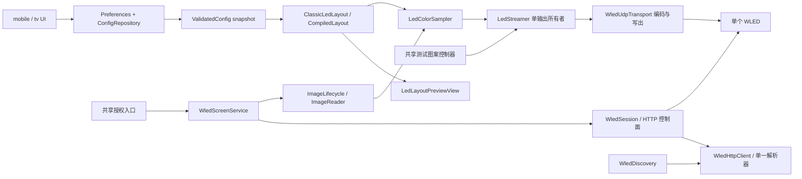

# WLED Grabber 技术架构

> 本文是架构、参数、协议、生命周期与兼容要求的唯一技术规范。关联文档：[品牌与图标规范](app-icon/brand-guide.md)、[配置与排障手册](../guides/configuration-and-troubleshooting.md)。
>
> 实现状态与未闭环项见[任务册 §5.2 交付证据复核](../archive/task/00-overview.md#delivery-audit-2026-11-17)与[§5.3 第二轮复核](../archive/task/00-overview.md#second-audit-2026-11-17)（2026-11-17）。本文描述目标契约，不等于全部已实现、待发布或生产验收。

## 阅读导航

- [1. 目标与范围](#scope) · [2. 模块边界与数据流](#architecture) · [3. 配置契约](#config)
- [4. 布局与映射](#layout) · [5. 采样与颜色](#sampling) · [6. 并发与生命周期](#lifecycle)
- [7. WLED 协议](#protocol) · [8. 网络控制面](#network) · [9. 双端交互](#ui)
- [10. 构建基线](#build) · [11. 性能与风险](#validation) · [附录 A 官方来源](#references)

<a id="scope"></a>

## 1. 目标、范围与基线


### 1.1 目标与技术结论

Android 在本地完成屏幕采集、四边布局与逐灯平均，直接驱动局域网内的单台 WLED 控制器。运行时只有 WLED 一条输出链路，布局、采样与报文编码全部在应用内完成。

首套 274 灯 RGB 采用 DNRGB 单包；RGBW 采用 DDP；精确积分图、有界帧池和单写者把计算与网络隔离。设备性能与平台兼容以实测为准。

### 1.2 范围与非目标

| 范围 | 要求 |
|---|---|
| 工程框架 | common Android Library、mobile/tv Application；Java/Kotlin、AppCompat/Material Views/Leanback，不使用 Compose |
| 布局 | 四边数量、SKIP/BLACK、Input/Reverse、深度、Overlap、Edge Gap、四角；平均色也遵守物理映射和黑灯规则 |
| 设备 | 单设备 LAN；RGB、RGBW 均支持；DDP 因 RGBW 为必做项，不延期 |
| 产品 | TV 优先且 mobile 完整配置；共用预览、三种测试图案；共享的主界面动效与导航体验 |
| 平台 | minSdk 21、compileSdk 35、targetSdk 35；授权、通知、磁贴、开机自启动/提醒及横竖屏按平台规则适配 |
| 身份 | WLED Grabber，`com.abrenoch.wledgrabber`，versionName 1.0；仅侧载；图标、色板、字标与资源映射见[品牌与图标规范](app-icon/brand-guide.md) |
| 性能 | 首套 274 灯目标 60 fps；达不到即为发布门禁未通过，不静默改为 30 fps |
| 增强 | 黑边检测、线性平均、饱和度、时间平滑等画质增强默认关闭 |

不做：云端/远程访问、多设备同步组、音频采集/同步、DRM 绕过、2D 矩阵/PWM 布局、屏幕内容识别、WLED 固件修改/usermod、Google Play 上架。录屏只采集平台允许的画面，受保护内容不承诺可用；不请求麦克风权限。

### 1.3 设备与兼容基线

- 首套：Sony KD55XD8005（4K Android TV）+ ESP32-WROOM-32D + 274 颗 WS2815 RGB。
- 接线预设：T86/B90/L49/R49、Gap0、Input161、Reverse=true。其余布局值采用 §3 通用默认，不能混用 288 参考示例的 Depth/Overlap。
- 固件源码基线：WLED v0.15.1 / `4f3992b4dc57c888b53d9576c894a278e03e4cfc`。其他版本、定制固件按显式兼容试验处理，不概括为“全部 0.15+ 已支持”。
- ESP8266 保留配置入口和性能警告，但不继承 ESP32 性能结论；500/1000/2000 灯分别验收。同构 RGBW 需另备灯带；混合总线/CCT/复杂映射不属于已验证范围。


<a id="architecture"></a>

## 2. 模块边界与数据流


### 2.1 模块职责

| 模块 | 职责 |
|---|---|
| common | 配置/布局/采样/帧流/设备控制、服务、通知与扫描；所有共享算法与协议只在此实现 |
| mobile | 设置与授权 UI 壳、独立预览宿主、快捷设置磁贴；不复制协议/算法 |
| tv | Leanback 完整 D-pad 设置、实时布局编辑器与预览宿主；不把高级参数转交手机配置 |

### 2.2 数据流




- 只有三个 Gradle 模块；纯 Java 模型置 `common/.../led`，协议与客户端置 `common/.../network/wled`。不引入 DI 容器、通用后端注册器、额外线程框架或新 HTTP 库。
- `Preferences` 是持久化唯一适配器；`ConfigRepository` 负责一次读取/校验/原子保存，纯 `LedLayoutConfig` 不直接依赖 Android Resources。UI 只展示共享验证结果，不各写一份范围判断。
- `CompiledLayout` 包含规范化矩形、像素矩形、物理到逻辑映射与 generation；预览、真实采样、测试图案使用同一计划，不重复布局公式。
- `LedColorSampler` 只消费平面视图和计划并填充租约；`ImageLifecycle` 只取得/关闭 Image，服务层负责发布帧。生产代码只有一套采样实现。
- `WledUdpTransport` 只编码/写出，`WledSession` 只管理设备探测/释放策略；`LedStreamer` 是应用内唯一 UDP writer/输出模式所有者。socket ready 不是设备 ready。
- `WledDiscovery` 负责地址枚举/排序与进度语义；HTTP 探测一次性返回 `ProbeResult(device, capabilities, observedAt, error)`，不先做 bool 探测再二次请求。
- 两个 `LayoutPreviewActivity` 只提供主题、导航、生命周期；View 不持有 socket、不请求 MediaProjection。测试图案控制器归 common。

### 2.3 接口职责与单一事实来源

| 边界 | 输入 → 输出 / 责任 | 禁止承担 |
|---|---|---|
| ConfigRepository / ConfigValidator | 草稿 → 字段错误或最后成功持久化的 ValidatedConfig | 双端各自解析/校验；逐字段热更新 |
| ClassicLedLayout → CompiledLayout | 配置+有效采集尺寸 → 矩形、索引、generation | 依赖 Resources、socket、Activity |
| LedColorSampler | PlaneView+CompiledLayout+空闲 FrameLease → 物理顺序颜色 | 持有 Image 跨线程；分包或等待网络 |
| LedStreamer | offer 移交租约，latest-wins，唯一 UDP writer | 无界队列；把 send 成功当 ACK |
| WledUdpTransport | 已确认格式的物理颜色 → 报文字节/本地写出结果 | 推测设备在线；第二套停止流程 |
| WledSession | CAPTURE/TEST 仲裁、epoch、探测/健康/释放结果 | 各宿主创建独立 sender；回调修改旧会话 |
| WledHttpClient / WledDiscovery | 单一解析器、受限端点、ProbeResult | bool 探测后重复 GET；任意 URL/无限扫描 |

这是职责划分，不要求为每一行另造接口或通用框架。模型/布局/采样/编码优先纯 Java，便于 JVM 测试；仅平台适配层依赖 Android。共同 fixture 由共享测试源维护，避免每模块复制 mock、颜色图案和布局向量。

<a id="config"></a>

## 3. 配置、设备能力与持久化契约


### 3.1 快照、验证与生效规则

`ValidatedConfig` 含 schemaVersion、revision、DeviceEndpoint、明确的 RGB/RGBW 模式、布局、采集参数及停止策略。数值解析失败返回字段错误，不抛异常到 UI；范围/交叉校验集中在 `ConfigValidator`。`Preferences` 增加一次 edit 的多字段保存，后台提交成功才发布新 revision；不逐字段更新正在发送的配置。SharedPreferences 的 commit 失败不保证其内部内存视图回滚，因此两端只从 Repository 读取“最后成功提交”的缓存快照，禁止直接旁路读取 Preferences；失败保留旧活动 revision 并提示重试。进程重建时重新读取、校验磁盘快照，不能自动恢复采集。

保存配置后标记“下次启动生效”；运行中的 epoch 使用不可变快照。更换设备、数量、通道、协议、分辨率、布局均先 stop，再由用户重新启动/授权。旋转是同一会话的 display generation 更新，不等于重用已终止授权。

- `GET /json/info` 根字段为 `leds.count/ver/udpport/...`，不是 `info.leds`。聚合 `/json` 才用 `info` 子对象。
- 探测 `count` 是设备观察值；手动值是配置值，分别存储，禁止覆盖观察记录。数量不足阻断启动，不提供“强制继续”绕过；多余物理灯每帧黑色。定义发送长度 M 为已确认的全设备可寻址数量；有效探测 count 与手动物理数量必须一致，否则仅保存待修正草稿、不启动。不能把手动较小值截断报文而让设备尾灯遗留旧色；观察值缺失时先恢复探测，不借“手动覆盖”伪造确认。
- `rgbw` deprecated，`lc/seglc` 在固定源码与滚动文档间有 OR/AND 差异；只能提示。对同构 RGB 或同构 RGBW 验收，混合总线/CCT/复杂映射保留未验证警告并要求明确配置，不自动推导 stride。
- 手动地址入口始终可用；探测失败进入未确认状态。不提供“跳过所有验证仍显示已连接”，也不通过 UDP 成功猜固件/协议能力。
- 每边 0..1000，N>0；输出数量 M 在 1..65536 且不小于有效布局数量；所有乘加用检查算术。协议索引边界是表示范围，不是“65536 灯 60fps 支持”承诺。

### 3.2 参数及偏好资源字典

键和默认值集中在 `common/src/main/res/values/pref_values.xml`，标题/摘要/字段错误在同模块 `strings.xml`。XML、GuidedAction 经 Repository 共享同一字段定义。纯模型不读 Resources。

| 资源名 | 类型 / 范围 | 默认与语义 |
|---|---|---|
| `pref_key_wled_host` | string，host 或 IP | 空；未配置不得启动 |
| `pref_key_wled_http_port` | int，1..65535 | 80；NSD 解析的是此端口 |
| `pref_key_wled_udp_port` | int，1..65535 | 21324；DNRGB 采用探测值或显式确认的覆盖值 |
| `pref_key_wled_ddp_port` | int，固定 4048 | 与 HTTP/UDP realtime 端口独立建模，不复用 udpport |
| `pref_key_wled_protocol` | enum `auto/dnrgb/ddp` | auto：RGB 按总数选 DRGB/DNRGB，RGBW 选 DDP；RGBW 强制 dnrgb 为字段错误；无 type5 选项 |
| `pref_key_wled_rgbw_mode` | enum `unconfirmed/rgb/rgbw` | unconfirmed；探测只提出建议，用户确认后才成为 RGB/RGBW 活动配置 |
| `pref_key_wled_rgbw_white_mode` | enum `min_subtract/preserve` | min_subtract；仅 RGBW 显示，要求 WLED Manual |
| `pref_key_wled_physical_leds` | int 草稿 0 或活动 1..65536 | 0 仅表示尚未确认，不能作为有效发送数量；活动 M 必须与探测 count 一致 |
| `pref_key_led_top` / `pref_key_led_bottom` | int，0..1000 | 60 / 60 |
| `pref_key_led_left` / `pref_key_led_right` | int，0..1000 | 34 / 34 |
| `pref_key_led_gap_length` / `pref_key_led_gap_position` | int，k≥0、g≥0、g+k≤N | 0 / 0；SKIP 额外要求 k<N，零 gap 允许 g=N |
| `pref_key_led_input_position` | int，经 floorMod 归一化 | 0；反转时不直接等于物理 0 采样的逻辑槽号 |
| `pref_key_led_reverse` | bool | false |
| `pref_key_led_gap_mode` | enum `skip/black` | skip |
| `pref_key_led_h_depth` / `pref_key_led_v_depth` | int，1..100（%） | 8 / 5；顶底深度 / 左右深度 |
| `pref_key_led_overlap` | int，0..100（%） | 0；切向归一化绝对扩展，不是单灯宽度比例 |
| `pref_key_led_edge_gap` | int，0..50（%） | 0；沿边端点内缩，按 §4 公式换算 |
| `pref_key_led_corner_tl_h` / `pref_key_led_corner_tl_v` | int，0..100（%） | 0 / 0 |
| `pref_key_led_corner_tr_h` / `pref_key_led_corner_tr_v` | int，0..100（%） | 100 / 0 |
| `pref_key_led_corner_br_h` / `pref_key_led_corner_br_v` | int，0..100（%） | 100 / 100 |
| `pref_key_led_corner_bl_h` / `pref_key_led_corner_bl_v` | int，0..100（%） | 0 / 100 |
| `pref_key_capture_max_dimension` | int，1..640 | 640；不放大源画面，不提供 960 选项 |
| `pref_key_framerate` | int，1..60 | 默认 30，可选 10/15/24/30/60；首套验收显式选择 60 |
| `pref_key_use_avg_color` | bool | false；整域平均仍执行 Gap/尾黑 |
| `pref_key_boot` | bool | true（仅新安装，已保存偏好不改写）；受控自启动 |

`schemaVersion/revision`、`DeviceEndpoint`（host、已验证地址、网络身份、分离端口）、`WledDevice`（MAC/版本/观察 count/能力/observedAt）与用户确认结果由配置层统一定义持久化/内存边界。能力观察不是偏好默认值；`ProbeResult(device, capabilities, observedAt, error)` 一次解析复用。`unconfirmed/0` 只用于草稿，不得流入 ValidatedConfig。高层策略和证据不能压成一个“connected”布尔值。


<a id="layout"></a>

## 4. Classic 四边布局与物理映射


### 4.1 坐标系与逻辑槽位

以**当前采集内容正视图**为基准，h=x、v=y，范围 [0,1]。旋转/单应用尺寸变化重编译计划，不把旧屏幕尺寸用于新内容。逻辑从左上开始顺时针：Top 左→右、Right 上→下、Bottom 右→左、Left 下→上；N=T+R+B+L，**不额外加 4 颗角灯**。

```text
Top:    [0, T)
Right:  [T, T+R)
Bottom: [T+R, T+R+B)
Left:   [T+R+B, N)
```

### 4.2 四边矩形生成

每条零灯边直接跳过，不能除零。共同定义：

```text
depthH = h_depth / 100
depthV = v_depth / 100
overlap = overlap_percent / 100
edgeVGap = edge_gap / 100 / 2
edgeHGap = edgeVGap * captureHeight / captureWidth
clamp(z) = min(1, max(0, z))
```

横向 Edge Gap 采用实际高宽比而不是固定 16:9。Overlap 只扩展切向边界；10% 表示两侧各扩展屏幕宽/高的 10%，不是每颗灯宽度的 10%。默认 0%，示例 10% 不是通用建议值。


#### 顶边（Top）

```text
stepH = (ptTR.h - ptTL.h - 2*edgeHGap) / T
stepV = (ptTR.v - ptTL.v) / T

for i in [0, T):
    hmin = clamp(ptTL.h + stepH*i     + edgeHGap - overlap)
    hmax = clamp(ptTL.h + stepH*(i+1) + edgeHGap + overlap)
    vmin = ptTL.v + stepV*i
    vmax = vmin + depthH
```

#### 右边（Right）

```text
stepH = (ptBR.h - ptTR.h) / R
stepV = (ptBR.v - ptTR.v - 2*edgeVGap) / R

for i in [0, R):
    hmax = ptTR.h + stepH*(i+1)
    hmin = hmax - depthV
    vmin = clamp(ptTR.v + stepV*i     + edgeVGap - overlap)
    vmax = clamp(ptTR.v + stepV*(i+1) + edgeVGap + overlap)
```

#### 底边（Bottom）

```text
stepH = (ptBR.h - ptBL.h - 2*edgeHGap) / B
stepV = (ptBR.v - ptBL.v) / B

for i = B-1 down to 0:        // 注意：数组顺序是“右→左”
    hmin = clamp(ptBL.h + stepH*i     + edgeHGap - overlap)
    hmax = clamp(ptBL.h + stepH*(i+1) + edgeHGap + overlap)
    vmax = ptBL.v + stepV*i
    vmin = vmax - depthH
```

#### 左边（Left）

```text
stepH = (ptBL.h - ptTL.h) / L
stepV = (ptBL.v - ptTL.v - 2*edgeVGap) / L

for i = L-1 down to 0:        // 注意：数组顺序是“下→上”
    hmin = ptTL.h + stepH*i
    hmax = hmin + depthV
    vmin = clamp(ptTL.v + stepV*i     + edgeVGap - overlap)
    vmax = clamp(ptTL.v + stepV*(i+1) + edgeVGap + overlap)
```

### 4.3 几何校验、量化与像素编译

四角必须凸、无自交、面积非零，且上/下边 x 递增、左/右边 y 递增。启用边需有正的切向可用长度；Depth/Edge Gap 组合必须可采样。逐边公式生成后：

1. 保留归一化边界的完整计算精度；切向先按上述 clamp 限制，深度方向在统一编译阶段也裁剪到 [0,1]。
2. 对**未量化、已裁剪**的矩形验证 `hmin<hmax` 且 `vmin<vmax`；真正零面积或倒置是配置错误，不能静默补一像素。
3. 采样/预览共用这份完整精度矩形及同一个像素编译器，按以下 round/半开区间转换；有效小矩形舍入后至少保留一像素。cropRect 是有效内容域，编译使用其宽高，读取时再加 crop 原点。
4. 4 位小数仅用于参考表示、导出与 golden 对照，**不得先量化再作几何准入判定，也不得将量化退化结果回灌活动计划**。

```text
x0 = clamp(round(hmin * W), 0, W-1)
x1 = clamp(round(hmax * W), x0+1, W)
y0 = clamp(round(vmin * H), 0, H-1)
y1 = clamp(round(vmax * H), y0+1, H)
pixels = [x0,x1) × [y0,y1)
channelMean = floor(channelSum / ((x1-x0)*(y1-y0)))
```

内部使用一个编译器与一种确定性 round 实现；与固定参考实现的差分 fixture 允许已说明的 ±1 像素取整容差，不能把容差当真实退化/越界豁免。不使用稀疏每 2–4 像素抽样替代精确平均。

边界 fixture：T=1000、其余边 0、M=1000、四角围成宽 1% 高 100% 的合法矩形、H Depth8%、Overlap/Edge Gap0。首槽 `[0,0.00001)` 为正宽区间，在 640 宽图像编译为 `[0,1)`，不能因 4 位小数表示成 `[0,0)` 而被拒绝。另测 R=1000、高 1% 宽 100% 的纵向对称例；两例 1000 个矩形都须非空，真实宽/高为 0 仍须拒绝。

### 4.4 Gap、Input、Reverse 与尾灯


令逻辑槽位 `L=[0..N-1]`，gap 为合法半开区间 `[g,g+k)`：

- SKIP：`S = L 删除 gap`，`K=N-k>0`。
- BLACK：`S=L`，`K=N`；gap 槽位保留但标为黑。
- 将 Input 用 `floorMod(input,K)` 归一化为 q。未反转 `slot(p)=S[(p+q) mod K]`；反转 `slot(p)=S[floorMod(q-1-p,K)]`。SKIP 后的索引基于过滤列表 S，而不是未过滤的 L。
- `p>=K` 的物理尾灯输出黑色。平均色模式也保留 BLACK gap 和尾黑，只填充映射有效且非 gap 的物理灯。
- 首套 274：`slot(p)=floorMod(160-p,274)`；物理 0/25/26/160/161/273 分别是逻辑 160/135/134/0/273/161。Input 在 reverse 时不是直观物理 0 对应的原始槽号，预览必须显示实际结果。

SKIP 用于该区间物理灯确实缺失；BLACK 用于灯珠存在但需要熄灭。两者不是同义选项。BLACK 允许整圈为黑，仍须 N>0 和完整设备数量；SKIP 不允许删除全部槽位。每帧输出 M 颗颜色，K≤M，尾灯不能截包留旧色。

### 4.5 参考向量与首套预设

默认布局 188 灯、首套 274 灯和参考示例 288 灯是三组不同配置。

**288 参考示例**：T116/R50/B72/L50、Gap0、Input206、Reverse=false、H/V Depth15%/8%、Overlap10%、Edge Gap0、四角全屏。逻辑 Top0–115、Right116–165、Bottom166–237、Left238–287；`slot(p)=(p+206) mod 288`。

| 物理区间 | 数量 | 逻辑槽位 | 侧别 |
|---|---|---|---|
| 0–31 | 32 | 206–237 | Bottom |
| 32–81 | 50 | 238–287 | Left |
| 82–197 | 116 | 0–115 | Top |
| 198–247 | 50 | 116–165 | Right |
| 248–287 | 40 | 166–205 | Bottom |

该例若 Reverse=true，则 `slot(p)=floorMod(205-p,288)`。

**274 首套预设**：T86/R49/B90/L49、Gap0、Input161、Reverse=true；其余用 §3 默认。逻辑 Top0–85、Right86–134、Bottom135–224、Left225–273；`slot(p)=floorMod(160-p,274)`。

| 物理区间 | 数量 | 逻辑槽位 | 侧别 |
|---|---|---|---|
| 0–25 | 26 | 160–135 | Bottom 反向 |
| 26–74 | 49 | 134–86 | Right 反向 |
| 75–160 | 86 | 85–0 | Top 反向 |
| 161–209 | 49 | 273–225 | Left 反向 |
| 210–273 | 64 | 224–161 | Bottom 反向 |

预览、采样与报文测试复用同一向量定义；预览和行走图案用于确认实际接线，数学表不能替代灯带观察。


<a id="sampling"></a>

## 5. 精确采样与颜色责任


### 5.1 有界精确矩形采样

默认 sRGB 分量算术平均，不增加 gamma/亮度增强。每个物理槽位仍以“矩形和÷面积向下取整”得到颜色，与逐像素 oracle 完全一致。

采用两路等价实现，按布局自动选择：边界型布局（所有矩形面积之和≤W×H，首套 T86/B90/L49/R49 约 6 万像素）逐矩形扫描自身像素求和；稠密或大面积布局改用逐行前缀和加矩形累加，复杂度 O(W×H+N)。平均色模式强制整帧前缀路径，一次扫描得到整域均值。两路都只做整数累加与整数除法，不引入近似。

- 长边 640 且不放大源图；所有尺寸正数，宽高均≤640。最大通道累积 `255×640×640=104448000`，int 安全；若将来提升尺寸须重新证明上界。
- 不分配 W×H 三通道积分图；前缀行工作区为 `3×(W+1)×4` 字节（640 宽约 7.7KiB），矩形和/面积数组按 N 计。首套实测采样 p95≈4.1ms、p99≈4.5ms（Sony KD-55XD8005，640×360，274 灯）。
- reader 最多 3 张，应用同时持有≤1 张；三帧颜色池；采集+采样工作区+帧池+布局工作缓冲预算≤12MiB（不含 UI/系统图形栈）。通过分配记录与堆分析分别验证，不能把 Java 堆当全部内存。
- 平面地址使用 buffer 的有效起始位置、rowStride、pixelStride、limit 及 Image cropRect；验证最后访问字节，不假定最后一行含完整 padding。Image 在 capture 线程的 finally 中关闭；不把其 ByteBuffer 交给 sender。
- 测试 oracle 用简单逐像素求和；热身后应用自有逐帧代码不新建数组/集合；系统 Image 包装分配不包含在“零数组分配”指标里。
- 自动黑边/线性平均/时间平滑默认关闭。启用前必须用全黑、单像素、异常 stride、裁剪抖动等回归锁住边界。

矩形和按行累加：直接路径对每个活跃矩形累加其 `[x0,x1)` 像素；前缀路径先构造每行三通道前缀 `P`，再取 `P[x1]-P[x0]` 累加到该矩形。两路最后都按面积整数除法取均值，不重复 RGBW 转换。平均色复用整帧总和，随后复用同一物理映射与黑灯掩码。

### 5.2 RGBW 与亮度职责


保留两个应用合成模式：`min_subtract: W=min(R,G,B), RGB'=RGB-W`；`preserve: RGB'=RGB, W=min(R,G,B)`。**两者均要求 WLED 的 auto-white 为 Manual，且全局 override 没有改回自动模式**。设置页必须显式说明/确认并用测试图案检查，未知时不能显示“已验证 RGBW”。

WLED auto-white 会重算 W；应用白色变成 (0,0,0,255) 后再被自动模式重算，会成为全黑。不得同时让两端合成。preserve 只是保留 RGB 并叠加 W，不保证亮度/色度恒定；需要 RGBW 样机标定。WLED 实时 gamma 也受设置控制，不能假设总会生效；默认应用不增加 gamma 并记录设备设置。

| 输入 RGB | min_subtract 输出 RGBW | preserve 输出 RGBW |
|---|---|---|
| (255,255,255) | (0,0,0,255) | (255,255,255,255) |
| (255,0,0) | (255,0,0,0) | (255,0,0,0) |
| (30,50,80) | (0,20,50,30) | (30,50,80,30) |

BLACK gap 与尾灯始终为全通道 0。输出保持 RGB/RGBW 语义顺序，物理 GRB 等颜色顺序由 WLED 处理；应用不二次交换、不默认增加 gamma、饱和度或平滑。


<a id="lifecycle"></a>

## 6. 执行域、帧所有权与生命周期


### 6.1 三个执行域

1. 主线程：Activity、授权结果、服务前台化、UI 状态；不执行 DNS、HTTP、扫描、UDP。
2. 一个 capture HandlerThread：Image acquire/采样/close、display resize 与计划 generation 切换。
3. 一个 sender 线程 + 有界控制面 executor：sender 是唯一 UDP 写者；HTTP 请求串行化设备状态变更，扫描最多 4 并发且与发送分离。不引入每帧 Thread 或每帧 Future。

`FrameLease` 携带 sessionEpoch、layoutGeneration、timestamp、channels、count。生产者只写借到的空闲帧；`offer(lease)` **无论接受还是丢弃均接管所有权**。sender 发送完成、pending 被替换或 epoch 失效时恰好归还一次。writer 由运行转为空闲时须在同一锁内重新检查 pending；不能让并发 offer 留在“已接受但无 writer”状态。池大小 3：producer、pending、inFlight 各≤1；无空闲帧则放弃当前采样，绝不等待网络。inFlight 绝不被覆盖；pending 总是 latest-wins。

同一物理输出只有 CAPTURE 或 TEST 一个模式。测试开始需采集已停；测试由前台预览 Activity 持有会话租约，不索取屏幕授权，也不启动 mediaProjection 类型 FGS；页面退后台或退出即停止。WledSession 在进程内仲裁 CAPTURE/TEST 所有权，两种宿主只可借用同一输出所有者，不能各建独立 sender。结束统一 release，返回页面不会偷偷恢复已终止的采集授权。测试图案占用同样的 epoch、帧池、编码器及 writer。

### 6.2 状态机与授权

```text
CAPTURE: IDLE -> VALIDATING -> AWAITING_CONSENT -> STARTING -> CAPTURING
TEST:    IDLE -> VALIDATING -> TESTING（不请求投屏授权）
验证失败/取消、用户拒绝授权 -> IDLE
CAPTURING -> PAUSED（仅仍有效会话） -> CAPTURING
启动失败、任意已持有资源的活动状态 -> STOPPING -> IDLE

释放结果单独记录: ReleaseStatus.CONFIRMED / ReleaseStatus.UNCONFIRMED
授权撤销/会话失效后的下一步要求: NEEDS_CONSENT（不自动重启）
```

VALIDATING 在用户前台操作后异步完成设备与配置验证，再显示系统授权；授权成功即启动 service，先前台化，再调用一次 getMediaProjection、注册 MediaProjection.Callback，最后 createVirtualDisplay 一次。注册失败/创建失败走统一幂等释放。不在等待网络期间占用前台启动时限。

- 新会话不缓存授权 Intent，不经 boot/进程重建自动重用；服务采用不自动重放采集的重启策略（如 START_NOT_STICKY）。
- `MediaProjection.Callback.onStop` 统一清理 reader/display/projection/thread/队列；VirtualDisplay.Callback 不能替代它。
- API34+ 用 captured-content resize 回调处理单应用窗口和旋转；低版本用 display/configuration 变化。在原 VirtualDisplay 上 resize/setSurface，先停止旧 reader 回调，生成新计划，再接受新 generation；不能重复 createVirtualDisplay。
- 息屏统一停止发送并 release；如系统已撤销投屏，亮屏只显示“需重新授权”，不承诺无感续采。仍有效会话的恢复与已终止会话严格区分。
- target35 开机接收器默认只提供用户可见提醒入口，不从 BOOT_COMPLETED 直接启动 mediaProjection FGS；仅当用户已显式开启自启动且平台与授权满足 §6.2.2 的受控条件时，才经 `BootActivity` 申请授权，其余情况不后台强拉 Activity；通知权限被拒则下次前台显示提示。
- service 和内部 Activity 默认不导出；launcher/tile/boot 入口按平台需求声明 exported 及系统权限。控制广播保持进程内或显式受限，不把 capture intent 暴露给外部。

### 6.2.1 Android 10 TV 持续授权

在设备所有者明确要求且具备 ADB 管理权限时，可仅对指定 Android 用户与 `com.abrenoch.wledgrabber` 设置 `PROJECT_MEDIA=allow`：

```sh
adb shell cmd appops set --user 0 com.abrenoch.wledgrabber PROJECT_MEDIA allow
# 恢复逐次确认：
adb shell cmd appops set --user 0 com.abrenoch.wledgrabber PROJECT_MEDIA default
```

Android 10 AOSP 分支允许系统在已有投射权限时返回**新的**授权结果而不显示确认页；应用仍请求新会话，不存储/重放旧 Intent 或 token，不自动提权，不修改系统警告。该设备配置与普通应用的逐次授权流程分开，不能外推到其他固件/API 或承诺卸载、重置、升级后“永久有效”。该权限允许采集屏幕上的敏感内容，仅应在设备所有者明确选择持续允许后配置。

### 6.2.2 后台运行与受控自启动

在目标 Sony Android 10 设备上为应用显式设置 `RUN_IN_BACKGROUND=allow`、`RUN_ANY_IN_BACKGROUND=allow` 并加入 deviceidle user 白名单。这是本机设置，不是 APK 自动获得系统权限，也不改变停止/息屏/撤销后的释放契约。

开机自启动按受控路径执行：boot 源码默认值为 true（只影响新装/缺省值，已保存偏好不被改写）。`WledBootReceiver` 在偏好开启、首次设置已完成、录屏服务未运行且配置就绪时调用 `StartupPolicy.onBoot`；只有平台为 API 29、`PROJECT_MEDIA` 已 allow、具备后台启动条件（悬浮窗或 device owner）、两个后台 AppOps 均 allow、已加入电池优化白名单时，才判定 `START_CAPTURE`：先发提醒兜底，再启动 `BootActivity` 申请授权；`BootActivity` 在显示系统授权前先做一次实时 HTTP 探测，并要求探测身份/数量/通道与已保存的启动确认匹配，未通过则保留提醒并结束，不请求授权。服务经 `BROADCAST_FILTER` 报告已开始采集后撤销提醒（不等于 WLED 或物理灯带已确认输出），出错或 10 秒超时保留提醒。其他版本与其他情况一律降级为用户可见提醒。`claimBootAttempt` 以 `Settings.Global.boot_count` 保证每次真实开机只尝试一次；不缓存旧 token、不绕过平台许可。

`BootActivity` 不把“服务实例存在”当作成功：先注册进程内状态监听，再发送 `GET_STATUS`，仅收到 `running=true` 才撤销提醒。idle/失败在自动入口保留提醒；面向用户的 TV/mobile/Tile/通知提醒统一进入 `StartCaptureActivity`（逐项确认 + 即时探测 + READY），`BootActivity` 仅承担受控自动入口。提醒的 PendingIntent 也指向 `StartCaptureActivity`，不重放旧授权。Activity 重建只恢复等待阶段与 `elapsedRealtime` 的原 10 秒截止时间，不能重置预算；等待系统 consent 时先恢复等待、不再查询 idle 服务或重复发起 consent。Bundle 不保存授权 Intent/token。

TV/mobile 首次主界面调用共享 `StartupSetupActivity.showIfNeeded`，后续可从“启动设置”重入。页面展示实时授权状态；仅缺电池豁免/后台启动许可时提供系统设置入口，管理员 ADB 命令只复制、不执行，非 API 29 不提供不适用的授权命令。完成时再次校验全部访问状态，通过 `ConfigRepository` 仅保存 boot 字段，再持久化 `completed_v1`；选择手动使用保存 false，Back 不保存草稿也不标记完成。配置仓库值按字符串落盘；boot 选择独立使用现有 Preferences 的字符串/缺省值读取，不能用 `SharedPreferences.getBoolean`。只有有效 false 才静默关闭；其他字段或 boot 值损坏不伪装成用户 opt-out，仍保留提醒，配置全量校验则继续阻断自动采集，不自动修正损坏字段。系统 AppOps/电池状态不缓存，清数据/重装/权限重置不在“永久保存”的承诺范围内。

系统权限、用户偏好和可运行的新录屏会话分层验证：真实冷启动、重启保持、息屏与厂商限制以实测为准，不以后台白名单、广播注册或源码实现代替自动启动证据。

启动入口的验证范围与真机缺口见[最终验证快照](../archive/verification/wled/startup/final-verification-2026-11-17.md)；其中 Android 模拟器回归不代表 Sony 真实开机后灯带输出已验收。

### 6.3 停止屏障与恢复

所有停止原因（按钮、通知、测试结束、息屏、授权撤销、错误）调用同一停止操作：

1. 进入 STOPPING 并封闭该 epoch 新 offer；停止生产、丢 pending，等待/取消本地 inFlight 后禁止后续颜色发送。
2. 在同一 writer 上尽力发送一帧全黑；随后通过同一控制客户端 POST `/json/state`，载荷 `{"on":false,"live":false,"tt":0}`。
3. 读回 `/json/state.on==false` 且 `/json/info.live==false` 才记录 `CONFIRMED`；它表示该时点设备观察值，不能保证其他控制器或迟到 UDP 不会再次点亮。
4. 总停止控制面预算 3 秒；超时/断网/身份变化记 `UNCONFIRMED`，释放本地资源并明确显示“设备关灯未确认”。不把 UDP 黑帧或超时当关灯证据。
5. STOPPING 中禁止新 start；陈旧控制请求结果不能改变新 epoch。请求结果未知时不自动重放 off 到后续会话；再次开始需用户确认并做新探测。epoch 只隔离本地，不能撤销已到达设备的 HTTP/UDP。

DNRGB 设 timeout=2 秒；DDP 依赖设备有限 realtime timeout，基线源码默认 2500ms 但可配置。要求用户核对有限超时、关闭强制实时最大亮度、其他发送者和 Sync；不发送无限占用的 `live:true`/timeout255，不擅自修改固件配置。进程被杀时不保证 finally/HTTP 执行；设备超时可能恢复原效果，不保证关灯，属于显式风险。

网络切换/设备重启：终止旧端点 epoch、释放旧 socket；新网络重新 NSD/HTTP 校验身份、数量、协议后才恢复。设备身份/能力变化必须由用户确认；不把历史 IP 当长期身份，不无限重试或排队陈旧帧。

恢复不是偷偷复活旧授权：若停止已释放 MediaProjection 或网络变化使会话终止，用户从新 VALIDATING/授权流程开始。PAUSED 仅表示同一有效授权中的暂时内部暂停，不用于息屏停止后的自动重启。UNCONFIRMED 是释放结果，NEEDS_CONSENT 是下一步操作要求，UI 分别展示，不能合并成“已关灯”。


<a id="protocol"></a>

## 7. WLED 数据面协议


### 7.1 固件能力与传输选择

固定源码核验覆盖 **v0.15.1 / `4f3992b4dc57c888b53d9576c894a278e03e4cfc`** 的可见实现行为，不宣称所有 0.15+ 或定制固件一致。能力页面展示版本、编译信息（如有）、MAC、count、检测时间与用户确认配置。其他版本可进行显式兼容试验，不把 best-effort 显示为已验证支持。ESP8266 保留支持入口和性能警告，但不继承 ESP32 性能承诺。

| 传输 | 选择与精确报文 | 分包/边界 |
|---|---|---|
| RGB，M=1 | DRGB type2，`[02][02][R][G][B]` | type4 的 7 字节单灯包被固定固件忽略；只适用于物理索引 0、总数 1 |
| RGB，M≥2 | DNRGB type4，`[04][02][start16be][RGB...]` | 每包 2..489 灯、报文≤1472B；余 1 时重分尾部，如 490=488+2、979=489+488+2 |
| RGBW | **DDP 必做**，10B header + RGBW | datatype0x1B，目标端口 4048；每包≤1440 数据字节=360 灯 |
| RGB 可选传输 | 同一 DDP 编码器，datatype0x0B | 每包≤1440 数据字节=480 灯；不是额外后端 |

DDP：version1；非末包 flags=0x40，末包/单包=0x41；sequence 固定 0（禁用序号，不做 0..15 普通循环）；destination=1；offset 为累计**字节**偏移 32bit 大端，length 为本包数据字节 16bit 大端；不带 timecode。1440 是客户端数据预算而非协议最大值。DDP 使用 4048，不能误用 info.udpport；DNRGB 使用 info.udpport 或已确认的用户覆盖端口。HTTP 端口与这两者分别存储。

PUSH 不是 ACK/完整帧事务；固定接收实现首次 PUSH 前可能显示非 PUSH 包，丢包/乱序不能可靠重组。DNRGB 按包 show 同样可能局部更新。发送失败后放弃剩余旧帧，下一次发送新完整帧，不重试过期分片；首套 274 两种格式均单包。禁止实现 type5 作为“自动 fallback”。

必要寻址前提：realtime offset=0、main-segment-only 关闭、DDP DMX start address=1、没有额外 LED map/总线反向叠加；这些不能从一个 rgbw 字段证明。协议保持 RGB/RGBW 语义顺序，物理 GRB 等交给 WLED，不二次重排。

### 7.2 分片、精确字节与边界向量

固定固件 `udp.cpp` 的外层 `udpIn[0]>0 && udpIn[0]<5` 使 type5 分支不可达；type4 又要求 `packetSize>7`。因此禁用 DNRGBW type5，且 type4 分片不能留下 1 灯尾包。计数和 byte offset 使用检查算术，先计算完整帧分片，再写入同一 writer。

```text
RGB，M=1，红：
02 02 FF 00 00                      # type2, timeout2s

RGB，M=2，红+绿，start=0：
04 02 00 00 FF 00 00 00 FF 00       # type4, timeout2s, start16be

RGBW，M=1，白W通道，DDP单包：
41 00 1B 01 00 00 00 00 00 04 00 00 00 FF
# flags seq datatype dest offset32be length16be RGBW
```

| 向量 | 期望 |
|---|---|
| DNRGB 数量 2/489/490/979 | 分片 2；489；488+2；489+488+2，每包至少 2 颗 |
| DNRGB 数量 2..65536 | 分片数量之和=M；start 最大不越 16bit；末片不是 1 颗 |
| DDP RGBW 数量 1/360/361 | 数据 4；1440；1440+4 字节，末包 PUSH；361 末包 offset1440 |
| 274 RGB DNRGB | 4+274×3=826 字节，单包 |
| 274 RGBW DDP | 10+274×4=1106 字节，单包 |
| 288 RGB | DNRGB 868 字节；DDP 874 字节，均单包 |

网络只证明本地写出，协议不提供逐帧 ACK。分片重排、丢失以及另一发送者竞争无法由发送端 epoch 消除；故障测试与状态文案按 §8、§11 执行。


<a id="network"></a>

## 8. 设备控制、发现与 LAN 安全


### 8.1 受限 HTTP 与有界发现

使用平台 `HttpURLConnection` + `org.json`，不为两个 GET/一个 POST 引入新库。连接与读取各≤1 秒、完整操作的应用截止时间≤3 秒、响应体≤64KiB；拒绝非 2xx、错 schema、重定向和异常 Content-Length/超限流。单一 JSON 解析器供发现、启动、健康、停止读回复用。低 API 上的阻塞 DNS 不保证可中断：解析放在专用有界 worker（同时最多 1 个），超时使结果失效，不增开替代线程；迟到解析不得继续发 HTTP/UDP。3 秒是调用方结果/本地采集停止预算，不宣称操作系统 DNS 线程必在该时刻结束；占满时新解析快速报告暂不可用。

端点只接受显式 host/IP+port，不接收任意 URL 路径、userinfo 或 scheme。解析后绑定选定网络上的同一地址；允许可信局域网的私有 IPv4/link-local/IPv6 ULA 或 link-local（scope 正确），拒绝公网、回环、组播目标及跨网重定向。DNS/NSD 结果变化重新验证，不在同一请求中未经验证二次解析。平台 API21..22 若无法精确绑 Network，记录限制并在网络变化时销毁 socket；不得退回公网扫描。

NSD 浏览 `_wled._tcp.`，解析的 port 是 HTTP 端口，不是 UDP；缓存 service 身份/MAC 与上次地址，IP 仅提示。手动输入和有限 HTTP 扫描均保留；扫描必须用户触发，仅当前本地前缀、候选≤256、并发≤4、整体≤15 秒、可取消，超时返回 partial 结果。没有网络/无候选是空结果，不抛崩溃。

`network_security_config` 对动态 LAN 地址无法静态细分，采用明确的应用级 cleartext 例外及代码端点限制；min21..23 路径同时核验 `usesCleartextTraffic`/默认平台行为，API24+ 使用 network-security-config。这不是 TLS 或认证，LAN 访问者仍可能控制 WLED；隐私说明公开此边界。

状态至少分为 capture 状态、localSend 状态、最近 HTTP 观察与 release 结果；HTTP 探测最多每 5 秒一次且后台串行，时间戳超过 10 秒标记 stale。状态文案只能说“正在发送/设备最近可达”，不能宣称逐帧收到。错误区分授权、配置、DNS、HTTP、UDP 本地失败、设备未确认。

### 8.2 JSON 边界与启动确认

```json
{"ver":"0.15.1","mac":"example-device-id","udpport":21324,"live":false,"leds":{"count":274,"rgbw":false}}
```

这是 `GET /json/info` 的**根形状示例**，不是完整设备响应、不是探测结果 fixture，也不把示例 MAC 当有效身份。聚合 `/json` 才含 `info` 子对象；两种 endpoint 不能共用错误的根包装假设。状态读取单独使用 `/json/state`。解析对缺字段、错误类型、溢出、超长与未知能力 fail-closed，具体错误保留到 UI。

开始前确认：LAN 网络/目标身份/固件、全部可寻址数量 M、同构 RGB 或 RGBW、分离端口、§7 寻址前提及有限实时超时。RGBW 另外确认 Manual/全局 override。共享 `StartCaptureActivity` 把上述确认做成逐项勾选，并在请求系统授权前做一次即时探测；服务启动时用 `DeviceReadiness` 再次校验观察与已保存确认，缺失/不匹配即拒绝，不提供“强制继续”。配置草稿可以保存以便修正，但不满足前提时不能启动采集或 TEST。HTTP 可达不等于 LED 颜色、帧率或关灯已验证；实时请求也可能恢复设备先前亮度，`on:false` 不是持续锁灯机制。

### 8.3 统一状态与错误呈现

| 领域 | 状态或错误 | UI 动作 |
|---|---|---|
| 配置 | 未确认格式/数量不一致/空布局/非法几何 | 指向具体字段；保留合法已提交快照，不“强制继续” |
| 设备 | DNS/HTTP/身份变化/版本或能力未验证 | 显示检测时间和可重试原因；不自动协议降级到 type5 |
| 采集 | 需授权/被拒绝/被撤销/资源失败 | 回到用户可见授权入口；不重放 Intent |
| 发送 | LOCAL_SENDING / 本地 UDP 失败 | 仅陈述本地写出；不能显示逐帧“设备已收到” |
| 观察 | DEVICE_OBSERVED / stale | 显示最近 HTTP 时间，过期明确标注 |
| 释放 | CONFIRMED / UNCONFIRMED | 后者显示“设备关灯未确认”；明确本地已停止与远端结果不同 |

设置页字段错误/Toast、主界面状态、前台通知及两端测试结果消费同一结构化错误；跨组件控制进程内或显式受限，不复用无保护的隐式控制广播。不得记录投屏授权 token 或原始屏幕内容。


<a id="ui"></a>

## 9. 手机、TV 与共享预览交互


### 9.1 两端完整设置

| 分组 | 共同字段与动作 | 宿主差异 |
|---|---|---|
| WLED Connection | host、HTTP 端口、UDP realtime 端口、只读 DDP 端口、协议、明确通道格式、扫描/测试 | 手机 Preference；TV GuidedStep 首步，缺设备保留手动入口 |
| LED Layout | T/B/L/R、物理数量、Gap length/position、Input、Reverse | TV 实时布局编辑器（D-pad 步进、精确输入、实时预览、逐边/Input 校验） |
| Advanced Layout | H/V Depth、Overlap、Edge Gap、四角、SKIP/BLACK、RGBW 白模式、平均色、采集长边、画质 | 两端均提供；TV 高级选项步骤，不能只给手机配置提示 |
| Preview | 共用预览、274 预设、288 参考向量、三种图案、逐边/输入位置点亮校验 | 两端各有独立 LayoutPreviewActivity；TV 编辑器内联实时预览 |
| Capturing / General | 帧率、自启动设置、权限/状态 | 录屏授权/通知/Tile/系统 insets 按平台适配 |

手机：空配置点击电源先进入 WLED 设置/扫描；配置就绪后与 TV/Tile/通知入口一样进入共享 `StartCaptureActivity`，逐项确认并即时探测通过后才请求系统授权。TV：`NetworkScanActivity → ScanResultActivity` 导航，再进入 Connection → Layout（实时编辑器，含预览/测试）→ Advanced（可选）→ Capturing。保留主界面与非后端相关交互；设置保存失败不启动、不假显示已保存。同一字段只在上述唯一页面出现：物理数量只在布局编辑器，RGBW white mode/平均色/采集长边/画质只在高级选项，连接步骤不再重复。

复用 `SettingsStepBaseFragment` 的 `unSignedNumberAction`、`radioListAction` 和现有 Preference listener 适配职责，`assertIntValue` 等校验统一委托 ConfigValidator，不复制规则；TV 实时布局编辑器通过共享 `ConfigValidator.validateLayout`/`SettingsDraftController` 完成草稿校验与原子保存。扫描 `saveResult()` 保存确认的 WLED 端点。RGB 模式隐藏 White Mode；unconfirmed 模式提示确认硬件而不自动假定 RGB。修改草稿即时刷新预览，**不热更新正在发送的快照**；运行中保存显式提示“下次启动生效”。错误、单位、默认值和资源均共享，TV 大字体/D-pad 焦点完整可达。

布局页提供**逐边与输入位置点亮校验**：按当前草稿编译布局，经 `LayoutProbe` 取逻辑环区间并映射到物理索引，借助共享 `TEST` 输出租约向 WLED 发送约 2 秒白色脉冲，其余灯珠为黑；采集运行中不抢占输出，提示先停止。该动作只用于确认接线/顺序/Input/Reverse，不替代正式预览与 10 秒图案测试。

### 9.2 预览与图案

共用 `LedLayoutPreviewView` 绘制屏幕、四角连线、半透明采样矩形、物理索引/侧别及 Gap/尾灯状态；从 CompiledLayout 读取，不重复公式，不持有 socket。密集标签可按焦点展示，不能遮挡操作。预览纯绘制不需要录屏授权。

| 图案 | 行为 | 验证目的 |
|---|---|---|
| 四边色 | Top 红、Right 绿、Bottom 蓝、Left 白 | 侧别、Input/Reverse、Gap |
| 行走像素 | 按物理索引递增标识，显示当前索引；BLACK 和尾黑保持不点亮 | 接线顺序；不为了测试绕过黑灯掩码 |
| 整带纯色 | 有效灯红/绿/蓝/白循环，Gap/尾灯仍黑 | RGB/RGBW 通道与实际颜色 |

统一测试默认 10 秒，可取消并显示倒计时；大型行走测试 10 秒内不保证覆盖全部灯，可从索引继续选择验证，不能虚报全带通过。TEST 必须先确认 CAPTURE 已停止；测试使用同一 epoch/帧池/writer/停止屏障，不增加 HTTP 逐灯发送备用路径。退后台/退出即 release，不自动恢复已终止的采集。测试显示发送与观察状态，颜色是否正确仍需用户/硬件证据。


<a id="build"></a>

## 10. 构建基线与 APK 身份

固定工具链：**AGP8.7.2 + Gradle8.9 + JDK17 + Kotlin2.1.21**，compile/target35、min21。AndroidX 具体版本锁定在集中版本目录，构建时检查每个 AAR minSdk 及传递依赖，不追滚动“最新”；移除重复 buildscript/jcenter。

mobile 与 tv 使用同一 applicationId，输出**替代 APK**，不能共装；统一版本来源并注明变体。应用 ID 为 `com.abrenoch.wledgrabber`，侧载安装，不通过 Google Play 分发。构建成功不代表签名、安装或发布已获授权。

图标、通知与 TV banner 的资源映射见[品牌与图标规范](app-icon/brand-guide.md)。


<a id="validation"></a>

## 11. 性能预算、兼容矩阵与风险控制


### 11.1 性能预算与实测

使用 §4.5 的 288 配置（640×360、H15%、V8%、Overlap10%）计算：精确逐矩形遍历约 **1,678,644 次像素读取/帧**，60Hz 约 100,718,640 次/秒。该值是算法访问量，不是 Android benchmark。按布局选择：矩形面积和≤W×H 时逐矩形求和（首套约 6 万像素/帧），否则逐行前缀+矩形累加（≤230,400 像素/帧）。

首套 274 RGB DNRGB 为 826B/帧、60Hz 为 49,560B/s（仅 UDP 应用报文，不含链路开销）。这只能证明带宽数量级；若灯带为 800kbit/s、24bit/像素，纯数据阶段为 8.22ms，尚不含 reset/latch，不能统一写“WLED 渲染 1–5ms”。硬件供电/电流按实际灯带资料与接线测量。

| 层级 | 必须采集的证据 | 判定 |
|---|---|---|
| 纯算法 | golden/性质/畸形输入/字节报文/压力竞态测试 | JVM 通过不等于 Android 生命周期正确 |
| Android 模拟/设备 | API21/23/26/29/33/34/35，手机+TV 关键组合；授权/通知/旋转/锁屏/撤销/拒绝 | 缺某组合明确未验收；不得靠提高 minSdk 消除失败 |
| 首套性能 | 固定 60Hz 测试内容、274 灯、640 长边，30 分钟；capture、sample、send、WLED show、物理输出分别计时 | 采样 p95≤5ms、p99≤8ms；发送间隔 p95≤20ms；物理不同帧平均≥59fps、1 秒窗口≥55fps；端到端 p95≤80ms |
| 有界资源 | 预热 5 分钟，随后 25 分钟；池/队列上界与 Java/native/graphics 内存分开记录 | 队列/租约不越界；无 ANR/崩溃；应用稳定工作集净增长≤5MiB 且无持续上升趋势 |
| RGBW | 独立同构 RGBW 灯带，Manual + 两种 white mode、1/360/361 灯边界 | 白通道可见、末灯正确；没有样机则 RGBW 发布验收未完成 |
| 故障 | HTTP 失败、UDP 丢包/延迟/乱序、路由变更、WLED 重启、其他发送者、应用进程被杀 | 状态与已观察事实一致；不报告未确认关灯；本地资源按预算释放 |

验收须记录设备型号/系统/WLED 烧录版本/灯数/总线/网络、原始数据与统计方法。`info.leds.fps` 是 show 层证据，物理刷新需逻辑分析仪或可复核高速摄影/光学采样，不能相互替代。500/1000/2000 灯与 ESP8266 分别测试并发布自己的支持矩阵，不把 274 结论外推。

目标硬件软件侧实测（Sony KD-55XD8005 + 274 RGB，640×360，60 fps 配置）：采样 p50≈3.3ms、p95≈4.05–4.5ms、p99≈4.5–4.9ms；发送间隔 p95≈17.3ms；WLED show 层 `leds.fps` 30 次 1 秒采样 min=66/avg=107.4。软件侧采样与发送门禁达标；物理刷新与端到端 p95 仍需测量设备。

### 11.2 主要风险与失败处理

| 风险 | 控制与失败条件 | 模块 |
|---|---|---|
| 固件版本差异/type5 不可达/混合总线 | 固定源码、显式格式、DDP RGBW；不支持组合不假报通过 | 配置、网络、验收 |
| RGBW 二次合成/寻址叠加 | Manual、override、offset/映射设置确认，样机观察 | 采样、网络、验收 |
| 投屏 token 重用/后台启动/旋转 | 新会话新授权、前台时序、callback、原 display resize | 采集、手机、验收 |
| 慢网/旧帧/缓冲竞态 | 三租约、latest-wins、epoch/generation、统一停止 | 采集、输出、网络 |
| 迟到 UDP/HTTP、杀进程、其他发送者 | 最佳努力黑帧+控制读回；不保证永久关灯，未确认必须可见 | 网络、验收 |
| DNS 不可中断/扫描拖垮发送 | 单解析 worker、调用方截止时间、有界扫描、独立 writer | 网络、输出 |
| Sony 60fps 或内存超预算 | 采样/发送/物理输出分层计时；缺证据或低于门限阻断发布 | 验收 |
| TV 与硬件验收相互等待 | 模块门禁和目标硬件门禁分离，保持前置有向无环 | TV、验收 |

机器检查范围与硬件验证边界分别记录；不使用“最新组件”“绝对关灯”“所有 WLED 版本支持”作为不可验证承诺。


<a id="references"></a>

## 附录 A. 官方资料与固定来源

仅使用协议制定方、项目官方源码和 Android/Kotlin 官方资料。网页为滚动资料，源码以下列提交为基线。

| ID | 来源 | 核验重点 |
|---|---|---|
| S01 | https://github.com/wled/WLED/blob/4f3992b4dc57c888b53d9576c894a278e03e4cfc/wled00/udp.cpp | 615–675 type4/type5 可达性、包长、逐包 show；410–489 实时锁/超时；697–712 索引/gamma |
| S02 | https://github.com/wled/WLED/blob/4f3992b4dc57c888b53d9576c894a278e03e4cfc/wled00/e131.cpp | 13–53 DDP RGBW、PUSH、偏移与序号处理 |
| S03 | https://github.com/wled/WLED/blob/4f3992b4dc57c888b53d9576c894a278e03e4cfc/wled00/json.cpp | 314–388 控制面；653–667 能力；1066–1126 endpoint 响应形状 |
| S04 | https://github.com/wled/WLED/blob/4f3992b4dc57c888b53d9576c894a278e03e4cfc/wled00/bus_manager.cpp | 83–96 及 295–298 autoWhiteCalc 覆盖传入 W |
| S05 | https://kno.wled.ge/interfaces/udp-realtime/ ; https://kno.wled.ge/interfaces/ddp/ ; https://kno.wled.ge/interfaces/json-api/ ; http://www.3waylabs.com/ddp/ | 官方 UDP/JSON 说明、DDP 规范；与固定源码冲突时以明确版本的实测/源码为准 |
| S06 | https://developer.android.com/media/grow/media-projection | 一次授权/一次 VirtualDisplay、onStop、resize、单应用窗口 |
| S07 | https://developer.android.com/develop/background-work/services/fgs/service-types ; https://developer.android.com/privacy-and-security/security-config ; https://developer.android.com/develop/connectivity/wifi/use-nsd | mediaProjection FGS 前置及 boot 限制、cleartext、NSD |
| S08 | https://developer.android.com/build/releases/past-releases/agp-8-7-0-release-notes ; https://kotlinlang.org/docs/gradle-configure-project.html | 固定构建兼容矩阵，非“最新版本”承诺 |
| S09 | https://github.com/hyperion-project/hyperion.ng/blob/c3f24c0fcc3aaed854535214608b186a1f3de388/assets/webconfig/js/content_leds.js | Classic 布局参考函数；文件 SHA256 `c6e884ce6dc58cde68c4077fc9890dac6929c98fb6ef83eb942aa13f5b3aab64` |
| S10 | https://github.com/wled/WLED/blob/4f3992b4dc57c888b53d9576c894a278e03e4cfc/wled00/FX_fcn.cpp ; https://github.com/wled/WLED/blob/4f3992b4dc57c888b53d9576c894a278e03e4cfc/wled00/wled.h ; https://github.com/wled/WLED/blob/4f3992b4dc57c888b53d9576c894a278e03e4cfc/wled00/cfg.cpp | show 统计与异步输出；timeout/gamma 默认及配置覆盖 |
