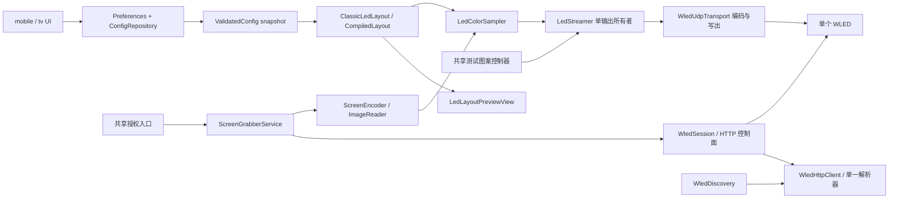

# WLED 直连流光溢彩技术方案（最终定稿）

> 版本：1.0；定稿日期：2026-11-16；源码核验基线：`1f8466c0ecd6b7544bb338068601cbfbef9dd48a`。  
> 本文是架构、参数、协议、生命周期与验收要求的**唯一技术规范**，已实质合并架构复核结论；文件名为保留已有引用而不变。  
> 状态：**技术方案定稿，功能待开发、构建待验证、设备待验收**。定稿不代表60fps、RGBW或设备关灯已验证。开发状态与任务证据统一维护于[任务总纲](../task/00-overview.md)。  
> 2026-11-16 实施进展：FND-1/2、CFG-1/2、LAY-1/2、SMP-1/2、NET-1/2/3 已验收；CAP-1/2/3、PRE-1/2、MOB-1、TV-1 本地实现完成，待设备仪器/宿主接线验证；TV-2/MOB-2 本地开发完成、待设备验收；REL-2 迁移文档已交付；REL-1 本地完成唯一WLED服务切换、旧proto/网络删除与包名/品牌迁移，Debug/Release/lint通过，待真机/QA验证；QA-1 本地端到端/回归测试台与API矩阵完成、待仪器；QA-2 无目标硬件，保持BLOCKED。构建使用项目本地Temurin 17.0.21 + Gradle 8.9 + AGP 8.7.2。证据见[任务总纲](../task/00-overview.md#completion-audit-2026-11-16)与`docs/verification/wled/`。

## 阅读导航

- [1. 目标与范围](#scope) · [2. 架构与复用](#architecture) · [3. 配置契约](#config)
- [4. 布局与映射](#layout) · [5. 采样与颜色](#sampling) · [6. 并发与生命周期](#lifecycle)
- [7. WLED协议](#protocol) · [8. 网络控制面](#network) · [9. 双端交互](#ui)
- [10. 构建与迁移](#build-migration) · [11. 性能与验证](#validation) · [12. 实施与准入](#delivery)
- [附录A 源码锚点](#source-audit) · [附录B 决策记录](#decisions) · [附录C 官方来源](#references) · [附录D 变更台账](#change-ledger)


<a id="scope"></a>

## 1. 目标、范围与基线


### 1.1 目标与技术结论

将现有“Android采集 → 中间服务器处理 → 灯带输出”替换为“Android采集 → 本地四边布局/逐灯平均 → 单个WLED”。最终运行时只保留WLED，不保留旧后端选择、TCP/protobuf链路或自动读取旧配置的兼容层。

方案具备实施可行性：首套274 RGB采用DNRGB单包；RGBW采用DDP；精确积分图、有界帧池和单写者把计算与网络隔离。**设备性能与平台兼容仍须逐项验收**，不能由带宽估算或静态源码审计推定通过。

### 1.2 首版范围与非目标

| 范围 | 定稿要求 |
|---|---|
| 工程框架 | 保持common Android Library、mobile/tv Application；Java/Kotlin、AppCompat/Material Views/Leanback，不改Compose |
| 布局 | 四边数量、SKIP/BLACK、Input/Reverse、深度、Overlap、Edge Gap、四角；平均色也遵守物理映射和黑灯规则 |
| 设备 | 单设备LAN；RGB、RGBW均首版；DDP因RGBW为必做，不延期 |
| 产品 | TV优先且mobile完整配置；共用预览、三种测试图案；保留与后端无关的主界面动效等体验，不扩大为UI重写 |
| 平台 | minSdk21、compileSdk35、targetSdk35；授权、通知、磁贴、开机提醒及横竖屏按平台规则适配 |
| 身份 | WLED Grabber，`com.abrenoch.wledgrabber`；major破坏性版本，仅侧载；图标、色板、字标与资源映射见[品牌与图标规范](app-icon/brand-guide.md) |
| 性能 | 首套274灯目标60fps；达不到则发布门禁未通过，不静默改为30fps |
| 延后 | 仅SMP-3的黑边检测、线性平均、饱和度、平滑等增强；默认关闭 |

不做：云端/远程访问、多设备同步组、音频采集/同步、DRM绕过、2D矩阵/PWM布局、屏幕内容识别、WLED固件修改/usermod、Google Play上架。录屏只采集平台允许的画面，受保护内容不承诺可用；不请求麦克风权限。

### 1.3 设备与兼容基线

- 首套：Sony KD55XD8005（4K Android TV）+ ESP32-WROOM-32D + 274颗WS2815 RGB。TV实际系统版本、可用采集率与60fps能力在QA-2记录。
- 接线预设：T86/B90/L49/R49、Gap0、Input161、Reverse=true。其余布局值采用§3通用默认，不能混用288参考示例的Depth/Overlap。
- 固件源码基线：WLED v0.15.1 / `4f3992b4dc57c888b53d9576c894a278e03e4cfc`。其他版本、定制固件按显式兼容试验处理，不概括为“全部0.15+已支持”。
- ESP8266保留配置入口和性能警告，但不继承ESP32性能结论；500/1000/2000灯分别验收。同构RGBW需另备灯带；混合总线/CCT/复杂映射不属于已验证范围。


<a id="architecture"></a>

## 2. 工程现状、模块边界与 DRY


### 2.1 当前工程与改造边界

| 模块 | 现有职责 | 本次改造 |
|---|---|---|
| common | ScreenEncoder/Service、Preferences、TCP发送、通知与扫描 | 承载所有新配置/布局/采样/帧流/设备控制；复用职责，替换有缺陷行为 |
| mobile | MainActivity、SettingsActivity、TileService | 设置与授权UI壳、独立预览宿主；不复制协议/算法 |
| tv | Leanback设置、扫描与结果引导 | 完整D-pad设置及预览宿主；不把高级参数转交手机配置 |

2026-11-16实施进展：构建已迁移到Gradle8.9/AGP8.7.2/Kotlin2.1.21、compile/target35、min21，AndroidX/ViewBinding、共享fixture、配置/端点/能力/READY、四边几何/映射、精确采样/RGBW、HTTP探测/发现、WLED报文与session release已落地（FND-1/2、CFG-1/2、LAY-1/2、SMP-1/2、NET-1/2/3已验收）；CAP-1/2/3、PRE-1/2本地模型、MOB-1共享设置/mobile表单与TV-1手动连接/共享probe完成，待设备仪器与宿主接线验证；TV-2/MOB-2开发中；REL-2迁移文档已交付；REL-1本地已切到`WledScreenService`、删除旧proto/网络并完成包名/品牌迁移，待真机/QA。E01–E17的符号与行号是改造前源码审计证据，不是已实现WLED的证据。

### 2.2 目标数据流




- 仍只有三个 Gradle 模块；新纯 Java 模型置 `common/.../led`，协议与客户端置 `common/.../network/wled`。不引入 DI 容器、通用后端注册器、额外线程框架或新 HTTP 库。
- `Preferences` 是持久化唯一适配器；`ConfigRepository` 负责一次读取/校验/原子保存，不让纯 `LedLayoutConfig` 直接依赖 Android Resources。UI 只展示共享验证结果，不能各写一份范围判断。
- `CompiledLayout` 包含规范化矩形、像素矩形、物理到逻辑映射与 generation；预览、真实采样、测试图案使用同一计划，不再重复布局公式。
- `LedColorSampler` 只消费平面视图和计划并填充租约；`ScreenEncoder` 只取得/关闭 Image 和发布帧。当前 BAOS 算法仅作为测试参考，不保留生产双实现。
- `WledUdpTransport` 只编码/写出，`WledSession` 只管理设备探测/释放策略；`LedStreamer` 是应用内唯一 UDP writer/输出模式所有者。socket ready 不是设备 ready。
- 复用 `NetworkScanner` 的地址排序意图与 scanner listener 的进度语义，不保留 AsyncTask 或固定 /24/50ms TCP 实现。HTTP 探测返回 `ProbeResult(device, capabilities, observedAt, error)`，不是 bool 后再次请求。
- 两个 `LayoutPreviewActivity` 只提供主题、导航、生命周期；View 不持有 socket、不请求 MediaProjection。测试图案控制器归 common，旧 TV TestTask 的网络分支删除。

### 2.3 接口职责与单一事实来源

| 边界 | 输入 → 输出 / 责任 | 禁止承担 |
|---|---|---|
| ConfigRepository / ConfigValidator | 草稿 → 字段错误或最后成功持久化的ValidatedConfig | 双端各自解析/校验；逐字段热更新 |
| ClassicLedLayout → CompiledLayout | 配置+有效采集尺寸 → 矩形、索引、generation | 依赖Resources、socket、Activity |
| LedColorSampler | PlaneView+CompiledLayout+空闲FrameLease → 物理顺序颜色 | 持有Image跨线程；分包或等待网络 |
| LedStreamer | offer移交租约，latest-wins，唯一UDP writer | 无界队列；把send成功当ACK |
| WledUdpTransport | 已确认格式的物理颜色 → 报文字节/本地写出结果 | 推测设备在线；第二套停止流程 |
| WledSession | CAPTURE/TEST仲裁、epoch、探测/健康/释放结果 | 各宿主创建独立sender；回调修改旧会话 |
| WledHttpClient / WledDiscovery | 单一解析器、受限端点、ProbeResult | bool探测后重复GET；任意URL/无限扫描 |

这是职责划分，不要求为每一行另造接口或通用框架。模型/布局/采样/编码优先纯Java，便于JVM测试；仅平台适配层依赖Android。共同fixture由FND-2维护，避免每模块复制mock、颜色图案和布局向量。


<a id="config"></a>

## 3. 配置、设备能力与持久化契约


### 3.1 快照、验证与生效规则

`ValidatedConfig` 含 schemaVersion、revision、DeviceEndpoint、明确的 RGB/RGBW 模式、布局、采集参数及停止策略。数值解析失败返回字段错误，不抛异常到 UI；范围/交叉校验集中在 `ConfigValidator`。`Preferences` 增加一次 edit 的多字段保存，后台提交成功才发布新 revision；不逐字段更新正在发送的配置。SharedPreferences 的 commit失败不保证其内部内存视图回滚，因此两端只从Repository读取“最后成功提交”的缓存快照，禁止直接旁路读取Preferences；失败保留旧活动revision并提示重试。进程重建时重新读取、校验磁盘快照，不能自动恢复采集。

首版保存配置后标记“下次启动生效”；运行中的 epoch 使用不可变快照。更换设备、数量、通道、协议、分辨率、布局均先 stop，再由用户重新启动/授权。旋转是同一会话的 display generation 更新，不等于重用已终止授权。

- `GET /json/info` 根字段为 `leds.count/ver/udpport/...`，不是 `info.leds`。聚合 `/json` 才用 `info` 子对象。
- 探测 `count` 是设备观察值；手动值是配置值，分别存储，禁止覆盖观察记录。数量不足阻断启动，不提供“强制继续”绕过；多余物理灯每帧黑色。定义发送长度M为已确认的全设备可寻址数量；有效探测count与手动物理数量必须一致，否则仅保存待修正草稿、不启动。不能把手动较小值截断报文而让设备尾灯遗留旧色；观察值缺失时先恢复探测，不借“手动覆盖”伪造确认。
- `rgbw` deprecated，`lc/seglc` 在固定源码与滚动文档间有 OR/AND 差异；只能提示。首版对同构 RGB 或同构 RGBW 验收，混合总线/CCT/复杂映射保留未验证警告并要求明确配置，不自动推导 stride。
- 手动地址入口始终可用；探测失败进入未确认状态。首版不提供“跳过所有验证仍显示已连接”，也不通过 UDP 成功猜固件/协议能力。
- 每边0..1000，N>0；输出数量 M 在1..65536且不小于有效布局数量；所有乘加用检查算术。协议索引边界是表示范围，不是“65536灯60fps支持”承诺。

### 3.2 参数及偏好资源字典

以下资源契约已由CFG-1落地（2026-11-16）；键和默认值集中在`common/src/main/res/values/pref_values.xml`，标题/摘要/字段错误在同模块`strings.xml`，由TV/MOB任务补充。XML、GuidedAction经Repository共享同一字段定义。纯模型不读Resources；现有语言key不随意破坏。

| 资源名 | 类型 / 范围 | 默认与语义 |
|---|---|---|
| `pref_key_wled_host` | string，host或IP | 空；未配置不得启动 |
| `pref_key_wled_http_port` | int，1..65535 | 80；NSD解析的是此端口 |
| `pref_key_wled_udp_port` | int，1..65535 | 21324；DNRGB采用探测值或显式确认的覆盖值 |
| `pref_key_wled_ddp_port` | int，首版固定4048 | 与HTTP/UDP realtime端口独立建模，不复用udpport |
| `pref_key_wled_protocol` | enum `auto/dnrgb/ddp` | auto：RGB按总数选DRGB/DNRGB，RGBW选DDP；RGBW强制dnrgb为字段错误；无type5选项 |
| `pref_key_wled_rgbw_mode` | enum `unconfirmed/rgb/rgbw` | unconfirmed；探测只提出建议，用户确认后才成为RGB/RGBW活动配置 |
| `pref_key_wled_rgbw_white_mode` | enum `min_subtract/preserve` | min_subtract；仅RGBW显示，要求WLED Manual |
| `pref_key_wled_physical_leds` | int草稿0或活动1..65536 | 0仅表示尚未确认，不能作为有效发送数量；活动M必须与探测count一致 |
| `pref_key_wled_auto_detect` | bool | true；刷新能力建议，不得覆盖已确认配置或伪造观察值；关闭也不豁免启动验证 |
| `pref_key_led_top` / `pref_key_led_bottom` | int，0..1000 | 60 / 60 |
| `pref_key_led_left` / `pref_key_led_right` | int，0..1000 | 34 / 34 |
| `pref_key_led_gap_length` / `pref_key_led_gap_position` | int，k≥0、g≥0、g+k≤N | 0 / 0；SKIP额外要求k<N，零gap允许g=N |
| `pref_key_led_input_position` | int，经floorMod归一化 | 0；反转时不直接等于物理0采样的逻辑槽号 |
| `pref_key_led_reverse` | bool | false |
| `pref_key_led_gap_mode` | enum `skip/black` | skip |
| `pref_key_led_h_depth` / `pref_key_led_v_depth` | int，1..100（%） | 8 / 5；顶底深度 / 左右深度 |
| `pref_key_led_overlap` | int，0..100（%） | 0；切向归一化绝对扩展，不是单灯宽度比例 |
| `pref_key_led_edge_gap` | int，0..50（%） | 0；沿边端点内缩，按§4公式换算 |
| `pref_key_led_corner_tl_h` / `pref_key_led_corner_tl_v` | int，0..100（%） | 0 / 0 |
| `pref_key_led_corner_tr_h` / `pref_key_led_corner_tr_v` | int，0..100（%） | 100 / 0 |
| `pref_key_led_corner_br_h` / `pref_key_led_corner_br_v` | int，0..100（%） | 100 / 100 |
| `pref_key_led_corner_bl_h` / `pref_key_led_corner_bl_v` | int，0..100（%） | 0 / 100 |
| `pref_key_capture_max_dimension` | int，1..640 | 640；不放大源画面，首版不提供960选项 |
| `pref_key_framerate` | int，1..60 | 保留30默认及10/15/24/30/60选项；首套验收显式选择60，不用默认30替代门禁 |
| `pref_key_use_avg_color` | bool | false；整域平均仍执行Gap/尾黑 |
| `pref_key_boot` | bool | false；UI改为“开机提醒”，不沿用自动复用录屏授权的语义 |

`schemaVersion/revision`、`DeviceEndpoint`（host、已验证地址、网络身份、分离端口）、`WledDevice`（MAC/版本/观察count/能力/observedAt）与用户确认结果由CFG统一定义持久化/内存边界。能力观察不是偏好默认值；`ProbeResult(device, capabilities, observedAt, error)`一次解析复用。`unconfirmed/0`只用于草稿，不得流入ValidatedConfig。高层策略和证据不能压成一个“connected”布尔值。


<a id="layout"></a>

## 4. Classic四边布局与物理映射


### 4.1 坐标系与逻辑槽位

以**当前采集内容正视图**为基准，h=x、v=y，范围[0,1]。旋转/单应用尺寸变化重编译计划，不把旧屏幕尺寸用于新内容。逻辑从左上开始顺时针：Top左→右、Right上→下、Bottom右→左、Left下→上；N=T+R+B+L，**不额外加4颗角灯**。

```text
Top:    [0, T)
Right:  [T, T+R)
Bottom: [T+R, T+R+B)
Left:   [T+R+B, N)
```

### 4.2 四边矩形生成

下列算法以S09的`createClassicLedLayout`为来源；每条零灯边直接跳过，不能除零。共同定义：

```text
depthH = h_depth / 100
depthV = v_depth / 100
overlap = overlap_percent / 100
edgeVGap = edge_gap / 100 / 2
edgeHGap = edgeVGap * captureHeight / captureWidth
clamp(z) = min(1, max(0, z))
```

横向Edge Gap采用实际高宽比而不是上游固定16:9，这是有意差异。Overlap只扩展切向边界；10%表示两侧各扩展屏幕宽/高的10%，不是每颗灯宽度的10%。默认0%，示例10%不是通用建议值。


#### 顶边（Top）

```text
stepH = (ptTR.h - ptTL.h - 2*edgeHGap) / T
stepV = (ptTR.v - ptTL.v) / T

for i in [0, T):
    hmin = clamp(ptTL.h + stepH*i     + edgeHGap - overlap)
    hmax = clamp(ptTL.h + stepH*(i+1) + edgeHGap + overlap)
    vmin = ptTL.v + stepV*i
    vmax = vmin + depthH
```

#### 右边（Right）

```text
stepH = (ptBR.h - ptTR.h) / R
stepV = (ptBR.v - ptTR.v - 2*edgeVGap) / R

for i in [0, R):
    hmax = ptTR.h + stepH*(i+1)
    hmin = hmax - depthV
    vmin = clamp(ptTR.v + stepV*i     + edgeVGap - overlap)
    vmax = clamp(ptTR.v + stepV*(i+1) + edgeVGap + overlap)
```

#### 底边（Bottom）

```text
stepH = (ptBR.h - ptBL.h - 2*edgeHGap) / B
stepV = (ptBR.v - ptBL.v) / B

for i = B-1 down to 0:        // 注意：数组顺序是“右→左”
    hmin = clamp(ptBL.h + stepH*i     + edgeHGap - overlap)
    hmax = clamp(ptBL.h + stepH*(i+1) + edgeHGap + overlap)
    vmax = ptBL.v + stepV*i
    vmin = vmax - depthH
```

#### 左边（Left）

```text
stepH = (ptBL.h - ptTL.h) / L
stepV = (ptBL.v - ptTL.v - 2*edgeVGap) / L

for i = L-1 down to 0:        // 注意：数组顺序是“下→上”
    hmin = ptTL.h + stepH*i
    hmax = hmin + depthV
    vmin = clamp(ptTL.v + stepV*i     + edgeVGap - overlap)
    vmax = clamp(ptTL.v + stepV*(i+1) + edgeVGap + overlap)
```

### 4.3 几何校验、量化与像素编译

四角必须凸、无自交、面积非零，且上/下边x递增、左/右边y递增。启用边需有正的切向可用长度；Depth/Edge Gap组合必须可采样。逐边公式生成后：

1. 保留归一化边界的完整计算精度；切向先按上述clamp限制，深度方向在统一编译阶段也裁剪到[0,1]。
2. 对**未量化、已裁剪**的矩形验证`hmin<hmax`且`vmin<vmax`；真正零面积或倒置是配置错误，不能静默补一像素。
3. 采样/预览共用这份完整精度矩形及同一个像素编译器，按以下round/半开区间转换；有效小矩形舍入后至少保留一像素。cropRect是有效内容域，编译使用其宽高，读取时再加crop原点。
4. S09的4位小数仅用于参考表示、导出与golden对照，**不得先量化再作几何准入判定，也不得将量化退化结果回灌活动计划**。完整精度输出与参考坐标的误差界仍由LAY-1验证。

```text
x0 = clamp(round(hmin * W), 0, W-1)
x1 = clamp(round(hmax * W), x0+1, W)
y0 = clamp(round(vmin * H), 0, H-1)
y1 = clamp(round(vmax * H), y0+1, H)
pixels = [x0,x1) × [y0,y1)
channelMean = floor(channelSum / ((x1-x0)*(y1-y0)))
```

内部使用一个编译器与一种确定性round实现；与固定上游的差分fixture允许已说明的±1像素取整容差，不能把容差当真实退化/越界豁免。不使用稀疏每2–4像素抽样替代精确平均。

边界fixture：T=1000、其余边0、M=1000、四角围成宽1%高100%的合法矩形、H Depth8%、Overlap/Edge Gap0。首槽`[0,0.00001)`为正宽区间，在640宽图像编译为`[0,1)`，不能因4位小数表示成`[0,0)`而被拒绝。另测R=1000、高1%宽100%的纵向对称例；两例1000个矩形都须非空，真实宽/高为0仍须拒绝。

### 4.4 Gap、Input、Reverse与尾灯


令逻辑槽位 `L=[0..N-1]`，gap为合法半开区间 `[g,g+k)`：

- SKIP：`S = L 删除gap`，`K=N-k>0`。
- BLACK：`S=L`，`K=N`；gap槽位保留但标为黑。
- 将 Input 用 `floorMod(input,K)` 归一化为 q。未反转 `slot(p)=S[(p+q) mod K]`；反转 `slot(p)=S[floorMod(q-1-p,K)]`。SKIP后的索引基于过滤列表S，而不是未过滤的L。
- `p>=K` 的物理尾灯输出黑色。平均色模式也保留 BLACK gap 和尾黑，只填充映射有效且非gap的物理灯。
- 首套274：`slot(p)=floorMod(160-p,274)`；物理0/25/26/160/161/273分别是逻辑160/135/134/0/273/161。Input 在 reverse 时不是直观物理0对应的原始槽号，预览必须显示实际结果。

SKIP用于该区间物理灯确实缺失；BLACK用于灯珠存在但需要熄灭。两者不是同义选项。BLACK允许整圈为黑，仍须N>0和完整设备数量；SKIP不允许删除全部槽位。每帧输出M颗颜色，K≤M，尾灯不能截包留旧色。

### 4.5 参考向量与首套预设

以下是数学期望和共享fixture输入，不是声称已有全量上游差分测试。默认布局188灯、首套274灯和参考示例288灯是三组不同配置。

**288参考示例**：T116/R50/B72/L50、Gap0、Input206、Reverse=false、H/V Depth15%/8%、Overlap10%、Edge Gap0、四角全屏。逻辑Top0–115、Right116–165、Bottom166–237、Left238–287；`slot(p)=(p+206) mod 288`。

| 物理区间 | 数量 | 逻辑槽位 | 侧别 |
|---|---|---|---|
| 0–31 | 32 | 206–237 | Bottom |
| 32–81 | 50 | 238–287 | Left |
| 82–197 | 116 | 0–115 | Top |
| 198–247 | 50 | 116–165 | Right |
| 248–287 | 40 | 166–205 | Bottom |

该例若Reverse=true，则`slot(p)=floorMod(205-p,288)`。

**274首套预设**：T86/R49/B90/L49、Gap0、Input161、Reverse=true；其余用§3默认。逻辑Top0–85、Right86–134、Bottom135–224、Left225–273；`slot(p)=floorMod(160-p,274)`。

| 物理区间 | 数量 | 逻辑槽位 | 侧别 |
|---|---|---|---|
| 0–25 | 26 | 160–135 | Bottom反向 |
| 26–74 | 49 | 134–86 | Right反向 |
| 75–160 | 86 | 85–0 | Top反向 |
| 161–209 | 49 | 273–225 | Left反向 |
| 210–273 | 64 | 224–161 | Bottom反向 |

LAY/PRE/SMP/NET的测试复用同一向量定义；预览和行走图案用于确认实际接线，数学表不能替代灯带观察。


<a id="sampling"></a>

## 5. 精确采样与颜色责任


### 5.1 有界精确矩形采样

默认 sRGB 分量算术平均，不增加 gamma/亮度增强。每个物理槽位仍以“矩形和÷面积向下取整”得到颜色，与逐像素 oracle 完全一致。

首版采用两路等价实现，按布局自动选择：边界型布局（所有矩形面积之和≤W×H，首套 T86/B90/L49/R49 约 6 万像素）逐矩形扫描自身像素求和；稠密或大面积布局改用逐行前缀和加矩形累加，复杂度 O(W×H+N)。平均色模式强制整帧前缀路径，一次扫描得到整域均值。两路都只做整数累加与整数除法，不引入近似。

- 长边640且不放大源图；所有尺寸正数，宽高均≤640。最大通道累积 `255×640×640=104448000`，int安全；若将来提升尺寸须重新证明上界。
- 不再分配 W×H 三通道积分图；前缀行工作区为 `3×(W+1)×4` 字节（640 宽约 7.7KiB），矩形和/面积数组按 N 计。首套实测采样 p95≈4.1ms、p99≈4.5ms（Sony KD-55XD8005，640×360，274 灯）。
- reader最多3张，应用同时持有≤1张；三帧颜色池；采集+采样工作区+帧池+布局工作缓冲预算≤12MiB（不含UI/系统图形栈）。通过分配记录与堆分析分别验证，不能把Java堆当全部内存。
- 平面地址使用 buffer 的有效起始位置、rowStride、pixelStride、limit及Image cropRect；验证最后访问字节，不假定最后一行含完整 padding。Image 在 capture线程的 finally 中关闭；不把其 ByteBuffer 交给 sender。
- 测试 oracle 用简单逐像素求和，测试中共享一个实现；生产仅一个积分图路径。热身后应用自有逐帧代码不新建数组/集合；系统 Image 包装分配不包含在“零数组分配”指标里。
- 自动黑边/线性平均/时间平滑是 SMP-3 的后续范围，首版不启用。以后复用 BorderProcessor 前必须用全黑、单像素、异常stride、裁剪抖动等回归锁住边界。

矩形和按行累加：直接路径对每个活跃矩形累加其 `[x0,x1)` 像素；前缀路径先构造每行三通道前缀 `P`，再取 `P[x1]-P[x0]` 累加到该矩形。两路最后都按面积整数除法取均值，不重复RGBW转换。平均色复用整帧总和，随后复用同一物理映射与黑灯掩码。

### 5.2 RGBW与亮度职责


首版保留两个应用合成模式：`min_subtract: W=min(R,G,B), RGB'=RGB-W`；`preserve: RGB'=RGB, W=min(R,G,B)`。**两者均要求WLED的auto-white为Manual，且全局override没有改回自动模式**。设置页必须显式说明/确认并用测试图案检查，未知时不能显示“已验证RGBW”。

S04显示auto-white会重算W；应用白色变成(0,0,0,255)后再被自动模式重算，会成为全黑。不得同时让两端合成。preserve只是保留RGB并叠加W，不保证亮度/色度恒定；需要RGBW样机标定。WLED实时gamma也受设置控制，不能假设总会生效；默认应用不增加gamma并记录设备设置。

| 输入RGB | min_subtract输出RGBW | preserve输出RGBW |
|---|---|---|
| (255,255,255) | (0,0,0,255) | (255,255,255,255) |
| (255,0,0) | (255,0,0,0) | (255,0,0,0) |
| (30,50,80) | (0,20,50,30) | (30,50,80,30) |

BLACK gap与尾灯始终为全通道0。输出保持RGB/RGBW语义顺序，物理GRB等颜色顺序由WLED处理；应用不二次交换、不默认增加gamma、饱和度或平滑。增强功能由SMP-3独立门禁启用，不能改变首版基线。


<a id="lifecycle"></a>

## 6. 执行域、帧所有权与生命周期


### 6.1 三个执行域

1. 主线程：Activity、授权结果、服务前台化、UI状态；不执行 DNS、HTTP、扫描、UDP。
2. 一个 capture HandlerThread：Image acquire/采样/close、display resize与计划generation切换。
3. 一个 sender线程 + 有界控制面executor：sender是唯一UDP写者；HTTP请求串行化设备状态变更，扫描最多4并发且与发送分离。不引入每帧 Thread 或每帧 Future。

`FrameLease` 携带 sessionEpoch、layoutGeneration、timestamp、channels、count。生产者只写借到的空闲帧；`offer(lease)` **无论接受还是丢弃均接管所有权**。sender发送完成、pending被替换或epoch失效时恰好归还一次。池大小3：producer、pending、inFlight各≤1；无空闲帧则放弃当前采样，绝不等待网络。inFlight绝不被覆盖；pending总是latest-wins。

同一物理输出只有 CAPTURE 或 TEST 一个模式。测试开始需采集已停；测试由前台预览Activity持有会话租约，不索取屏幕授权，也不启动mediaProjection类型FGS；页面退后台或退出即停止。WledSession在进程内仲裁CAPTURE/TEST所有权，两种宿主只可借用同一输出所有者，不能各建独立sender。结束统一release，返回页面不会偷偷恢复旧采集授权。测试图案占用同样的epoch、帧池、编码器及writer。

### 6.2 状态机与授权

```text
CAPTURE: IDLE -> VALIDATING -> AWAITING_CONSENT -> STARTING -> CAPTURING
TEST:    IDLE -> VALIDATING -> TESTING（不请求投屏授权）
验证失败/取消、用户拒绝授权 -> IDLE
CAPTURING -> PAUSED（仅仍有效会话） -> CAPTURING
启动失败、任意已持有资源的活动状态 -> STOPPING -> IDLE

释放结果单独记录: RELEASE_CONFIRMED / RELEASE_UNCONFIRMED
授权撤销/会话失效后的下一步要求: NEEDS_CONSENT（不自动重启）
```

VALIDATING在用户前台操作后异步完成设备与配置验证，再显示系统授权；授权成功即启动service，先前台化，再调用一次getMediaProjection、注册MediaProjection.Callback，最后createVirtualDisplay一次。注册失败/创建失败走统一幂等释放。不在等待网络期间占用前台启动时限。

- 新会话不缓存授权Intent，不经boot/进程重建自动重用；服务采用不自动重放采集的重启策略（如START_NOT_STICKY）。
- `MediaProjection.Callback.onStop` 统一清理reader/display/projection/thread/队列；VirtualDisplay.Callback不能替代它。
- API34+ 用 captured-content resize回调处理单应用窗口和旋转；低版本用display/configuration变化。在原VirtualDisplay上resize/setSurface，先停止旧reader回调，生成新计划，再接受新generation；不能重复createVirtualDisplay。
- 息屏统一停止发送并release；如系统已撤销投屏，亮屏只显示“需重新授权”，不承诺无感续采。仍有效会话的恢复与已终止会话严格区分。
- target35开机接收器只提供用户可见提醒入口，不从BOOT_COMPLETED启动mediaProjection FGS，不后台强拉Activity；通知权限被拒则下次前台显示提示。
- service和内部Activity默认不导出；launcher/tile/boot入口按平台需求声明exported及系统权限。控制广播保持进程内或显式受限，不把capture intent暴露给外部。

### 6.2.1 用户选择的 Android 10 TV 持续授权

在设备所有者明确要求且具备 ADB 管理权限时，可仅对指定 Android 用户与 `com.abrenoch.wledgrabber` 设置 `PROJECT_MEDIA=allow`。已核对的 Android 10 AOSP 分支允许系统在已有投射权限时返回**新的**授权结果而不显示确认页；应用仍请求新会话，不存储/重放旧 Intent 或 token，不自动提权，不修改系统警告。该设备配置与普通应用的逐次授权流程分开，不能外推到其他固件/API或承诺卸载、重置、升级后“永久有效”。撤销使用同一用户/包的 `PROJECT_MEDIA=default`。

2026-11-17 Sony Android 10 设备已完成指定包 `default → allow` 并读回；新会话免弹窗、进程重建与重启保持仍待实测。调用链、作用范围、命令、撤销及验收分层见[设备授权记录](../verification/wled/cap-1/android10-persistent-consent.md)，不得据此提升 CAP-1/QA 状态。

### 6.2.2 默认后台与自启动需求增补（待实现）

2026-11-17 用户补充“默认后台运行及自启动”。已在指定 Sony Android 10 设备为新版包显式设置 `RUN_IN_BACKGROUND=allow`、`RUN_ANY_IN_BACKGROUND=allow` 并加入 deviceidle user 白名单，独立读回通过；这是本机设置，不是 APK 自动获得系统权限，也不改变停止/息屏/撤销后的释放契约。

上文“开机只提醒”仍是**当前实现**，不是新增自启动需求的完成状态：boot 源码默认值仍为 false，receiver 仍只发提醒。开机后进入待机还是直接采集的目标及新增公共测试边界待确认，随后再以 TDD 修改默认值/启动策略并执行真实冷启动验收。系统权限、用户偏好和可运行的新录屏会话须分层验证，不以后台白名单或广播注册代替自动启动证据；不缓存旧 token、不绕过平台许可、不扩展权限到旧包或其他应用。

命令、撤销、当前调用链及待验收项见[后台运行与自启动记录](../verification/wled/cap-1/android10-background-autostart.md)。该增补归属 CAP-1 / MOB-2 / QA-1，不自动提升现有任务状态。

### 6.3 停止屏障与恢复

所有停止原因（按钮、通知、测试结束、息屏、授权撤销、错误）调用同一停止操作：

1. 进入STOPPING并封闭该epoch新offer；停止生产、丢pending，等待/取消本地inFlight后禁止后续颜色发送。
2. 在同一writer上尽力发送一帧全黑；随后通过同一控制客户端 POST `/json/state`，载荷 `{"on":false,"live":false,"tt":0}`。
3. 读回 `/json/state.on==false` 且 `/json/info.live==false` 才记录 `RELEASE_CONFIRMED`；它表示该时点设备观察值，不能保证其他控制器或迟到UDP不会再次点亮。
4. 总停止控制面预算3秒；超时/断网/身份变化记 `RELEASE_UNCONFIRMED`，释放本地资源并明确显示“设备关灯未确认”。不把UDP黑帧或超时当关灯证据。
5. STOPPING中禁止新start；旧控制请求结果不能改变新epoch。请求结果未知时不自动重放off到后续会话；再次开始需用户确认并做新探测。epoch只隔离本地，不能撤销已到达设备的HTTP/UDP。

DNRGB设timeout=2秒；DDP依赖设备有限 realtime timeout，基线源码默认2500ms但可配置。首版要求用户核对有限超时、关闭强制实时最大亮度、其他发送者和Sync；不发送无限占用的 `live:true`/timeout255，不擅自修改固件配置。进程被杀时不保证finally/HTTP执行；设备超时可能恢复原效果，不保证关灯，属于显式风险。

网络切换/设备重启：终止旧端点epoch、释放旧socket；新网络重新NSD/HTTP校验身份、数量、协议后才恢复。设备身份/能力变化必须由用户确认；不把历史IP当长期身份，不无限重试或排队陈旧帧。

恢复不是偷偷复活旧授权：若停止已释放MediaProjection或网络变化使会话终止，用户从新VALIDATING/授权流程开始。PAUSED仅表示同一有效授权中的暂时内部暂停，不用于息屏停止后的自动重启。RELEASE_UNCONFIRMED是释放结果，NEEDS_CONSENT是下一步操作要求，UI分别展示，不能合并成“已关灯”。


<a id="protocol"></a>

## 7. WLED数据面协议


### 7.1 固件能力与传输选择

固定源码核验仅覆盖 **v0.15.1 / `4f3992b4dc57c888b53d9576c894a278e03e4cfc`** 的可见实现行为，不宣称所有0.15+或定制固件一致。能力页面展示版本、编译信息（如有）、MAC、count、检测时间与用户确认配置。其他版本可进行显式兼容试验，不把best-effort显示为已验证支持。ESP8266保留支持入口和性能警告，但不继承ESP32性能承诺。

| 传输 | 首版选择与精确报文 | 分包/边界 |
|---|---|---|
| RGB，M=1 | DRGB type2，`[02][02][R][G][B]` | type4的7字节单灯包被固定固件忽略；只适用于物理索引0、总数1 |
| RGB，M≥2 | DNRGB type4，`[04][02][start16be][RGB...]` | 每包2..489灯、报文≤1472B；余1时重分尾部，如490=488+2、979=489+488+2 |
| RGBW | **DDP必做**，10B header + RGBW | datatype0x1B，目标端口4048；每包≤1440数据字节=360灯 |
| RGB可选传输 | 同一DDP编码器，datatype0x0B | 每包≤1440数据字节=480灯；不是额外后端 |

DDP：version1；非末包flags=0x40，末包/单包=0x41；sequence固定0（禁用序号，不做0..15普通循环）；destination=1；offset为累计**字节**偏移32bit大端，length为本包数据字节16bit大端；不带timecode。1440是客户端数据预算而非协议最大值。DDP使用4048，不能误用info.udpport；DNRGB使用info.udpport或已确认的用户覆盖端口。HTTP端口与这两者分别存储。

PUSH不是ACK/完整帧事务；固定接收实现首次PUSH前可能显示非PUSH包，丢包/乱序不能可靠重组。DNRGB按包show同样可能局部更新。发送失败后放弃剩余旧帧，下一次发送新完整帧，不重试过期分片；首套274两种格式均单包。禁止实现type5作为“自动fallback”。

必要寻址前提：realtime offset=0、main-segment-only关闭、DDP DMX start address=1、没有额外LED map/总线反向叠加；这些不能从一个rgbw字段证明。协议保持RGB/RGBW语义顺序，物理GRB等交给WLED，不二次重排。

### 7.2 分片、精确字节与边界向量

固定固件`udp.cpp`的外层`udpIn[0]>0 && udpIn[0]<5`使type5分支不可达；type4又要求`packetSize>7`。因此禁用DNRGBW type5，且type4分片不能留下1灯尾包（S01）。计数和byte offset使用检查算术，先计算完整帧分片，再写入同一writer。

```text
RGB，M=1，红：
02 02 FF 00 00                      # type2, timeout2s

RGB，M=2，红+绿，start=0：
04 02 00 00 FF 00 00 00 FF 00       # type4, timeout2s, start16be

RGBW，M=1，白W通道，DDP单包：
41 00 1B 01 00 00 00 00 00 04 00 00 00 FF
# flags seq datatype dest offset32be length16be RGBW
```

| 向量 | 定稿期望 |
|---|---|
| DNRGB数量2/489/490/979 | 分片2；489；488+2；489+488+2，每包至少2颗 |
| DNRGB数量2..65536 | 分片数量之和=M；start最大不越16bit；末片不是1颗 |
| DDP RGBW数量1/360/361 | 数据4；1440；1440+4字节，末包PUSH；361末包offset1440 |
| 274 RGB DNRGB | 4+274×3=826字节，单包 |
| 274 RGBW DDP | 10+274×4=1106字节，单包 |
| 288 RGB | DNRGB868字节；DDP874字节，均单包 |

网络只证明本地写出，协议不提供逐帧ACK。分片重排、丢失以及另一发送者竞争无法由发送端epoch消除；故障测试与状态文案按§8、§11执行。


<a id="network"></a>

## 8. 设备控制、发现与LAN安全


### 8.1 受限HTTP与有界发现

使用平台 `HttpURLConnection` + `org.json`，不为两个GET/一个POST引入新库。连接与读取各≤1秒、完整操作的应用截止时间≤3秒、响应体≤64KiB；拒绝非2xx、错schema、重定向和异常Content-Length/超限流。单一JSON解析器供发现、启动、健康、停止读回复用。低API上的阻塞DNS不保证可中断：解析放在专用有界worker（同时最多1个），超时使结果失效，不增开替代线程；迟到解析不得继续发HTTP/UDP。3秒是调用方结果/本地采集停止预算，不宣称操作系统DNS线程必在该时刻结束；占满时新解析快速报告暂不可用。

端点只接受显式host/IP+port，不接收任意URL路径、userinfo或scheme。解析后绑定选定网络上的同一地址；首版允许可信局域网的私有IPv4/link-local/IPv6 ULA或link-local（scope正确），拒绝公网、回环、组播目标及跨网重定向。DNS/NSD结果变化重新验证，不在同一请求中未经验证二次解析。平台API21..22若无法精确绑Network，记录限制并在网络变化时销毁socket；不得退回公网扫描。

NSD浏览`_wled._tcp.`，解析的port是HTTP端口，不是UDP；缓存service身份/MAC与上次地址，IP仅提示。手动输入和有限HTTP扫描均保留；扫描必须用户触发，仅当前本地前缀、候选≤256、并发≤4、整体≤15秒、可取消，超时返回partial结果。没有网络/无候选是空结果，不抛崩溃。

`network_security_config`对动态LAN地址无法静态细分，采用明确的应用级cleartext例外及代码端点限制；min21..23路径同时核验 `usesCleartextTraffic`/默认平台行为，API24+使用network-security-config。这不是TLS或认证，LAN访问者仍可能控制WLED；隐私说明公开此边界。未来提高target时另审本地网络权限，不能用本次target35结论担保未来版本。

状态至少分为 capture状态、localSend状态、最近HTTP观察与release结果；HTTP探测最多每5秒一次且后台串行，时间戳超过10秒标记stale。状态文案只能说“正在发送/设备最近可达”，不能宣称逐帧收到。错误区分授权、配置、DNS、HTTP、UDP本地失败、设备未确认。

### 8.2 JSON边界与启动确认

```json
{"ver":"0.15.1","mac":"example-device-id","udpport":21324,"live":false,"leds":{"count":274,"rgbw":false}}
```

这是`GET /json/info`的**根形状示例**，不是完整设备响应、不是探测结果fixture，也不把示例MAC当有效身份。聚合`/json`才含`info`子对象；两种endpoint不能共用错误的根包装假设。状态读取单独使用`/json/state`。解析对缺字段、错误类型、溢出、超长与未知能力fail-closed，具体错误保留到UI。

开始前确认：LAN网络/目标身份/固件、全部可寻址数量M、同构RGB或RGBW、分离端口、§7寻址前提及有限实时超时。RGBW另外确认Manual/全局override。配置草稿可以保存以便修正，但不满足前提时不能启动采集或TEST。HTTP可达不等于LED颜色、帧率或关灯已验证；实时请求也可能恢复设备先前亮度，`on:false`不是持续锁灯机制。

### 8.3 统一状态与错误呈现

| 领域 | 状态或错误 | UI动作 |
|---|---|---|
| 配置 | 未确认格式/数量不一致/空布局/非法几何 | 指向具体字段；保留合法已提交快照，不“强制继续” |
| 设备 | DNS/HTTP/身份变化/版本或能力未验证 | 显示检测时间和可重试原因；不自动协议降级到type5 |
| 采集 | 需授权/被拒绝/被撤销/资源失败 | 回到用户可见授权入口；不重放Intent |
| 发送 | LOCAL_SENDING / 本地UDP失败 | 仅陈述本地写出；不能显示逐帧“设备已收到” |
| 观察 | DEVICE_OBSERVED / stale | 显示最近HTTP时间，过期明确标注 |
| 释放 | RELEASE_CONFIRMED / RELEASE_UNCONFIRMED | 后者显示“设备关灯未确认”；明确本地已停止与远端结果不同 |

设置页字段错误/Toast、主界面状态、前台通知及两端测试结果消费同一结构化错误；跨组件控制进程内或显式受限，不复用无保护的隐式控制广播。不得记录投屏授权token或原始屏幕内容。


<a id="ui"></a>

## 9. 手机、TV与共享预览交互


### 9.1 两端完整设置与首次引导

| 分组 | 共同字段与动作 | 宿主差异 |
|---|---|---|
| WLED Connection | host、HTTP端口、UDP realtime端口、只读DDP端口、协议、明确通道格式、RGBW白模式、物理数量/观察值、自动探测、扫描/测试 | 手机Preference；TV GuidedStep首步，缺设备保留手动入口 |
| LED Layout | T/B/L/R、Gap length/position、Input、Reverse | TV D-pad可编辑并显示实际物理0对应槽位 |
| Advanced Layout | H/V Depth、Overlap、Edge Gap、四角、SKIP/BLACK | 两端均首版，TV不能只给手机配置提示 |
| Preview | 共用预览、274预设、288参考向量、三种图案、逐边/输入位置点亮校验 | 两端各有独立LayoutPreviewActivity |
| Capturing / General | 帧率、平均色、长边上限、开机提醒、权限/状态 | 录屏授权/通知/Tile/系统insets按平台适配 |

手机：空配置点击电源先进入WLED设置/扫描，完成确认后返回主界面再授权。TV：沿用改造后的`NetworkScanActivity → ScanResultActivity`导航，再进入Connection → Layout → Advanced → Preview → Capturing。保留主界面与非后端相关交互；设置保存失败不启动、不假显示已保存。

复用`SettingsStepBaseFragment`的`unSignedNumberAction`、`radioListAction`和现有Preference listener适配职责，`assertIntValue`等校验统一委托ConfigValidator，不复制规则。扫描`saveResult()`保存确认的WLED端点，不能继续写旧Host/Port；删除TV TestTask独立网络分支。

RGB模式隐藏White Mode；unconfirmed模式提示确认硬件而不自动假定RGB。修改草稿即时刷新预览，**不热更新正在发送的快照**；运行中保存显式提示“下次启动生效”。错误、单位、默认值和资源均共享，TV大字体/D-pad焦点完整可达。

布局页提供**逐边与输入位置点亮校验**：按当前草稿编译布局，经`LayoutProbe`取逻辑环区间并映射到物理索引，借助共享`TEST`输出租约向WLED发送约2秒白色脉冲，其余灯珠为黑；采集运行中不抢占输出，提示先停止。该动作只用于确认接线/顺序/Input/Reverse，不替代正式预览与10秒图案测试。

### 9.2 预览与图案

共用`LedLayoutPreviewView`绘制屏幕、四角连线、半透明采样矩形、物理索引/侧别及Gap/尾灯状态；从CompiledLayout读取，不重复公式，不持有socket。密集标签可按焦点展示，不能遮挡操作。预览纯绘制不需要录屏授权。

| 图案 | 行为 | 验证目的 |
|---|---|---|
| 四边色 | Top红、Right绿、Bottom蓝、Left白 | 侧别、Input/Reverse、Gap |
| 行走像素 | 按物理索引递增标识，显示当前索引；BLACK和尾黑保持不点亮 | 接线顺序；不会为了测试绕过黑灯掩码 |
| 整带纯色 | 有效灯红/绿/蓝/白循环，Gap/尾灯仍黑 | RGB/RGBW通道与实际颜色 |

统一测试默认10秒，可取消并显示倒计时；大型行走测试10秒内不保证覆盖全部灯，可从索引继续选择验证，不能虚报全带通过。TEST必须先确认CAPTURE已停止；测试使用同一epoch/帧池/writer/停止屏障，不增加HTTP逐灯发送备用路径。退后台/退出即release，不自动恢复旧采集。测试显示发送与观察状态，颜色是否正确仍需用户/硬件证据。

TV-2在模拟器或其他受控设备验收模块UI/仪器行为；Sony遥控器、大字体和60fps实测属于QA-2，不能让TV-2反向等待后置QA-2形成验收环。


<a id="build-migration"></a>

## 10. 构建基线、切换与用户迁移


### 10.1 工具链与原子切换

固定候选工具链：**AGP8.7.2 + Gradle8.9 + JDK17 + Kotlin2.1.21**，compile/target35、min21。S08证明AGP8.7兼容API35/Gradle8.9/JDK17，Kotlin表覆盖该组合；FND-1已用项目本地Temurin 17.0.21完成三模块Debug构建与单测，但不代表目标硬件或发布验收完成。AndroidX具体版本在FND-1锁定并检查每个AAR minSdk及传递依赖，不追滚动“最新”；构建集中版本目录，移除重复buildscript/jcenter。

迁移顺序：

1. FND-1/FND-2在内部开发分支把工具链、AndroidX、ViewBinding、R资源所有权与测试基座变绿。临时保留旧协议编译所需依赖/生成链，必要时只调整生成插件使API兼容并记录锁定版本；不得先删依赖让每个后续PR不可编译。
2. 在新契约下并行开发布局、采样、网络和UI；生产入口在最终切换前不发布“半新半旧”版本。内部测试装配不是产品双后端选择。
3. REL-1单PR切换唯一WLED入口，删除旧网络/proto/临时依赖、类名与包迁移、更新所有manifest/XML/反射/资源引用。之后再跑完整验收；不签名/发布中间构建。
4. REL-2交付旧字段映射、新配置手册、故障/权限/隐私说明及回退路径；QA-3是最终准入记录，不代替用户的实际签名发布授权。

mobile/tv目前同applicationId，继续输出**同ID的替代APK**，不承诺二者共装；统一版本来源并注明变体。新ID与旧应用可以共装，不需要以卸载旧应用为安装前提，但应提醒停止旧发送者。旧X/Y只指导采集缩放，不能自动转换成四边灯数；不读取旧Host/Port/Priority充当WLED配置。

品牌检查覆盖活动源码、资源、manifest、包目录、生成产物与UI；迁移报告、历史引用、许可证/版权归属和第三方来源是具名例外，不运行整仓零命中的破坏性清扫。技术文档中的旧路径是审计证据，包迁移后新增新路径对照。

### 10.2 逐字段重建与回退说明

迁移手册交付路径为`docs/migration/legacy-to-wled-layout.md`（REL-2计划新增），不通过后台读取旧应用配置实现迁移。

| 旧字段/能力 | 新版本处理 |
|---|---|
| 旧服务器Host/Port | 删除；重新发现/输入WLED host、HTTP及UDP端口，不直接套用旧19445 |
| Priority / Reconnect / Reconnect Delay | 删除；用受限健康观察和显式会话恢复，不模拟旧TCP优先级 |
| X/Y LED Count | 只影响旧采集缩放，不能转换灯数；按实际四边数量重建 |
| Frame Rate / Average Color | 保留能力和共享设置入口；新配置独立保存，平均色仍执行Gap/尾黑 |
| Grab on Boot | 改为开机提醒，需用户前台授权；权限被拒在下次前台提示 |
| 旧服务器布局 | 按四边/Gap/Input/Reverse/Depth/Overlap/Edge Gap/四角重建，参考§4向量 |
| 实际接线 | 预览物理索引及三种图案确认，不用旧X/Y或起点直觉推断 |
| 首套274 | 使用§4.5预设；RGBW需另测，不能把WS2815当RGBW |

回退保留旧版APK/分支与操作说明；新旧应用ID不同可共装，但先停止当前发送者，不能同时控制设备。mobile/tv同ID是替代安装包，不能宣称彼此可共装。构建成功不代表签名、安装、发布已获授权或已完成。


<a id="validation"></a>

## 11. 性能预算、兼容矩阵与风险控制


### 11.1 性能预算与证据层级

使用S09固定函数与§4.5的288配置（640×360、H15%、V8%、Overlap10%）计算：精确逐矩形遍历约 **1,678,644次像素读取/帧**，60Hz约100,718,640次/秒。该值是算法访问量，不是Android benchmark。首版按布局选择：矩形面积和≤W×H时逐矩形求和（首套约6万像素/帧），否则逐行前缀+矩形累加（≤230,400像素/帧）。真机首套实测采样p95≈4.1ms、p99≈4.5ms、发送间隔p95≈17.3ms，见§11.1证据。

首套274RGB DNRGB为826B/帧、60Hz为49,560B/s（仅UDP应用报文，不含链路开销）。这只能证明带宽数量级；若灯带为800kbit/s、24bit/像素，纯数据阶段为8.22ms，尚不含reset/latch，不能统一写“WLED渲染1–5ms”。硬件供电/电流按实际灯带资料与接线测量，不将未经验证的单灯功率估值当选型依据。

| 层级 | 必须采集的证据 | 判定 |
|---|---|---|
| 纯算法 | golden/性质/畸形输入/字节报文/压力竞态测试 | JVM通过不等于Android生命周期正确 |
| Android模拟/设备 | API21/23/26/29/33/34/35，手机+TV关键组合；授权/通知/旋转/锁屏/撤销/拒绝 | 缺某组合明确未验收；不得靠提高minSdk消除失败 |
| 首套性能 | 固定60Hz测试内容、274灯、640长边，30分钟；capture、sample、send、WLED show、物理输出分别计时 | 采样p95≤5ms、p99≤8ms；发送间隔p95≤20ms；物理不同帧平均≥59fps、1秒窗口≥55fps；端到端p95≤80ms |
| 有界资源 | 预热5分钟，随后25分钟；池/队列上界与Java/native/graphics内存分开记录 | 队列/租约不越界；无ANR/崩溃；应用稳定工作集净增长≤5MiB且无持续上升趋势 |
| RGBW | 独立同构RGBW灯带，Manual + 两种white mode、1/360/361灯边界 | 白通道可见、末灯正确；没有样机则RGBW发布验收未完成 |
| 故障 | HTTP失败、UDP丢包/延迟/乱序、路由变更、WLED重启、其他发送者、应用进程被杀 | 状态与已观察事实一致；不报告未确认关灯；本地资源按预算释放 |

以上阈值是**拟定验收预算，不是已有测量结果**；QA-2须记录设备型号/系统/WLED烧录版本/灯数/总线/网络、原始数据与统计方法。`info.leds.fps`是show层证据，物理刷新需逻辑分析仪或可复核高速摄影/光学采样，不能相互替代。500/1000/2000灯与ESP8266分别测试并发布自己的支持矩阵，不把274结论外推。

**2026-11-17 首套软件侧实测（Sony KD-55XD8005 + WLED_TV 274 RGB，640×360，60fps 配置）**：采样 p50≈3.3ms、p95≈4.05–4.5ms、p99≈4.5–4.9ms；发送间隔 p95≈17.3ms；WLED show 层 `leds.fps` 30次1秒采样 min=66/avg=107.4。软件侧采样与发送门禁达标；物理刷新与端到端 p95 需测量设备，尚未验收。原始日志见 `docs/verification/wled/qa-2/device-metrics-2026-11-17.txt`。

### 11.2 主要风险与失败处理

| 风险 | 控制与失败条件 | 责任任务 |
|---|---|---|
| 固件版本差异/type5不可达/混合总线 | 固定源码、显式格式、DDP RGBW；不支持组合不假报通过 | CFG-2、NET-1/2、QA-2 |
| RGBW二次合成/寻址叠加 | Manual、override、offset/映射设置确认，样机观察 | SMP-2、NET-1、QA-2 |
| 投屏token重用/后台启动/旋转 | 新会话新授权、前台时序、callback、原display resize | CAP-1/2、MOB-2、QA-1 |
| 慢网/旧帧/缓冲竞态 | 三租约、latest-wins、epoch/generation、统一停止 | CAP-2/3、NET-3 |
| 迟到UDP/HTTP、杀进程、其他发送者 | 最佳努力黑帧+控制读回；不保证永久关灯，未确认必须可见 | NET-3、QA-1/2 |
| DNS不可中断/扫描拖垮发送 | 单解析worker、调用方截止时间、有界扫描、独立writer | NET-1/3 |
| Sony60fps或内存超预算 | 采样/发送/物理输出分层计时；缺证据或低于门限阻断发布 | QA-2/3 |
| 老构建无法过渡/资源R变化 | FND固定工具链与依赖、暂留编译链，REL原子删除旧后端 | FND-1/2、REL-1 |
| TV与QA形成语义环 | 模块门禁和目标硬件门禁分离，保持前置有向无环 | TV-2、QA-2/3 |

机器检查范围与硬件验证边界分别记录；定稿不使用“最新组件”“绝对关灯”“所有WLED版本支持”作为不可验证承诺。


<a id="delivery"></a>

## 12. 实施组织与最终准入


### 12.1 模块分解与串并行

[任务总纲](../task/00-overview.md)是任务状态、完整DAG、风险、变更文件和验证命令的唯一维护点；本文定义技术要求，不再复制26张任务卡。

| 阶段 | 模块 / 任务册 | 主要边界 |
|---|---|---|
| 基础 | [FND](../task/01-foundation.md)、[CFG](../task/02-configuration.md) | 工具链、fixture、配置模型先就绪 |
| 纯逻辑/网络 | [LAY](../task/03-layout.md)、[SMP](../task/04-sampling.md)、[NET](../task/05-wled.md) | 按具体前置并行；SMP-3唯一可延期项 |
| 平台/交互 | [CAP](../task/06-capture.md)、[PRE](../task/07-preview.md)、[TV](../task/08-tv.md)、[MOB](../task/09-mobile.md) | 共享服务/配置/资源单维护，UI只消费 |
| 切换/验收 | [REL](../task/10-release-migration.md)、[QA](../task/11-validation.md) | REL-1统一切换删除；QA-1→QA-2→QA-3收集证据 |

热点必须串行/单PR：ConfigRepository/Preferences/pref_values/strings由CFG维护；服务/Encoder由CAP维护；共享网络状态由NET维护；各module build与manifest按FND后REL顺序；全局包名/品牌/proto删除集中REL-1。具体文件见[附录D](#change-ledger)和总纲，不让并行任务自行生成第二套helper/fixture/状态机。

### 12.2 验证顺序与退出条件

1. 核对当前HEAD、WIP、源码锚点；未来修改代码前重新运行GitNexus impact。不能把本次文档评审当修改所有代码的永久许可。
2. 各卡按RED→GREEN→重构运行最小独立测试；FND就绪后才执行真实Gradle任务；检查lint、两端构建、manifest及依赖产物。
3. QA-1汇总布局/字节/所有权/HTTP/生命周期与API矩阵，QA-2补Sony及RGBW原始硬件数据，再由QA-3作独立准入。缺设备写明未验收，不能勾选通过。
4. REL核对旧链路/身份/品牌与合法来源豁免，迁移/回退/隐私文档和当前实现一致。实际签名、安装、发布单独授权。

**首版准入 checklist**（实施时由任务册附证据，不因本文定稿自动勾选）：

- [ ] 25张首版卡完成且前置/验收证据齐全；SMP-3延期明确，不含DDP延期。
- [ ] 配置无绕过、几何/映射/字节golden与性质测试通过；黑灯和尾灯覆盖完整M。
- [ ] 单输出所有者、三租约与停止屏障压力测试通过；旧epoch不污染新会话。
- [ ] 手机/TV完整设置、预览与无授权TEST正确，录屏/通知/旋转/撤销/boot/tile矩阵通过。
- [ ] Sony274/60fps及RGBW Manual两模式真实证据满足§11，不以发送率或show统计替代物理证据。
- [ ] 唯一WLED后端/新身份/替代APK、固定构建、迁移手册、无意外权限及来源许可检查通过。
- [ ] 关灯未确认、明文LAN、进程被杀和并发发送者风险在UI/手册中如实公开；QA-3准入完成。

**文档定稿边界（2026-11-16）**：当时仅整合并定稿技术方案、同步任务引用，没有生产代码/Gradle/依赖修改。此后实施已开始：FND-1/2、CFG-1/2、LAY-1/2、SMP-1/2、NET-1/2/3 已完成工具链、AndroidX/ViewBinding、共享fixture、配置/端点/能力/READY、几何/映射、采样/RGBW、HTTP探测/发现、WLED报文与session release；CAP-1/2/3、PRE-1/2 本地模型、MOB-1共享设置/mobile表单与TV-1手动连接完成，待设备仪器与宿主接线验证；TV-2/MOB-2开发中；REL-2迁移文档已交付；三模块Debug构建与相关单测通过；仍没有Android/WLED硬件验收。源码锚点与外部固定来源用于设计可追溯，不能替代实施期测试。


<a id="source-audit"></a>

## 附录A. 当前源码锚点与复用边界


下列证据于2026-11-16核验，路径相对仓库根，**符号优先于行号**；重命名后维护新旧路径对照。GitNexus索引时间`2026-11-16T08:47:30.152Z`、索引提交`1f8466c`、109个已索引文件；本次复核编辑文档后 `docs/design/wled-direct-ambilight-feasibility.md` 进入 `dirtyPaths`，源码未变。Encoder upstream LOW，直接入口为Service.startScreenRecord、传递至onStartCommand；Service类级upstream LOW（4直接import、6总命中），不能据此排除运行期回调。Markdown impact为UNKNOWN，引用关系另作文本核查。

| ID | 当前 file:line / 符号 | 当前行为与复用边界 |
|---|---|---|

| <a id="e01"></a>E01 | `common/src/main/java/com/abrenoch/hyperiongrabber/common/HyperionScreenEncoder.java:45-55` `prepare` | 创建 VirtualDisplay，随后设置 ImageReader |

| <a id="e02"></a>E02 | `common/src/main/java/com/abrenoch/hyperiongrabber/common/HyperionScreenEncoder.java:120-152` `setImageReader` / `imageAvailableListener` | 异常路径没有 finally close，不能原样复用 |

| <a id="e03"></a>E03 | `common/src/main/java/com/abrenoch/hyperiongrabber/common/HyperionScreenEncoder.java:154-242` `getPixels/getAverageColor/sendImage` | 每帧分配 BAOS；平均模式也会调用 BorderProcessor |

| <a id="e04"></a>E04 | `common/src/main/java/com/abrenoch/hyperiongrabber/common/HyperionScreenEncoderBase.java:60-64` 构造器缩放 | 不能沿用 X/Y 推导新采样分辨率 |

| <a id="e05"></a>E05 | `common/src/main/java/com/abrenoch/hyperiongrabber/common/util/HyperionGrabberOptions.java:50-65` `findDivisor` | 替换尺寸策略，保留参数容器职责 |

| <a id="e06"></a>E06 | `common/src/main/java/com/abrenoch/hyperiongrabber/common/network/HyperionThread.java:21-40` `sendFrame`；`:86-104` `run` | 发送在调用线程同步执行 |

| <a id="e07"></a>E07 | `common/src/main/java/com/abrenoch/hyperiongrabber/common/network/Hyperion.java:112-151` `sendRequest/receiveReply` | 最终删除，不能作为 UDP 健康判断依据 |

| <a id="e08"></a>E08 | `common/src/main/java/com/abrenoch/hyperiongrabber/common/util/Preferences.kt:18-49` `getString/getInt/putInt`；`:71-82` 布尔值/默认资源 | getInt 可抛解析错误，多字段写非原子，必须补强统一入口 |

| <a id="e09"></a>E09 | `mobile/src/main/java/com/abrenoch/hyperiongrabber/mobile/SettingsActivity.java:36-60` listener；`:129-147` `GeneralPreferenceFragment` | 仅整数可解析性，不是完整范围/跨字段校验 |

| <a id="e10"></a>E10 | `tv/src/main/java/com/abrenoch/hyperiongrabber/tv/fragments/settings/BasicSettingsStepFragment.kt:32-159` `onCreateActions`；`:173-225` `onGuidedActionClicked` | 完整处理到225行；测试另在 `:254-256` 和 `:280-322` |

| <a id="e11"></a>E11 | `common/src/main/java/com/abrenoch/hyperiongrabber/common/network/NetworkScanner.java:43-65` `tryNext`；`:95-165` `getIPAddresses/getIPsToTry` | 只复用枚举/排序思路；固定 /24、50ms TCP 探测、失败 socket 释放不可照搬 |

| <a id="e12"></a>E12 | `common/src/main/java/com/abrenoch/hyperiongrabber/common/BootActivity.java:38-49` `startScreenRecorder`；`common/src/main/java/com/abrenoch/hyperiongrabber/common/HyperionGrabberBootReceiver.java:14-24` `onReceive` | 入口可保留，授权/后台启动行为不可原样复用 |

| <a id="e13"></a>E13 | `common/src/main/java/com/abrenoch/hyperiongrabber/common/HyperionScreenService.java:163-201` `onStartCommand`；`:250-301` 采集/释放/状态 | 当前 177 行采集早于 178 行前台化；必须倒置且回调闭合 |

| <a id="e14"></a>E14 | `common/src/main/java/com/abrenoch/hyperiongrabber/common/HyperionScreenEncoderBase.java:19` `mRemoveBorders`；`common/src/main/java/com/abrenoch/hyperiongrabber/common/util/BorderProcessor.java:56-145` `parseBorder` | 开关默认 false；算法需边界测试后才接入，首版默认不启用 |

| <a id="e15"></a>E15 | `build.gradle:4-15`；`gradle/wrapper/gradle-wrapper.properties:6`；`common/build.gradle:31-62`；`mobile/build.gradle:26-31`；`tv/build.gradle:27-59` | 4.6/3.2.1/1.2.71、SDK26、Support26.1.0 已核验 |

| <a id="e16"></a>E16 | `mobile/src/test/java/com/abrenoch/hyperiongrabber/ExampleUnitTest.java:1-17` | 仅示例；没有新协议/布局/竞态测试，不能称有回归保障 |

| <a id="e17"></a>E17 | 固定参考提交 `c3f24c0fcc3aaed854535214608b186a1f3de388` 的 `createClassicLedLayout` 286–423，`createClassicLeds` 425 起 | 未来只按符号/固定提交对照，见 S09 |


无fixture/可复跑命令的“与参考实现比对通过”不作为验收凭据。既有验证仅包括固定布局像素访问量、274映射与报文/分片算术；完整差分/性质测试由LAY/SMP/NET实施。规划新增类不在本表中冒充现有源码。


<a id="decisions"></a>

## 附录B. 关键架构决策记录


A01–A14为稳定追溯ID，任务卡可引用；它们是已经纳入正文的设计决定，不是另一套覆盖正文的规则。落实状态仅在任务册更新。

| ID | 最终决策 | 依据与取舍 | 落地任务 |
|---|---|---|---|
| <a id="a01"></a>A01 | RGBW首版DDP，禁止type5 | S01固定固件入口不可达；保留RGBW范围而不依赖死分支 | NET-2、QA-2 |
| <a id="a02"></a>A02 | 按endpoint根形状解析，观察与确认分离 | S03的rgbw/lc不足以证明物理同构；不自动推断stride | CFG-2、NET-1 |
| <a id="a03"></a>A03 | 三租约、单writer、epoch、统一停止 | E02/E13现有同步/可变缓冲不足以支持异步安全 | CAP-2、CAP-3、NET-3 |
| <a id="a04"></a>A04 | 新会话新授权、前台化后projection、回调后单display | E12/E13、S06/S07；保留入口职责而非旧启动顺序 | CAP-1、MOB-2 |
| <a id="a05"></a>A05 | 单灯DRGB、DNRGB尾片不得只有1灯 | S01 type4要求packetSize>7；重分尾片而非填入越界灯 | NET-2 |
| <a id="a06"></a>A06 | 应用合成RGBW并要求设备Manual | S04避免白色二次计算变黑；preserve不承诺恒定光度 | SMP-2、NET-1、QA-2 |
| <a id="a07"></a>A07 | 本地发送、HTTP观察与释放结果分离 | 无ACK与远端持久关灯保证，诚实显示UNCONFIRMED | NET-3、CAP-3 |
| <a id="a08"></a>A08 | 精确积分图与固定尺寸/内存上界 | Overlap扩大采样访问量；不牺牲均值精度换稀疏估算 | SMP-1、QA-2 |
| <a id="a09"></a>A09 | S过滤索引、严格几何/数量校验 | SKIP不等于BLACK；草稿不等于可启动配置 | CFG-1、LAY-1、LAY-2 |
| <a id="a10"></a>A10 | 固定构建矩阵，REL统一删除旧生成链 | 内部过渡可编译，最终产品不保留双后端 | FND-1、FND-2、REL-1 |
| <a id="a11"></a>A11 | ProbeResult、LAN约束、限时限量发现 | E11旧/24+TCP不可复用；避免二次请求/无界DNS线程 | CFG-2、NET-1 |
| <a id="a12"></a>A12 | 新旧ID可共装、两端替代APK，来源许可豁免 | 不把强制卸载或整仓品牌零命中当验收 | REL-1、REL-2 |
| <a id="a13"></a>A13 | DDP序号0、PUSH非事务、设备有限超时 | S01/S02/S10；不伪造可靠组帧或跨会话重放 | NET-2、NET-3 |
| <a id="a14"></a>A14 | 发送/show/物理帧率与延迟分别取证 | S10 show统计不等于灯带物理输出；缺样机不予准入 | QA-2、QA-3 |


<a id="references"></a>

## 附录C. 官方资料与固定来源


仅使用协议制定方、项目官方源码和Android/Kotlin官方资料。核验日期均为2026-11-16；网页为滚动资料，源码以下列提交为基线。

| ID | 来源 | 核验重点 |
|---|---|---|
| S01 | https://github.com/wled/WLED/blob/4f3992b4dc57c888b53d9576c894a278e03e4cfc/wled00/udp.cpp | 615–675 type4/type5可达性、包长、逐包show；410–489实时锁/超时；697–712索引/gamma |
| S02 | https://github.com/wled/WLED/blob/4f3992b4dc57c888b53d9576c894a278e03e4cfc/wled00/e131.cpp | 13–53 DDP RGBW、PUSH、偏移与序号处理 |
| S03 | https://github.com/wled/WLED/blob/4f3992b4dc57c888b53d9576c894a278e03e4cfc/wled00/json.cpp | 314–388控制面；653–667能力；1066–1126 endpoint响应形状 |
| S04 | https://github.com/wled/WLED/blob/4f3992b4dc57c888b53d9576c894a278e03e4cfc/wled00/bus_manager.cpp | 83–96及295–298 autoWhiteCalc覆盖传入W |
| S05 | https://kno.wled.ge/interfaces/udp-realtime/ ; https://kno.wled.ge/interfaces/ddp/ ; https://kno.wled.ge/interfaces/json-api/ ; http://www.3waylabs.com/ddp/ | 官方UDP/JSON说明、DDP规范；与固定源码冲突时以明确版本的实测/源码为准 |
| S06 | https://developer.android.com/media/grow/media-projection | 一次授权/一次VirtualDisplay、onStop、resize、单应用窗口 |
| S07 | https://developer.android.com/develop/background-work/services/fgs/service-types ; https://developer.android.com/privacy-and-security/security-config ; https://developer.android.com/develop/connectivity/wifi/use-nsd | mediaProjection FGS前置及boot限制、cleartext、NSD |
| S08 | https://developer.android.com/build/releases/past-releases/agp-8-7-0-release-notes ; https://kotlinlang.org/docs/gradle-configure-project.html | 固定构建兼容矩阵，非“最新版本”承诺 |
| S09 | https://github.com/hyperion-project/hyperion.ng/blob/c3f24c0fcc3aaed854535214608b186a1f3de388/assets/webconfig/js/content_leds.js | Classic函数；文件SHA256 `c6e884ce6dc58cde68c4077fc9890dac6929c98fb6ef83eb942aa13f5b3aab64` |
| S10 | https://github.com/wled/WLED/blob/4f3992b4dc57c888b53d9576c894a278e03e4cfc/wled00/FX_fcn.cpp ; https://github.com/wled/WLED/blob/4f3992b4dc57c888b53d9576c894a278e03e4cfc/wled00/wled.h ; https://github.com/wled/WLED/blob/4f3992b4dc57c888b53d9576c894a278e03e4cfc/wled00/cfg.cpp | show统计与异步输出；timeout/gamma默认及配置覆盖 |

<a id="change-ledger"></a>

## 附录D. 计划文件变更与重命名台账


下表是**未来开发范围**，不是本次已执行变更。最终包前缀统一`com.abrenoch.wledgrabber`；REL-1已在本地完成目录/命名迁移，旧协议删除后仍需真机/QA验收。任务总纲维护更细的文件责任人与热点顺序。

| 现有入口 / 范围 | 计划产出或处理 | 所属 |
|---|---|---|
| 根build.gradle、settings.gradle、gradle-wrapper.properties、三模块build.gradle | 固定工具链、集中版本目录、google/mavenCentral、AndroidX/ViewBinding与测试工具；不提前拆掉旧proto编译链 | FND |
| 三模块AndroidManifest、AppCompatPreferenceActivity、SettingsStepBaseFragment | namespace/R/Binding迁移、显式exported、mediaProjection FGS/通知权限、进程内控制；具体入口按平台要求保留 | FND、CAP、MOB |
| util/Preferences.kt、pref_values.xml、strings.xml | ConfigRepository/ConfigValidator、字段/能力/快照模型；共享键、默认值、错误 | CFG |
| 新common/led目录 | LedLayoutConfig、ClassicLedLayout、LedSampleRect、CompiledLayout、LedColorSampler、FrameLease及共用fixture | CFG、LAY、SMP、CAP |
| network/Hyperion.java、HyperionThread.java、HyperionProto.proto及生成代码 | 最终删除；改由LedStreamer和network/wled的WledDevice/WledSession/WledUdpTransport/WledHttpClient/WledDiscovery承担职责 | NET、CAP、REL |
| network/NetworkScanner.java、util/HyperionScannerTask.java | 枚举排序/监听职责迁入WledDiscovery；必要的UI任务适配更名WledScannerTask，不重复探测和AsyncTask发送；不用bool HostProbe抽象 | NET、TV、REL |
| HyperionScreenEncoder / HyperionScreenEncoderBase | 更名ScreenEncoder / ScreenEncoderBase，替换采样和租约发布；Base若只剩重复职责可合并，不强留空抽象 | CAP、SMP、REL |
| HyperionScreenService / HyperionNotification / HyperionGrabberBootReceiver | 更名ScreenGrabberService / GrabberNotification / GrabberBootReceiver，统一状态/停止与开机提醒 | CAP、REL |
| util/HyperionGrabberOptions / mobile的HyperionGrabberTileService | 更名GrabberOptions / GrabberTileService；前者只组装快照，后者走用户授权入口 | CFG、MOB、REL |
| 两端MainActivity/SettingsActivity、TV BasicSettingsStepFragment与扫描/结果页 | 保留UI框架和导航，完整新设置；移除旧TestTask及旧字段 | TV、MOB |
| 新common/views/LedLayoutPreviewView、共享图案控制器、两端LayoutPreviewActivity | 共用计划/测试writer，宿主只管理主题导航和生命周期 | PRE |
| 新common/res/xml/network_security_config.xml、pref_general.xml、通知/图标/文案 | LAN明文例外及代码约束；旧品牌/key/action/channel替换，保留合法来源例外 | NET、CFG、REL |
| common JVM tests、两端仪器测试、fixture/故障注入 | 按模块新增测试；源路径与最终包迁移同步 | FND及各模块、QA |
| 新docs/migration/legacy-to-wled-layout.md、验收记录与安装/回退说明 | 对照当前实现与证据，不提前标记完成 | REL、QA |

最终删除旧key：`pref_key_host`、`pref_key_port`、`pref_key_priority`、`pref_key_reconnect`、`pref_key_reconnect_delay`、`pref_key_x_led`、`pref_key_y_led`及其默认值/文案/引用；不定义`pref_key_led_backend`。删除protobuf插件/依赖/生成链、Support Library、ButterKnife/annotationProcessor和jcenter依赖，按FND→REL顺序执行，非同一时刻提前全部删除。

保留源码/资源中的许可、版权、第三方来源与历史审计路径。重命名先GitNexus rename预览，再核查manifest/XML/反射/action/channel/生成物；提交前运行detect_changes，不用全仓字符串替换代替图分析。
