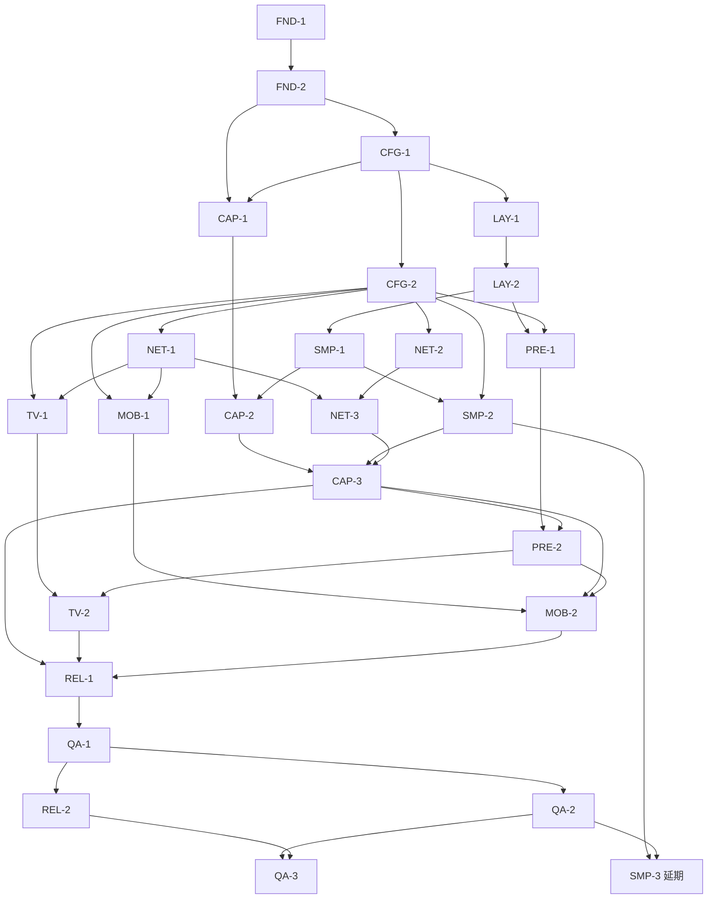

# 00. WLED 直连流光溢彩开发任务总纲

> 编制：2026-11-16；来源代码 HEAD：`1f8466c0ecd6b7544bb338068601cbfbef9dd48a`。  
> 本次交付是**技术方案定稿与任务分解**，不是功能开发。26张任务卡中25张首版必做、1张P2延期；本册初始状态均为**待开发**。  
> 参数/状态机/协议的唯一规范：[WLED直连流光溢彩技术方案（最终定稿）](../design/wled-direct-ambilight-feasibility.md)。架构复核已合入正文，不再维护两套规范。

> 2026-11-17 设备授权补充：[Sony Android 10 持续录屏授权记录](../verification/wled/cap-1/android10-persistent-consent.md)。指定包 `PROJECT_MEDIA=allow` 已读回；新会话免弹窗/重启保持待实测，不改变下列任务验收状态；技术约束见方案 §6.2.1。

> 同轮[完成状态初审与待确认 TDD 边界](../fixes/2026-11-17-completion-audit.md)：已记录两项待修复问题和当前验证限制；不是全面审核通过或发布准入。

> 2026-11-17 后台/自启动增补：[本机后台权限已配置，自启动待实现与验收](../verification/wled/cap-1/android10-background-autostart.md)。涉及 CAP-1 / MOB-2 / QA-1；系统白名单不等于开机自动采集，技术边界见方案 §6.2.2。

## 1. 四要素与需求复述

| 要素 | 本次输入/处理 |
|---|---|
| ① 来源报告路径 | `docs/design/wled-direct-ambilight-feasibility.md`（最终技术方案）；源码锚点见附录A，修订决策已合入正文并在附录B保留A01–A14追溯ID |
| ② 拆分维度 | **按模块成册**；P0/P1/P2只作卡片属性，阶段只表达依赖，不另建按Phase重复册 |
| ③ 输出目录 | `docs/task`，`00-overview.md` + 11份模块文档 |
| ④ 参考格式文档 | 首次拆分时用户未提供现成模板，仓库docs也无既有task文档；按用户指定三段式建立 [01-foundation.md](01-foundation.md) 作为本册可复用模板；不是冒称已有历史格式 |

复述目标：移除中间服务器，由Android在本地完成四边布局与逐灯采样，直接发送给单个WLED。保留common/mobile/tv框架、Views/Leanback、API21、TV优先及mobile完整配置；RGB/RGBW、SKIP/BLACK、Input/Reverse、四角/深度/Overlap/Edge Gap、平均色、预览/测试属于首版。新身份WLED Grabber / `com.abrenoch.wledgrabber`，最终只保留WLED后端。

本册按已经整合定稿的技术方案拆分；协议、生命周期、所有权和构建顺序的评审修订已进入唯一来源。模块卡只补交付/约束/独立测试/量化验收，不再各自设计一套架构。

首套：Sony KD55XD8005 + ESP32-WROOM-32D + 274 WS2815 RGB；T86/B90/L49/R49、Input161、Reverse=true。60fps与RGBW实机都是发布门禁；没有硬件证据不得降级描述为已实现或已验收。黑边/线性平均/平滑等仅SMP-3延期；**DDP因RGBW而成为首版必做**。

本次不改生产代码、不安装依赖、不接触真实灯带、不签名/部署/发布。已有未跟踪docs/工具配置均保留；未来执行每卡前检查WIP和写权限。

## 2. 当前现状评分表

评分0=不存在，1=历史实现/缺关键约束，2=可复用但需实质改造，3=有设计/部分证据，4=自动化闭环，5=目标实机验收完成。评分是**当前证据判断**，不是benchmark；产品维度不因文档定稿自动升分，最后一行仅评价设计成熟度。E编号见[技术方案附录A](../design/wled-direct-ambilight-feasibility.md#source-audit)。

| 维度 | 当前分/5 | 当前证据 | 达标路径 |
|---|---|---|---|
| 构建可复现性 | 1 | E15：Gradle4.6/AGP3.2.1/JCenter；本机可用JDK19/27，均不满足Gradle4.6 | FND-1/FND-2锁矩阵、依赖、Debug与测试基座 |
| 现代采集生命周期 | 2 | E01/E02/E12/E13：可采集，但前台顺序/回调/关闭不满足新契约 | CAP-1/CAP-2 |
| 配置一致性 | 2 | E08-E10：Preferences存在，两UI自行校验且非原子 | CFG-1/CFG-2 |
| 四边布局/物理映射 | 0 | E05：只有X/Y缩放提示，无本地四边模型 | LAY-1/LAY-2 |
| 本地逐灯采样 | 1 | E03：整帧/平均色算法可参考，无逐灯管线 | SMP-1/SMP-2 |
| WLED协议/能力探测 | 0 | E06/E07/E11仍是旧TCP链路；固定固件type5不可达，定稿选DDP RGBW | NET-1/NET-2 |
| 流控/停止/故障恢复 | 1 | E02/E13：同步发送，可变缓冲所有权与统一release缺失 | NET-3/CAP-3 |
| 双端UI/预览 | 2 | E09/E10：有旧设置基础，无共享新布局预览 | PRE、TV、MOB |
| 自动化与实机证据 | 0 | E16仅示例测试；无目标硬件验收记录 | QA-1/QA-2/QA-3 |
| 实施方案健壮性（仅设计） | 3 | A01–A14已整合为定稿契约并映射任务 | 设计闭环；代码、构建与实机证据仍待各卡，不计为已实现 |

## 3. 依赖拓扑与执行顺序

依赖按**任务ID**定义，下图不把模块级双向协作误画成任务循环。独立测试基座就绪后可并行；各卡在自己声明的证据层级验收通过并入基线，后置卡才使用其接口。模块已验收不代表目标硬件/发布验收完成：TV-2先验收独立UI/仪器测试，Sony遥控器/大字体和60fps仅在QA-2验收；缺Sony阻断QA-2/QA-3，不能反向阻断进入QA-2。P0不表示能跳过前置。



推荐合并批次（不是另一套任务状态）：

1. FND-1/FND-2串行建立工具链/fixture；CFG-1冻结配置核心。
2. CFG-2、LAY-1/LAY-2、CAP-1可在明确文件所有权下并行；NET-1与NET-2随后并行，SMP消费LAY。
3. CAP-2/CAP-3收敛生命周期与输出；PRE-1可先独立绘制验证。TV-1/MOB-1可先用fake后端，不等真实设备。
4. PRE-2/TV-2/MOB-2完成组合；**REL-1全仓独占窗口**统一删除/重命名。
5. QA-1之后REL-2与QA-2可并行；QA-3以实际证据准入。SMP-3延期，不阻断首版。

旧报告24–41人日只是未解决协议/构建风险的粗估，本册不据此承诺工期。FND-2完成后按实际迁移量、设备可用性与每卡测试工作重新估时。

## 4. 风险表与阻断条件

| 风险 | 严重度 | 控制/验证 | 所属卡 | 残余风险/停止条件 |
|---|---|---|---|---|
| type5不可达、单灯尾包不更新 | 高 | 固定v0.15.1；RGBW DDP、RGB单灯type2、DNRGB尾包重分 | NET-2 | 不外推其他固件；协议边界未过阻断 |
| RGBW二次白通道合成 | 高 | WLED Manual/override确认+白色实机图案 | SMP-2、QA-2 | 无RGBW样机保持待硬件 |
| 旧授权复用/FGS顺序错误 | 高 | 一会话一次授权/display、onStop与API矩阵 | CAP-1/CAP-2 | 缺平台证据不标完整兼容 |
| 缓冲撕裂/停止后旧帧复活 | 高 | 3租约/1pending/1writer、epoch/屏障、慢sink压力 | CAP-3 | 网络中的迟到UDP无法由本地epoch撤回 |
| 关灯误报/进程被杀后恢复效果 | 高 | release+off读回；UNCONFIRMED明确；有限timeout | NET-3 | 无端到端保证，禁止自动重试off污染新会话 |
| 采样/物理输出达不到60fps | 高 | 积分图、分层指标、30分钟物理时序 | SMP-1、QA-2 | 未达标保持阻塞，不擅降规格 |
| 构建升级使中间提交不可编译 | 高 | 临时保留编译依赖，REL-1一次删除；固定矩阵 | FND、REL-1 | 缺JDK17/依赖获取是明确环境阻塞 |
| 明文LAN/无认证/自动扫描范围过大 | 中高 | 端点限定、禁重定向、64KiB、4并发/256候选/15秒 | NET-1、QA-1 | 不能防可信LAN其他控制器主动干扰 |
| 一次探测被当永久能力 | 中高 | 身份/版本/观察时间与用户配置分开，网络变更重新核验 | CFG-2、NET-3 | 自定义固件/混合总线不能自动保证支持 |
| 非法几何/数量/取整越界 | 高 | 统一校验、性质测试、独立oracle | CFG、LAY、SMP | 不能用clamp或强制保存掩盖无效配置 |
| 多任务编辑共享热点 | 中高 | 所有权表、接口先冻结、重命名单PR | 各模块 | 冲突回所属模块，禁止覆盖他人WIP |
| 新ID/许可证/历史引用被清扫 | 中 | 活动代码扫描+具名例外，替代APK身份说明 | REL | 保留历史来源/版权；本轮不实际发布 |

## 5. 进度校验矩阵

**唯一状态源**：本表。状态流为待开发→开发中→待验证→已验收；另有阻塞/延期。更新时附代码变更、命令输出、设备原始证据；不以“方案已写”把功能标完成。卡内初始状态仅记录建册时刻，后续查本表。

| 任务 | 关键验收 | 前置 | 优先级 | 状态 | 证据 |
|---|---|---|---|---|---|
| [FND-1 锁定兼容工具链与可编译过渡](01-foundation.md#fnd-1) | 三个模块Debug编译均退出0；所有新增/升级依赖为精确版本。 | 无 | P0 | 已验收 | 三模块Debug构建与单测通过（Gradle8.9/AGP8.7.2/Kotlin2.1.21/Temurin17.0.21）；jcenter=0；依赖/AAR证据见`docs/verification/wled/fnd-1/` |
| [FND-2 AndroidX、ViewBinding与共享fixture](01-foundation.md#fnd-2) | Debug编译与已有/fixture单测全绿；活动代码中的Support依赖与ButterKnife绑定0。 | FND-1 | P0 | 已验收 | AndroidX/ViewBinding迁移完成；Support/ButterKnife依赖与源码引用0；三模块Debug构建+16个JVM单测通过；`common/src/sharedTest`供JVM/androidTest共用；androidTest APK编译通过（未连设备运行）；lint基线见`docs/verification/wled/fnd-2/` |
| [CFG-1 纯模型、集中校验与原子保存](02-configuration.md#cfg-1) | 全部边界用例通过，非法输入崩溃0；一次保存只发布1个revision。 | FND-2 | P0 | 已验收 | 纯模型/ConfigValidator/ConfigRepository/PreferencesConfigStorage落地；18个CFG-1 JVM测试通过；androidTest APK编译通过（未连设备）；一次保存只发布1个revision，写失败保留旧快照；证据见`docs/verification/wled/cfg-1/` |
| [CFG-2 区分端点、能力观察与用户配置](02-configuration.md#cfg-2) | 三类端口100%独立；RGBW到type5的路由0。 | CFG-1 | P0 | 已验收 | DeviceEndpoint分离HTTP/UDP/DDP；WledDevice/Capabilities/ProbeResult/StartConfirmation/Transport/DeviceReadiness落地；HTTP8080/UDP自定义/DDP4048独立；RGBW仅DDP、无type5；身份/数量/地址/通道冲突与缺失能力均阻断READY；配置与观察时间戳独立；11个DeviceConfigTest通过；androidTest APK编译通过；证据见`docs/verification/wled/cfg-2/` |
| [LAY-1 四边几何、坐标与参考golden](03-layout.md#lay-1) | 所有输出0≤min<max≤1；像素矩形均在有效内容域内且非空。 | CFG-1 | P0 | 已验收 | `ClassicLedLayout`/`LedSampleRect`/`PixelRect`/`CompiledLayout`落地；274/288/4:3/竖屏/窄矩形/梯形/非法四边形覆盖；12个ClassicLedLayoutTest通过；4位小数golden见`docs/verification/wled/lay-1/golden.txt` |
| [LAY-2 Gap/Input/Reverse与物理尾黑](03-layout.md#lay-2) | 两套硬件fixture逐索引100%匹配；映射长度始终M。 | LAY-1 | P0 | 已验收 | `LedMapping`落地；274/288锚点与完整排列；SKIP/BLACK、负/极大Input、Reverse四组合、M>K尾黑、10000组随机映射通过；9个LedMappingTest通过；证据见`docs/verification/wled/` |
| [SMP-1 精确积分图采样与有界工作内存](04-sampling.md#smp-1) | 随机oracle结果逐通道误差0（统一整数舍入）；畸形帧安全丢弃不越界。 | LAY-2 | P0 | 已验收 | `PlaneView`/`IntegralImage`/`LedColorSampler`/`CaptureSizing`落地；1000帧随机oracle与畸形平面、10万帧热路径0分配测试通过；**2026-11-17真机优化：按行批量读取消除每像素JNI，随后改为“矩形面积和≤W×H时逐矩形求和、否则逐行前缀”两路等价实现，640×360/274灯实测采样p50≈3.3ms/p95≈4.05–4.5ms/p99≈4.5–4.9ms，oracle逐通道不变**；证据见`docs/verification/wled/net/`与`docs/verification/wled/qa-2/` |
| [SMP-2 平均模式掩码与单方白通道合成](04-sampling.md#smp-2) | 全部转换向量逐字节一致；通道溢出0，RGB无额外GRB重排。 | SMP-1, CFG-2 | P1 | 已验收 | `RgbwConverter`/`WhiteMode`与`samplePhysical`落地；min_subtract/preserve全部向量逐字节一致；平均/逐灯共用LAY黑灯掩码；6个Rgbw/Average测试通过 |
| [SMP-3 可选黑边与颜色质量增强](04-sampling.md#smp-3) | 关闭所有增强时与首版golden差异0；边界异常崩溃0。 | SMP-2, QA-2 | P2 | 待验证 | `QualitySettings`/`ColorQuality`（12位线性+饱和度+时间平滑）/`BlackBarCropper`+`CropWindow`落地，四个开关默认关闭；**2026-11-17：关闭态与首版逐字节一致（`qualityOffMatchesFirstVersionBytes`），全黑/闪字幕/信箱黑边滞回测试6个、颜色增强测试6个、采样集成测试4个，JVM 187通过/0失败**；设备端各开关性能/色彩对照与首套p95回归未测 |
| [NET-1 一次解析的HTTP探测与有界发现](05-wled.md#net-1) | 每次probe只发1次GET且只解析一次；所有错误返回明确类型，不误标发现成功。 | CFG-2 | P0 | 已验收 | `WledHttpClient`/`ProbeResult`/`ProbeError`/`WledDiscovery`/候选缓存落地；11个测试覆盖根info、错误类型、redirect/64KiB/超时、LAN/loopback策略、256/4/15s上界与取消不发布迟到结果 |
| [NET-2 固定固件的RGB/RGBW报文与分片](05-wled.md#net-2) | 274RGB DNRGB826B；274RGBW DDP1106B；全部golden逐字节一致。 | CFG-2 | P0 | 已验收 | `WledPacketizer`/`WledUdpTransport`/`DatagramSink`落地；8个测试覆盖DRGB/DNRGB/DDP计数、分片、flags/offset/length、尾1重分、无type5、失败不重试；274RGB826B/274RGBW1106B |
| [NET-3 健康观察、统一release与恢复策略](05-wled.md#net-3) | 只有读回on=false/live=false才CONFIRMED；其他路径100%为UNCONFIRMED/错误。 | NET-1, NET-2 | P0 | 已验收 | `WledSession`/`WledControlClient`/`StateReadResult`/`FrameSender`落地；9个FakeClock测试覆盖成功/超时/live仍true/身份变化/stale/旧epoch不覆盖新session/≤3秒预算；无读回不CONFIRMED；**2026-11-17真机(10.245.0.99/274RGB)：新增turnOn与1秒心跳，启动自动开灯、静态画面live保持10秒；WLED 16.x `/json/state`无`live`时回退`/json/info`，修复读回恒MISSING_FIELD，新增`liveFallsBackToInfoWhenStateOmitsIt`回归，真机测试图案release CONFIRMED** |
| [CAP-1 现代Android授权与前台服务入口](06-capture.md#cap-1) | 每个成功session创建display=1；失败/拒绝创建=0；旧token重用=0。 | FND-2, CFG-1 | P0 | 待验证 | 纯`CaptureSession`状态机7个测试通过；Android入口按前台化→单次getMediaProjection→Callback→单次display接线；FGS类型/权限、POST_NOTIFICATIONS、service exported=false、boot仅发提醒已落地；**2026-11-17 Sony KD-55XD8005（API 29）真机：修复FGS早退崩溃与令牌extra传递、状态机接入服务后，display=1/projection=1/前台服务=1，端到端WLED live=UDP且源IP为电视，停止后资源归零**；API21/26/33/34/35仪器测试仍未跑 |
| [CAP-2 Image关闭、resize与generation隔离](06-capture.md#cap-2) | Image泄漏/双关/使用已关闭buffer均0；100次循环结束reader/display/projection/线程归零。 | CAP-1, SMP-1 | P0 | 待验证 | `GenerationGate`/`ImageLifecycle` 5个JVM测试通过；`ImagePlaneView`接入SMP PlaneView；**2026-11-17 `ImageReaderLifecycleInstrumentedTest` 在 API 21/33/34 通过：真实Surface生产者20帧 acquired==closed、maxImages=3 第四次获取被拒**；旋转/锁屏/撤销与API34 resize 仪器项待设备 |
| [CAP-3 唯一输出所有者、三帧池与停止屏障](06-capture.md#cap-3) | 队列pending≤1、池占用≤3、UDP写者始终≤1；10万帧无内容撕裂或泄漏。 | CAP-2, SMP-2, NET-3 | P0 | 待验证 | `FrameLease`/`FramePool`/`OutputOwner`/`LedStreamer`落地；7个LedStreamerTest通过（10万帧无撕裂/泄漏、latest-wins、慢sink停止屏障、超时不误报、CAPTURE/TEST互斥、失败归还）；**2026-11-17 `OutputOwnershipInstrumentedTest` 在 API 21/33/34 通过：CAPTURE/TEST 互斥、release 需匹配 id+epoch、Activity 退出再进入可重取**；另有设备端静默服务器TIMEOUT与端口关闭CONNECT_FAILURE用例；真实断网/撤销/进程被杀待设备 |
| [PRE-1 共享预览View与索引可读性](07-preview.md#pre-1) | 所有绘制矩形与CompiledLayout误差≤1显示像素；索引golden匹配率100%。 | LAY-2, CFG-2 | P1 | 待验证 | `PreviewModel`/`LedLayoutPreviewView`落地；8个LedLayoutPreviewTest通过（274/288/SKIP/BLACK/Reverse/竖屏/梯形/错误/选中/尾黑）；**2026-11-17 `LedLayoutPreviewInstrumentedTest` 在 API 21/33/34 通过：D-pad 走位到 273/0 并钳位、resize 保持选中、错误态阻断选择**；触摸选中已由同类仪器测试覆盖；像素级 golden 与 TV 大字体/insets 待补 |
| [PRE-2 共用四边色与行走像素测试](07-preview.md#pre-2) | 一个循环访问每个可映射物理灯恰好1次；gap/尾黑泄漏0。 | PRE-1, CAP-3 | P1 | 待验证 | `LedTestPattern`/`TestPatternSession`/`TestPatternRunner`/`TestPatternActivity`落地；6个LedPatternTest+3个Runner测试通过；UDP transport/streamer/黑帧+HTTP off/readback与CONFIRMED/UNCONFIRMED展示已接；**2026-11-17 Sony真机`TvTestPatternDeviceTest`通过：10秒测试图案→release CONFIRMED**；另有`TvTestPatternLifecycleTest`验证宿主退出释放TEST租约、CAPTURE可重取（API33/34通过）；慢网络对照仍待补 |
| [TV-1 替换TV连接向导与运行状态](08-tv.md#tv-1) | 发现/手动两条路径各完整走通；错误输入提交数0。 | CFG-2, NET-1 | P1 | 待验证 | `WledSetupController`、TV手动连接GuidedStep、`WledScannerTask`（私有/24有界HTTP扫描）、`WledNsdDiscovery`（_wled._tcp.）、WLED ScanResult保存与Main状态文案已落地；**2026-11-17 Sony真机`TvMainActivityTest`/`TvSetupUiTest`通过（状态文案、手动连接步骤与整份保存）**；迟到扫描UI仍待仪器 |
| [TV-2 完整布局设置、预览与首套预设](08-tv.md#tv-2) | 技术方案首版参数覆盖率100%；每个动作D-pad可达且返回后焦点合理。 | TV-1, PRE-2 | P1 | 待验证 | TV完整Basic/Advanced布局、RGBW white mode、平均色、帧率/长边、274预设、预览、10秒测试入口、停止/下次启动提示已落地；`TvLayoutFlowTest`已编译；**2026-11-17布局页补Physical LED count及物理≥布局总灯数校验，连接步骤新增Layout & LED count直接入口、Frame rate与Language（默认跟随系统，中/英），真机确认274/86/90/49/49与语言即时切换**；D-pad全流程与TV仪器未运行 |
| [MOB-1 共享配置驱动的完整手机设置](09-mobile.md#mob-1) | 首版字段覆盖率100%；mobile/TV同输入快照完全一致。 | CFG-2, NET-1 | P1 | 待验证 | `SettingsDraftController`与mobile全字段表单落地；4个MobileSettingsTest通过（整份保存/取消、非法不写、mobile/TV错误码与快照一致）；**2026-11-17字段标签改走共享`ConfigFieldLabels`（中英文资源），语言选择项已加入；帧率等全字段仍由ConfigFields.ALL驱动**；**2026-11-17 `MobileSettingsFormTest` 在 API 21/33/34 通过：全字段标签非空、recreate 后保留值**；键盘遮挡/损坏Preferences待补 |
| [MOB-2 入口、磁贴、预览与系统行为](09-mobile.md#mob-2) | 所有入口使用同一授权/停止实现，重复token使用0。 | MOB-1, CAP-3, PRE-2 | P1 | 待验证 | 唯一CAPTURE/TEST owner、通知权限请求/拒绝提示、target35 system-bar/IME insets、Tile/主界面/通知统一停止、Preview/Test入口已落地；**2026-11-17 `MobileEntryTest` 在API 33与API 34 AVD均通过**；API矩阵/锁屏/授权撤销真机项未运行 |
<a id="completion-audit-2026-11-16"></a>
| [REL-2 配置重建、故障排查与侧载说明](10-release-migration.md#rel-2) | 旧Host/Port/Priority/X/Y/帧率/平均色/开机行为均有映射或“不迁移”解释。 | QA-1 | P1 | 待验证 | `docs/migration/legacy-to-wled-layout.md`交付；旧字段映射、274/Input/Reverse、DDP/auto-white、UNCONFIRMED排障与APK元数据覆盖；**2026-11-17本地回归：25文件/240链接/0错误**；QA-1未完成，不作发布声明 |
| [QA-1 跨模块协议、生命周期与安全回归](11-validation.md#qa-1) | JVM全部通过、build退出0、lint error=0；未覆盖平台保持待验证而非PASS。 | REL-1 | P0 | 已验收 | 端到端测试台（合成274→采样→DNRGB/DDP→localhost UDP/HTTP）4个测试；**166 JVM通过/0失败**；三模块lint error0；Debug与unsigned Release构建通过；**Sony API29：common 2/2、tv 7/7（真实WLED探测/读回/测试图案release CONFIRMED）；API34 AVD：mobile 1/1**；API 21/23/26/33/35及RGBW/端到端物理时延保持待验证；证据`docs/verification/wled/qa-1/` |
| [QA-2 274/60fps、RGBW与故障实机验收](11-validation.md#qa-2) | 首套采样p95≤5ms/p99≤8ms，发送间隔p95≤20ms，物理不同帧平均≥59fps且1秒窗口≥55fps，端到端p95≤80ms。 | QA-1 | P0 | 待验证（BLOCKED） | **2026-11-17实测（Sony KD-55XD8005 + WLED_TV 274 RGB @10.245.0.99，640长边/60fps）**：采样p95≈4.05–4.5ms、p99≈4.5–4.9ms、发送间隔p95≈17.3ms、WLED fps min66/avg107.4，四项达标；自动开灯/静态心跳/停止读回CONFIRMED已验证。**仍缺**：端到端物理时延（无光感/高速相机）、RGBW样机、500/1000/2000灯配置、Sony遥控器大字体；30分钟soak复测中。保持BLOCKED，不标PASS。见`docs/verification/wled/qa-2/device-metrics-2026-11-17.txt` |
| [QA-3 最终需求闭环与发布准入记录](11-validation.md#qa-3) | 25个首版任务中的本卡前置与其他必做卡全部通过；未闭合P0/P1=0。 | QA-2, REL-2 | P0 | 待开发（BLOCKED） | **2026-11-17复核**：QA-1已验收；SMP-3可选任务已实现并默认关闭；软件侧采样/发送/稳定性门禁达标。**未闭合**：QA-2的物理FPS与端到端时延（需光感/高速相机）、RGBW样机两模式、500/1000/2000灯配置；CAP-2/3、PRE-1/2、TV-1/2、MOB-1/2、REL-2的仪器/API矩阵项仍部分待验证。按准入规则保持BLOCKED，不作发布声明。 |

<a id="completion-audit-2026-11-16"></a>

### 5.1 2026-11-16 完成状态复核记录

复核基线：HEAD `1f8466c0ecd6b7544bb338068601cbfbef9dd48a`；`git status --short --branch` 仅有未跟踪的 docs/工具配置，`git diff --stat HEAD` 为空，即受版本控制的源码/构建文件与定稿基线一致；GitNexus 索引提交同为 `1f8466c`。

| 核验项 | 证据 | 结论 |
|---|---|---|
| 计划类落地 | `WledSession`、`WledHttpClient`、`WledDiscovery`、`LedColorSampler`、`CompiledLayout`、`ClassicLedLayout`、`LedLayoutConfig`、`ConfigRepository`、`ConfigValidator`、`ValidatedConfig`、`DeviceEndpoint`、`WledDevice`、`FrameLease`、`LedStreamer`、`WledUdpTransport`、`LedLayoutPreviewView`、`ScreenGrabberService`、`GrabberNotification` 等计划类在 common/mobile/tv 源码与资源中命中0 | 未实现 |
| 旧链路仍在 | `HyperionScreenEncoder/Base`、`HyperionScreenService`、`Hyperion.java`、`HyperionThread.java`、`HyperionProto.proto` 原样存在；活动源码中 WLED 关键字命中0 | 未切换 |
| 测试资产 | 活动测试源仅 `mobile/src/test/java/com/abrenoch/hyperiongrabber/ExampleUnitTest.java`；无协议/布局/采样/竞态测试，无 `src/androidTest` | 未建立 |
| 构建/测试/lint | 本机可用 JDK19 与 Homebrew JDK27；`./gradlew --version` 分别返回 `Could not determine java version from '19'` 与 `'27.0.1.0.3'`（Gradle 4.6 不支持）；`:mobile:testDebugUnitTest` 与 `:common:lintDebug` 均在启动阶段同样失败 | 环境阻塞，无编译/测试/lint 证据 |
| 文档结构 | 本地链接/锚点复核0错误（复核时198处，本次审计与归档完成后全部可解析）；26个任务ID唯一；依赖边42条且DAG无环，矩阵/卡片/Mermaid的优先级与前置一致；11个模块文档均含对应任务 | 文档交付有效 |
| 源码锚点 | E01–E16 的文件/符号/关键行已对照当前源码复核一致；E17 固定提交 S09 `content_leds.js` SHA256=`c6e884ce6dc58cde68c4077fc9890dac6929c98fb6ef83eb942aa13f5b3aab64`，`createClassicLedLayout`/`createClassicLeds` 行号286/425一致；S01 `udp.cpp` 的 type4 `packetSize>7` 与 type5 不可达外层条件复核一致 | 一致 |

结论：26张卡中25张保持**待开发**、SMP-3保持**延期（未开发）**；没有任何卡片达到“待验证”或“已验收”，状态矩阵无需升级。文档定稿与链接检查通过只证明文档交付，不证明本地实现、待发布或生产验收。下一次状态更新必须附与本表同类的可复跑证据。

**待核实（本环境无法取证，不计为通过）**：JDK17/SDK35 下的编译/单测/lint；API21–35 的授权/旋转/撤销矩阵；Sony KD55XD8005 274灯/60fps；RGBW 样机两模式；WLED v0.15.1 实机报文与关灯读回；签名/安装/发布。

**实施进展（2026-11-16）**：FND-1/2、CFG-1/2、LAY-1/2、SMP-1/2、NET-1/2/3 已验收；CAP-1/2/3、PRE-1/2、MOB-1、TV-1、TV-2、MOB-2、REL-1/2、QA-1 本地开发/文档完成，待设备仪器/宿主接线验证；TV-2 与 MOB-2 已无剩余开发项；QA-2 因无Sony/274/RGBW/测量设备保持BLOCKED；QA-3 待开发。当前状态以§5矩阵为准；上表保留实施前基线与证据口径。

### 最终技术方案到任务的覆盖检查

| 技术方案范围 | 任务与处置 |
|---|---|
| §2现状/DRY、§3配置、§10构建 | FND、CFG；E01–E16为现状证据，不代表功能已存在 |
| §6帧所有权/授权/服务/停止 | CAP、NET；同一租约、epoch与停止屏障 |
| §4四边/Gap/顺序/角点 | CFG、LAY、PRE、TV、MOB，全部首版 |
| §7协议、§8发现/能力/控制、§5.2 RGBW | NET、CFG、SMP-2；DDP首版、无type5分支，不减少RGBW范围 |
| §5采样/平均色/增强边界 | SMP-1/2首版；SMP-3明确延期 |
| §9双端设置/预览/测试、§10.2迁移 | PRE、TV、MOB、REL-2，首版完整覆盖 |
| §11性能/兼容、§12准入 | QA；274/60fps及RGBW为硬门禁，不以估算替代 |
| 附录A/B/C/D源码、决策、固定来源、变更台账 | 各卡稳定链接追溯；REL-1/2落实删除与合法引用例外 |

## 6. 文件变更清单与并发编辑热点

### 6.1 本次实际文档交付

- 定稿：`docs/design/wled-direct-ambilight-feasibility.md`，实质整合架构修订，保留完整参数/公式/交互/迁移细节，改为唯一技术方案。
- 合并入口：`docs/design/wled-direct-ambilight-architecture-review.md`仅保留指向定稿的说明，并已归档至[归档索引](../archive/README.md)（合并前全文见`docs/archive/design/wled-direct-ambilight-architecture-review-premerge-2026-11-16.md`，合并说明副本见`docs/archive/design/wled-direct-ambilight-architecture-review.md`）；E01–E17/A01–A14/S01–S10已分别进入定稿附录A/B/C。
- 任务册：`docs/task/00-overview.md`及下列11个模块文档；全部来源已指向定稿稳定锚点，任务ID/前置/初始状态不变；无生产源码、构建或依赖修改。

| 模块文件 | 前缀 | 卡数 |
|---|---|---|
| [01-foundation.md](01-foundation.md) | FND | 2 |
| [02-configuration.md](02-configuration.md) | CFG | 2 |
| [03-layout.md](03-layout.md) | LAY | 2 |
| [04-sampling.md](04-sampling.md) | SMP | 3 |
| [05-wled.md](05-wled.md) | NET | 3 |
| [06-capture.md](06-capture.md) | CAP | 3 |
| [07-preview.md](07-preview.md) | PRE | 2 |
| [08-tv.md](08-tv.md) | TV | 2 |
| [09-mobile.md](09-mobile.md) | MOB | 2 |
| [10-release-migration.md](10-release-migration.md) | REL | 2 |
| [11-validation.md](11-validation.md) | QA | 3 |

### 6.2 未来实施文件清单（不是本次已改动）

路径记号：`C=common/src/main/java/com/abrenoch/wledgrabber/common`，`M=mobile/src/main/java/com/abrenoch/wledgrabber/mobile`，`T=tv/src/main/java/com/abrenoch/wledgrabber/tv`。REL-1已统一迁移到`com/abrenoch/wledgrabber`；不要同时维护新旧包下两份业务逻辑。

| 动作 | 文件/目录 | 归属与顺序 |
|---|---|---|
| 修改 | `build.gradle`、`settings.gradle`、`gradle.properties`、`gradle/wrapper/gradle-wrapper.properties`及wrapper jar、`common/build.gradle`、`mobile/build.gradle`、`tv/build.gradle`、`common/variables.gradle` | FND先锁定，REL最后删临时协议依赖/旧版本源 |
| 新增 | `gradle/libs.versions.toml` | FND唯一版本来源 |
| 修改 | C/util/Preferences.kt、`common/src/main/res/values/pref_values.xml`、`common/src/main/res/xml/pref_general.xml`、共用`values/strings.xml` | CFG拥有key/default/校验；MOB替换Preference展示需串行集成 |
| 新增 | C/util/ConfigRepository、ConfigValidator、C/led/LedLayoutConfig、CaptureConfig、ValidatedConfig；C/network/wled/DeviceEndpoint、WledDevice、Capabilities | CFG；Java/Kotlin按相邻风格，不各建重复DTO |
| 新增 | C/led/ClassicLedLayout、LedSampleRect、CompiledLayout、PlaneView、LedColorSampler、RGBW helper | LAY/SMP分清文件所有权 |
| 新增 | C/network/wled/WledHttpClient、ProbeResult、WledDiscovery、WledUdpTransport、WledSession；C/network/LedStreamer、FrameLease | NET负责设备面，CAP负责帧池与writer；接口先冻结 |
| 修改/替换 | C/network/NetworkScanner.java、C/util/HyperionScannerTask.java | NET；复用候选排序/进度语义，删除TCP探测和AsyncTask生命周期 |
| 修改/最终重命名 | C/HyperionScreenService.java、HyperionScreenEncoder.java、HyperionScreenEncoderBase.java、HyperionNotification.java、HyperionGrabberBootReceiver.java、util/HyperionGrabberOptions.java | CAP/SMP按模块接口修改，REL统一新类名与包目录 |
| 修改 | C/BootActivity.java、C/ToggleActivity.java、三个`src/main/AndroidManifest.xml` | CAP先统一授权/导出/FGS；MOB/TV增加宿主声明；REL最后改包/动作 |
| 新增 | `common/src/main/res/xml/network_security_config.xml` | NET设计策略，CAP/MOB验证各API manifest合并 |
| 新增 | C/views/LedLayoutPreviewView、共享测试图案控制器；M/LayoutPreviewActivity、T/activities/LayoutPreviewActivity | PRE提供共用实现，MOB/TV仅宿主 |
| 修改 | M/MainActivity.java、SettingsActivity.java、AppCompatPreferenceActivity.java、HyperionGrabberTileService.java；mobile布局/样式/strings | FND机械迁移后MOB逻辑，REL最后命名 |
| 修改 | T/activities/{MainActivity,ManualSetupActivity,NetworkScanActivity,ScanResultActivity,LeanbackActivity}.java；T/fragments/settings/{BasicSettingsStepFragment,SettingsStepBaseFragment,SettingsStepStylist}.kt；T/views/SettingsRelativeLayout.java；TV布局/样式/strings | FND机械迁移后TV逻辑，REL最后命名 |
| 删除 | C/network/Hyperion.java、HyperionThread.java、`common/src/main/proto/HyperionProto.proto`、生成旧协议源码/配置/依赖及旧测试分支 | 已在REL-1本地删除；构建与APK审计通过，真机/QA仍待验证 |
| 修改 | 三模块`src/main/res/values*/strings.xml`、旧品牌资源/TAG/actions、README与隐私说明 | REL统一扫描；LICENSE/版权与来源保留具名例外 |
| 新增 | `common/src/test/java/...`各卡Test与fixtures，`common/src/test/resources/fixtures`，三模块`src/androidTest`按实际需要创建 | FND建立唯一fixture来源，各模块扩展，QA组合回归 |
| 新增 | `docs/migration/wled-configuration.md`、实施期验收证据目录`docs/verification/wled/` | REL/QA在实施时建立；本次不伪造这些证据 |

### 6.3 热点串行纪律

| 热点 | 涉及任务 | 合并约束 |
|---|---|---|
| 根/模块Gradle、版本目录、R/import全仓 | FND-1/FND-2/REL-1 | FND串行先合；REL最后独占，不与功能PR混改 |
| Preferences、pref_values、共享strings | CFG-1/2、TV、MOB、PRE | CFG拥有schema，UI仅提出字段需求；同key变更单PR集成 |
| Service/Encoder/Base/Boot/Notification/common manifest | CAP-1/2/3、NET、MOB | CAP拥有生命周期，NET提供接口，后续入口接线串行 |
| WledSession/LedStreamer/FrameLease接口 | NET-3/CAP-3/PRE-2 | 先共同冻结契约，文件分配明确；只保留1个writer |
| TV设置/扫描结果 | FND-2/TV-1/TV-2/REL-1 | 按依赖串行，禁止机械迁移与UI重写并行改同文件 |
| mobile设置/磁贴 | FND-2/MOB-1/MOB-2/REL-1 | 同上；公共授权入口不得分叉 |
| 全包名/manifest/action/多语言资源 | REL-1 | 最终集成单PR，代码冻结窗口；graph rename+文本补查 |
| 共享fixtures与状态矩阵 | FND/各模块/QA | 单一来源扩展；状态只更新本总纲，证据可分文件并行 |

## 7. 统一验证流程

### 7.1 本次文档工作的验证

1. 核对当前HEAD、索引文件哈希和技术方案附录A符号/行号；E01–E17记录当前行为与复用边界，固定WLED与参考布局来源。
2. 检查26个ID唯一、引用存在、依赖无环、前置与Mermaid一致；每卡包含来源/交付物/DRY/勾选测试/量化验收。
3. 检查全部本地链接/显式anchor/现有源码行号；计划新增路径不得误称现有文件。
4. 比较受版本控制文件哈希，证明没有生产代码/构建变更；来源报告只加复核入口。独立architect复核后修正阻断项，再运行文档检查。

这些是文档验证，不是下面的实现测试。没有运行JDK17/Gradle、Android instrumentation、WLED或TV硬件验收。

### 7.2 未来每张代码任务的RED→GREEN→集成

1. `git status --short`检查WIP；读取模块卡与复核契约；按待改符号执行GitNexus impact。HIGH/CRITICAL先报告范围，UNKNOWN补文本/运行证据；不无声重建索引。
2. 公共行为写最小RED并保存失败输出；使用FND fixture/oracle，修最小实现到GREEN；重构不改合同。
3. 使用卡片的测试过滤器。**卡片中的`:common:...`是Gradle任务参数，命令前加`./gradlew`**；文内测试类均为将来实现目标，不是当前已有测试。
4. 基座就绪后的共用集成命令：

```sh
./gradlew :common:testDebugUnitTest :mobile:testDebugUnitTest :tv:testDebugUnitTest
./gradlew :common:lintDebug :mobile:lintDebug :tv:lintDebug
./gradlew :mobile:assembleDebug :tv:assembleDebug
./gradlew :mobile:assembleRelease :tv:assembleRelease
```

Release此处是未签名/无发布副作用构建；不得为了通过命令写入签名密钥。Android类型检查由Kotlin/Java编译与lint完成，非另造无意义typecheck脚本。

5. 在受控设备执行对应`connectedDebugAndroidTest`，记录API/型号/屏幕方向/权限状态；测试执行安装属于后续实施验收的显式设备范围，不在本次操作。
6. 模块卡与QA-1可在模拟器或明确授权的通用Android测试设备上做仪器测试；QA-1用localhost可控网络跑异常。QA-2集中完成明确授权的Sony/WLED灯带端到端及目标遥控器验收。纯算法、HTTP可达、UDP写出、show FPS、物理刷新、实机安装、发布分别给证据。
7. 提交前运行`detect_changes(scope="all")`；partial/truncated结果重查，不作“无影响”证明。核对差异只覆盖本卡；更新矩阵证据与状态，前置不通过不得标后置已验收。

### 7.3 测试资产复用表

| 资产 | 创建卡 | 复用卡 |
|---|---|---|
| RGBA stride/position/limit/crop fixture | FND-2 | SMP、CAP、QA |
| 274/288原始参数与mapping golden | LAY-1/2（扩展FND目录） | SMP、PRE、TV、MOB、QA |
| 固件info/state fixtures、受控HTTP失败端点 | NET-1（扩展FND目录） | CFG、NET-3、TV、MOB、QA |
| FakeClock/RecordingDatagramSink/慢消费者 | FND-2 | NET、CAP、PRE、QA |
| 固定报文向量与独立decode断言 | NET-2 | CAP集成、QA |
| 状态快照与release结果模型 | CAP/NET | 双端UI、PRE、QA |

## 8. 全局验收 checklist

以下是**未来功能发布**checklist，本次全部保持未勾选。不能用文档评审通过将其打勾。

- [ ] FND：精确工具链/JDK17/min21；三模块构建测试通过，最终lint error=0；无JCenter/Support/未登记动态依赖。
- [ ] CFG：单一默认/校验/原子快照；非法配置拒绝激活；HTTP/UDP/DDP端口、观察与配置分离。
- [ ] LAY：274/288全部索引、SKIP/BLACK、负Input/Reverse、四角/Overlap/Edge Gap性质测试通过。
- [ ] SMP：oracle逐通道一致，stride/crop/limit安全，平均模式gap/尾黑不亮；RGBW单方合成。
- [ ] NET：固定v0.15.1范围、type5禁用、单灯/尾包/DDP完整golden、LAN/超时/响应体/扫描边界通过。
- [ ] CAP：每会话授权一次/display一次，主线程无网络，Image finally close，旋转/撤销/锁屏和TEST模式正确。
- [ ] STREAM：池≤3、pending≤1、writer≤1；慢sink与停止竞态无撕裂/越界/旧帧复活。
- [ ] STOP：统一release读回；远端未确认如实展示；进程kill/迟到UDP/其他控制器风险明确。
- [ ] PRE/TV/MOB：两端完整设置、共用预览/测试、D-pad可达、通知/磁贴/权限拒绝和insets通过。
- [ ] REL：唯一WLED后端、无protobuf/旧协议产物、正确新身份/两种替代APK；合法来源/版权保留。
- [ ] QA：Sony274/60fps满足技术方案§11量化门禁；RGBW两模式有样机证据，API与硬件矩阵缺项为0。
- [ ] DOC：字段映射、安装/回退、隐私/明文LAN/停止限制与代码一致；矩阵每个首版卡均附真实证据。
- [ ] ADMISSION：QA-3独立证据审查通过；签名/发布仍需单独授权，不自动执行。

## 9. 评审交付状态与剩余风险

本册建立了来源→修订决策→模块ID→前置→独立测试→量化验收的追溯关系。代码开发/构建升级已开始：FND-1/2、CFG-1/2、LAY-1/2、SMP-1/2、NET-1/2/3 已验收；CAP-1/2/3、PRE-1/2、MOB-1、TV-1、REL-2 本地实现/文档完成、待设备仪器与宿主接线验证；TV-2、MOB-2 开发中；REL-1、QA 仍待开发，真实硬件测试尚未开始；不存在“已完成26个开发任务”的结论。当前构建使用项目本地Temurin 17.0.21 + Gradle 8.9 + AGP 8.7.2；目标SDK/设备与RGBW样机仍需实施期检查。

技术方案是唯一规范；复核稿已归档，原位仅保留重定向。任意新证据推翻契约，先更新技术方案对应章节及附录决策记录，再更新关联卡与矩阵，不复制维护多套约束。

**定稿验证边界**：检查本地链接/稳定锚点、源码行号、26卡/42条依赖的DAG、任务三段式、DRY与量化验收；与整合前快照比较，任务ID/前置/状态及生产源码须保持不变。原架构复核已关闭TV-2/QA-2的Sony验收语义环；最终技术方案仍将模块UI和Sony硬件门禁分开。这里的文档通过不改变§5开发状态或§8功能checklist，也不代表Android构建/安装/硬件测试通过。

2026-11-16 复核再次确认：受版本控制的源码与构建无变更，26张卡均未进入实现；本机可用JDK19/27，Gradle 4.6 均无法启动，构建证据待 FND-1。证据与结论见[§5.1](#completion-audit-2026-11-16)。
